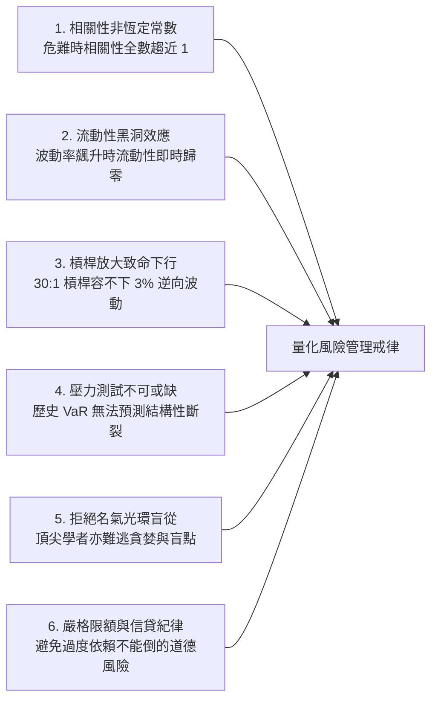

# APS1051: Session 4 Bilingual Study Notes
# 第四堂雙語深度溫習筆記：統計套利、期貨價差收斂與 LTCM 風險管理啟示錄

**Course / 課程：** APS1051: Portfolio Management under Real Market Constraints (真實市場限制下之投資組合管理)  
**Institution / 學府：** University of Toronto | Master of Engineering (ELITE Program)  
**Instructors / 導師：** Sabatino Costanzo & Loren Trigo  
**Primary Source Materials / 核心教學資源：**
* `S4B`: `A SESSION 4 README UP UPDATED.docx` (Session Roadmap & Rationale)
* `S4B`: `PPP 0 THE INTUITION BEHIND STATISTICAL ARBITRAGE.pptx` (Statistical Arbitrage & Pairs Trading Primer)
* `S4B`: `PPP 1 HOW LTCM USED FUTURES ARBITRAGE.pptx` & `COMMENTS ON PPP1 ...pdf` (Futures Mechanics & M/J Spread Convergence)
* `S4B`: `PPP 2 LCTM RISK MANAGEMENT LESSONS.ppt` & `COMMENTS ON PPP2 ...pdf` (LTCM Operational Anatomy, Breakdown & Risk Lessons)
* `S4E`: `HOMEWORK SESSION 4.docx` (17 Comprehensive Review Problems)
* `S4E`: `READING JAMES SIMONS BIO.docx` (Renaissance Technologies & Medallion Fund Architecture)
* `S4E`: `3 THE TRILLION DOLLARS BET FULL MOVIE TRANSCRIPTION.pdf` (PBS NOVA Documentary, 2000)

---

## Master Architecture of Session 4
## 第四堂總體架構導覽

```mermaid
flowchart TD
    subgraph S4_Architecture["Session 4: Risk Management & The Limits of Quantitative Arbitrage"]
        direction TB
        subgraph Part1["Part 1: Microfoundations of Arbitrage"]
            P0["PPP 0: Statistical Arbitrage & Pairs Trading<br>• Economic co-movement & cointegration<br>• Constructing synthetic mean-reverting series<br>• The 95% standard deviation band rule"]
            P1["PPP 1: Futures & Spread Arbitrage Mechanics<br>• Farmer & Baker: Hedgers vs Speculators<br>• Liquidity Premium: On-the-run M vs Off-the-run J bonds<br>• Invariant Convergence Profit = Initial Spread (+2)"]
            BS["Black-Scholes Inverse Engineering<br>• Historical Volatility (backward-looking) vs Implied Volatility (forward-looking)<br>• Options as portfolio insurance<br>• Selling volatility as a directional divergence bet"]
        end

        subgraph Part2["Part 2: The Macro Disaster & Lessons"]
            LTCM["The Rise of LTCM (1994-1997)<br>• The 'Dream Team': Meriwether, Scholes, Merton, Mullins<br>• High-volume low-margin vacuum cleaner ($1.25T notional)<br>• 4 Core Bets: Bond Arb, Correlation Arb, Merger Arb, Vol Sale"]
            CRISIS["The Crisis & Systemic Unwinding (1998)<br>• Return of capital while maintaining asset base (Leverage jumps to 30:1)<br>• Russian default (Aug 17) -> Global Flight to Quality<br>• Convergence turns into divergence; $500M loss in 1 day<br>• $3.625B Consortium Bailout organized by NY Fed"]
            LESSONS["Core Risk Management Lessons<br>• Models assume correlations are invariant; in crisis correlations -> 1<br>• Liquidity vanishes precisely when volatility spikes<br>• Leverage converts small anomalies into catastrophic solvency failure<br>• Keynes Maxim: Markets remain irrational longer than you remain solvent"]
        end

        subgraph Part3["Part 3: The Sustainable Alternative"]
            SIMONS["James Simons & Renaissance Medallion Fund<br>• Pure math/science talent (no conventional finance bias)<br>• Shorter holding periods (intraday trading)<br>• Massive model diversification & speech-recognition signal extraction"]
        end

        Part1 --> Part2 --> Part3
    end
```

---

## Section 1: The Intuition Behind Statistical Arbitrage (PPP 0)
## 第一節：統計套利與配對交易的數學直覺

### English Technical Foundation:
Statistical arbitrage is the quantitative institutional formulation of pairs trading. In financial markets, securities issued by firms operating within the identical industry, sharing comparable capital structures, regulatory environments, and customer bases, exhibit strong empirical co-movement and co-integration over extended historical horizons. Under unconstrained market conditions, idiosyncratic order flow or localized supply-demand imbalances cause the market price of one asset to temporarily diverge from its economic counterpart. Statistical arbitrage models track the price spread between the two assets, establishing a long position in the undervalued security and an offsetting short position in the overvalued security, under the mathematical expectation that market forces will restore the historical equilibrium relationship.

A fundamental challenge in single-asset algorithmic trading is that standalone asset price paths frequently exhibit non-stationary, trending behavior with time-varying means and variances. By constructing a synthetic spread asset:
Spread_t = Price_A,t - gamma * Price_B,t
the econometrician transforms two non-stationary price series into a stationary, mean-reverting process. Because logarithmic prices of financial assets approximate normal distributions, the synthetic difference asset oscillates predictably around its central equilibrium mean. When the spread widens to the boundary of its 95% confidence interval (approximated by 2 standard deviations away from the rolling mean via Chebyshev's Theorem and the Empirical Rule), the probability of immediate mean-reverting price action reaches 95%. The quantitative trader shorts the synthetic spread at the upper barrier and buys it at the lower barrier.

> 💡 **廣東話實戰直覺與註解：**  
> **點解要大費周章砌一對 Pair 嚟炒？**  
> 單買一隻股票，你最驚佢一直跌唔回頭（非平穩走勢，Random Walk 帶有趨勢），好難估邊個位係頂、邊個位係底。但如果你搵兩隻同氣連枝嘅股票（例如可口可樂 KO 同百事可樂 PEP，或者 Walmart WMT 同 Target TGT），佢哋嘅業務本質同宏觀經濟環境差唔多。就算突然間因為一單個別新聞搞到百事跌、可樂升，呢條「價差繩」遲早會將佢哋拉返埋一齊。  
> 做配對交易（Pair Trading / Statistical Arbitrage），本質上就係**「製造出一個必定會均值回歸（Mean-Reverting）嘅合成新資產」**。只要價差拋離歷史平均值達到 2 個標準差（95% 統計置信區間），根據統計學定律，佢有 95% 機會要彈返返去中心。呢個就係最早期對沖基金嘅賺錢印鈔機，亦係現代高頻交易（HFT）嘅基石。

---

## Section 2: Futures Mechanics & Converging Spread Arbitrage (PPP 1)
## 第二節：期貨合約本質與期貨價差收斂套利機制

### English Technical Foundation:
A futures contract is an institutional derivative agreement obligating the buyer (long) to purchase, and the seller (short) to deliver, a standardized quantity of an underlying asset at a pre-specified forward price on a designated maturity date. The fundamental economic function of futures markets is the segregation of commercial risk:
1. **Commercial Hedgers (e.g., The Farmer and the Baker):** Entities directly exposed to physical production risks enter futures contracts to lock in operational margins and completely eliminate spot price uncertainty. The hedger is indifferent to whether market prices rise or fall between contract inception and delivery, as cash flow predictability takes precedence over speculative gain.
2. **Speculators and Arbitrageurs:** Market participants possessing capital but no underlying commercial production interest. They absorb systemic risk from commercial hedgers and inject vital market liquidity, enabling tight bid-ask spreads and seamless contract execution.

In fixed-income derivatives, futures contracts written on highly liquid sovereign assets command a structural liquidity premium over contracts written on less liquid assets. This disparity manifests in the US Treasury market between **on-the-run bonds** (most recently auctioned, e.g., March 30-Year Bond 'M') and **off-the-run bonds** (previously auctioned issues, e.g., January 30-Year Bond 'J'):
* Large sovereign wealth funds, commercial banks, and institutional mandates possess strict fiduciary directives requiring the continuous acquisition of freshly auctioned paper, creating concentrated temporary demand and higher liquidity for M.
* Consequently, the futures contract on M trades at an immediate premium relative to the futures contract on J (e.g., Futures_M = $100 vs Futures_J = $98, establishing an initial spread of $2).

### The Invariant Mathematics of Spread Arbitrage:
Because Bond M and Bond J possess identical sovereign credit ratings (backed by the full faith and credit of the US Government), virtually identical coupon structures, and substantially equivalent durations, their market values must asymptotically converge to an identical equilibrium value V upon contract maturity. The arbitrageur executes a market-neutral spread strategy:
* **Leg 1 (Short Overpriced Liquid Asset):** Sell 1 unit of M futures at $100. Terminal payoff = $100 - V.
* **Leg 2 (Long Underpriced Illiquid Asset):** Buy 1 unit of J futures at $98. Terminal payoff = V - $98.

**Total Net Strategy Payoff:**
Net Profit = Payoff_Short_M + Payoff_Long_J = (100 - V) + (V - 98) = 100 - 98 = +$2

The terminal convergence price V algebraically cancels out across the legs of the transaction:
* If V converges upward to $105: Payoff = (100 - 105) + (105 - 98) = -5 + 7 = +$2
* If V spikes to an extreme $200: Payoff = (100 - 200) + (200 - 98) = -100 + 102 = +$2
* If V crashes to an extreme $50: Payoff = (100 - 50) + (50 - 98) = +50 - 48 = +$2

Spread arbitrage returns are completely orthogonal to market directional volatility. The quantitative manager monetizes purely the mispricing spread generated by temporary institutional liquidity preferences.

> 💡 **廣東話實戰直覺與註解：**  
> **點解期貨價差套利被稱為「執銀仔」理論？**  
> 睇清呢個數學代數式：`淨利潤 = (100 - V) + (V - 98) = $2`！  
> 無論 6 個月之後美國國債係升到 $200 定跌到 $50，個 `V` 都會喺正負兩邊互相抵銷。你根本唔需要估聽日個市升定跌，只要兩隻本質一模一樣嘅債券喺到期日會收斂（Convergence）去同一個價，嗰 $2 嘅初始價差就百分之百入你個袋！  
> **魔鬼喺細節度：** 呢張合約只係賺得嗰兩蚊（2% 都冇）。要令投資者睇得起你嘅回報率，基金經理唯一嘅做法就係**「狂借錢加槓桿（Leverage）」**——借 30 倍甚至 50 倍，將 2 蚊放大變成 60 蚊！但正正係呢種致命嘅貪婪，為後嚟 LTCM 嘅滅頂之災種下咗禍根。

---

## Section 3: Black-Scholes Inverse Engineering & Volatility Selling
## 第三節：Black-Scholes 逆向工程與「沽出波動率」

### English Technical Foundation:
The Black-Scholes option pricing formulation (1973) established the theoretical framework for pricing financial options via continuous-time dynamic hedging. The pricing equation requires five observable market parameters:
1. Current underlying asset price (S)
2. Strike price (X)
3. Risk-free interest rate (r)
4. Time to contract expiration (T)
5. Underlying asset price volatility (sigma)

While academic economists originally treated volatility (sigma) as an input estimated from historical price standard deviation to solve for theoretical option price (P), quantitative trading desks reverse-engineer the equation. By substituting the actively quoted market price of the option into the Black-Scholes formula, traders solve numerically for the unique volatility parameter that equates the theoretical price with the observed market price:
Implied Volatility (IV) = Black_Scholes_Inverse(Market_Option_Price, S, X, r, T)

### Forward-Looking Implied Volatility vs. Backward-Looking Historical Volatility:
Historical volatility represents a trailing backward-looking summary of past price fluctuations. In contrast, implied volatility represents the forward-looking consensus price of market uncertainty. Because options function economically as catastrophe insurance for investment portfolios, heightened public risk aversion immediately bids up option demand, causing implied volatility to trade at a substantial premium above historical reality.

LTCM identified that European and US index options frequently priced in an implied volatility of 20%, whereas the fund's econometric models estimated realized volatility at only 15%. Believing that option markets were overstating public fear, LTCM acted as aggressive **"volatility salespeople"**, establishing massive short positions in equity index options. Under normal market conditions, implied volatility steadily decays toward realized levels, allowing the option seller to pocket the rich premium. However, writing unhedged out-of-the-money options exposes the portfolio to non-linear, negatively skewed tail risk: steady, modest profits during tranquil regimes, punctuated by catastrophic, unbounded drawdowns during black swan events.

> 💡 **廣東話實戰直覺與註解：**  
> **咩叫「沽 Vol（Volatility Sale）」？**  
> 期權本質上就係「股市保險」。如果市場人人心慌慌，保費（期權價格）就會被炒高。LTCM 班頂尖天才用 Black-Scholes 反向推算，發現市場定價嘅隱含波動率成 20%，但根據佢哋嘅精密模型，實際波動率根本只有 15%。佢哋覺得全世界都太膽小、太唔理性，於是大肆做「保險公司」，瘋狂沽出期權賺取昂貴保費。  
> 呢種策略平時風平浪靜嗰陣好似印銀紙咁，每個月穩袋保費；但一旦真係發生百年一遇嘅大地震（黑天鵝事件），全人類一齊去買保險同索償，沽保險嘅人就要承擔無限嘅虧損！

---

## Section 4: The Rise and Fall of Long-Term Capital Management (LTCM)
## 第四節：長期資本管理公司（LTCM）的崛起與崩塌全紀錄

### English Technical Foundation:
Long-Term Capital Management was incorporated in 1993/1994 by John Meriwether, the legendary head of fixed-income arbitrage at Salomon Brothers. Meriwether assembled an unparalleled intellectual ensemble that included finance scholars Robert C. Merton and Myron S. Scholes (who jointly received the 1997 Nobel Memorial Prize in Economic Sciences for option pricing), former Federal Reserve Vice Chairman David Mullins, and premier quantitative researchers Eric Rosenfeld, Victor Haghani, and Lawrence Hilibrand.

### Fund Architecture & Operational Mandates:
* Minimum investor commitment: $10,000,000 with a strict three-year capital lockup period.
* Fee structure: 2% management fee on assets under management plus 25% incentive fee on net profits.
* Institutional prestige attracted $1.25 billion in initial equity capital, including allocations from UBS, Dresdner Bank, and sovereign monetary authorities.
* Net annualized investor returns for the initial three operating years: +20% (1994), +43% (1995), and +41% (1996).

### The Four Core Arbitrage Strategies:
1. **Sovereign Bond Convergence Arbitrage:** Long off-the-run vs short on-the-run US Treasuries; convergence bets across European sovereign spreads anticipating macroeconomic integration under the prospective Euro currency (e.g., Italian, Spanish, and French yields converging toward German Bunds).
2. **Equity Correlation Arbitrage:** Exploiting temporary deviations between closely tied equity share classes exhibiting near-identical economic rights (e.g., Royal Dutch vs. Shell, Volkswagen preferred vs. ordinary shares).
3. **Risk & Merger Arbitrage:** Long targets and short acquirers in announced corporate acquisitions, betting that regulatory approvals would close the final risk spread.
4. **Volatility Sales:** Extensive short option positions on major global equity indices, capitalizing on the persistent spread between implied and realized volatility.

### The Anatomy of Failure (1997 - 1998):
By late 1997, increasing market competition from Wall Street copycat desks compressed arbitrage spreads, reducing LTCM's net annual return to 17%. In response, LTCM's management executed a fatal capital structure maneuver: **the fund returned $2.7 billion of equity capital to outside investors while maintaining its massive gross asset base intact**. Consequently, the fund's debt-to-equity leverage ratio exploded from an aggressive 20:1 to an extreme **30:1** (supporting over $125 billion in balance sheet assets and a staggering **$1.25 trillion in gross derivatives notional exposure**).

On **August 17, 1998**, the Russian Federation devalued the ruble and declared an outright default on its domestic treasury debt (GKO/OFZ). The shock triggered a violent, worldwide **Flight to Quality**:
1. Investors globally dumped illiquid, credit-sensitive securities and rushed into ultra-liquid benchmark assets (primarily US Treasuries and German Bunds).
2. Spreads that were fundamentally engineered to converge underwent violent, sustained **divergence**.
3. Because LTCM was consistently long the less liquid asset and short the benchmark liquid asset, both sides of the spread hemorrhaged capital simultaneously.
4. On a single trading day (four days post-Russian default), LTCM dropped **$500 million** in net asset value. By late August 1998, the fund had lost **52% of its total equity**.
5. Facing massive margin calls, counterparties began pricing illiquid marks against LTCM. Because the fund's positions represented significant fractions of total market open interest across global exchanges, LTCM could not liquidate its positions without triggering an immediate price collapse.

### The Federal Reserve Orchestrated Bailout:
Recognizing that an uncontrolled bankruptcy would compel Wall Street prime brokers to seize and simultaneously dump $1.25 trillion in distressed collateral, the Federal Reserve Bank of New York (led by William McDonough and Peter Fisher) summoned top Wall Street executives to Greenwich, Connecticut. On September 23, 1998, a consortium of 14 major financial institutions (including J.P. Morgan, Chase Manhattan, Merrill Lynch, Morgan Stanley, Goldman Sachs, and European banks) pooled **$3.625 billion** to recapitalize the fund and assume 90% ownership, ensuring an orderly, multi-year unwinding of the portfolio. By early 2000, after fully reimbursing consortium debts, the entity was quietly liquidated.

> 💡 **廣東話實戰直覺與註解：**  
> **LTCM 神話破滅嘅真正原因：唔係計錯數，而係槓桿殺死人！**  
> 1. **致命自負：** 1997 年佢哋賺少咗（得返 17%），竟然做出一個自掘墳墓嘅決定——將 27 億美元資本退返畀投資者，但維持手頭上幾萬億嘅衍生工具倉位唔變！呢個舉動令佢哋嘅真實槓桿一下子飆升到 **30 倍以上**！  
> 2. **30 倍槓桿意味住乜嘢？** 只要你手頭上嘅資產跌 3.3%，你成間公司嘅資本金就會徹徹底底歸零！  
> 3. **「收斂變發散」：** 1998 年 8 月俄羅斯主權債務違約，引發全球資金奪命狂奔去買最安全嘅美債（Flight to Quality）。LTCM 手上「買差債、沽靚債」嘅組合，兩邊一齊輸到入肉。原本預計會埋邊嘅價差，越拉越闊！  
> 4. **凱恩斯名言應驗：** 「市場保持唔理性嘅時間，遠遠長過你保持唔破產嘅時間！」LTCM 嘅數學模型長遠係啱嘅（幾年後嗰啲價差真係收斂返），但喺短期嘅流動性乾涸同追繳保證金（Margin Call）狂潮之下，幾日時間佢就已經氣絕身亡。

---

## Section 5: Exhaustive Risk Management Lessons
## 第五節：量化投資組合風險管理的六大核心戒律

### English Technical Foundation:
The autopsy of LTCM provides quantitative portfolio managers with foundational principles regarding the structural limitations of mathematical financial engineering under institutional constraints:

1. **Breakdown of Correlation Invariance:** Standard Mean-Variance Optimization and Value-at-Risk (VaR) engines treat historical asset correlation matrices as stationary parameters. During liquidity-driven systemic panics, diversified multi-asset holdings lose their statistical independence. The Federal Reserve's Peter Fisher observed that LTCM's globally diversified portfolio acted as a single monolithic bet: *"Everything came up heads."* In an acute crisis, cross-asset correlation coefficients asymptotically converge toward +1.0.
2. **The Endogenous Endogeneity of Liquidity:** Academic models routinely assume infinite liquidity and zero price slippage. In reality, liquidity is an endogenous parameter directly correlated with market volatility: as volatility surges, market-making capacity vanishes. Attempting to unwind concentrated positions during distress triggers self-reinforcing price cascades.
3. **Rigid Model Risk & Lack of Stress Testing:** LTCM relied on Gaussian parametric assumptions, concluding that a loss exceeding $50 million per day was a 10-standard-deviation impossibility. Real-world financial returns exhibit fat-tailed (leptokurtic) distributions governed by geopolitical disruptions, structural regime shifts, and regulatory shocks. Models must undergo historical and hypothetical stress testing outside the bounds of past sample windows.
4. **Asymmetry of Financial Leverage:** While leverage scales up low-margin arbitrage yields during expansionary regimes, it drastically truncates the investor's survival horizon. An unleveraged investor holding converging spreads can withstand multi-month drawdowns until economic parity asserts itself; a 30:1 leveraged vehicle experiences immediate structural insolvency when confronted with adverse margin calls.
5. **Moral Hazard & Institutional Due Diligence:** Wall Street prime brokers routinely waived haircut requirements and provided unsecured credit lines to LTCM based entirely on the academic prestige of its founders. Quantitative transparency and independent third-party risk verification must supersede subjective institutional reputation.

> 💡 **廣東話實戰直覺與註解：**  
> **做 Quant 必須刻喺骨髓嘅六大教訓：**  
> * **教訓一：平時分散投資，出事時全部一齊死！** 平時你看似買齊美債、德債、日債、股票，好似好分散；但一旦大危機爆發，全人類淨係想做一件事——攞返美金現金。所有資產相關性全部變成 1，分散投資完全失效。  
> * **教訓二：千祈唔好以為數學公式係水晶球！** 諾貝爾獎得主嘅模型係假設世界係常態分佈（Bell Curve）。但真實金融世界係由「肥尾效應（Fat Tails）」同「黑天鵝」主宰。一日輸 5 億美金喺佢哋模型入面係幾億年先出現一次，但現實中幾年就發生一次。  
> * **教訓三：流動性係隨時會蒸發嘅氧氣！** 平時你想沽幾多都有人接；危機嚟到嗰陣，連做市商都縮埋，就算你肯減價 20% 都無人敢買。  
> * **教訓四：幾時都唔好用 30 倍槓桿玩命！** 活得耐重要過賺得快。

---

## Section 6: The Sustainable Counterpart: James Simons & Medallion Fund
## 第六節：量化投資的正確打開方式：James Simons 與大獎章基金

### English Technical Foundation:
To demonstrate that financial markets do indeed harbor exploitable quantitative anomalies without succumbing to the fatal vulnerabilities of LTCM, the curriculum contrasts Meriwether's disaster with the enduring success of Dr. James Simons and **Renaissance Technologies**.

Simons, an MIT graduate, UC Berkeley Ph.D., former military cryptographer, and Chair of the Stony Brook Mathematics Department, founded Renaissance Technologies in 1982. Its premier vehicle, the **Medallion Fund** (launched in 1988), achieved an unprecedented net annualized return exceeding **35% to 66% across more than three decades**, culminating in a **+98.2% net gain during the 2008 global financial crisis** (a year in which the S&P 500 dropped 37%).

### Key Architectural Differences Between LTCM and Renaissance:
| Architectural Dimension | Long-Term Capital Management (LTCM) | Renaissance Technologies (Medallion Fund) |
| :--- | :--- | :--- |
| **Academic Bias** | Economists, Nobel Laureates, Finance PhDs (deeply wedded to Efficient Market Hypothesis & equilibrium) | Mathematicians, Cryptographers, Physicists, Computer Scientists (NO finance backgrounds admitted) |
| **Trade Horizon** | Long-term macro convergence (weeks, months, years) | Extremely short, high-frequency, predominantly **intraday** execution |
| **Model Diversity** | Concentrated bets on a handful of sovereign/credit convergence ideas | Thousands of micro-predictive statistical models trading continuously across all asset classes |
| **Capacity Management** | Refused to reduce assets; returned equity to lever up | Strictly capped fund size (~$10B); expelled outside investors to prevent capacity drag |
| **Risk Management** | Static, rigid Gaussian assumption; passive hope for long-term convergence | Dynamic, non-linear, adaptive execution; continuous model recalibration and stop-loss execution |
| **Analytical Approach** | Deductive: assume markets *must* converge to theoretical fair value | Inductive: extract subtle, non-random probabilistic signals from massive petabyte datasets (speech-recognition algorithms via Peter Brown & Robert Mercer) |

> 💡 **廣東話實戰直覺與註解：**  
> **點解 Jim Simons 可以連續 30 年年年賺 60%，而 LTCM 4 年就玩完？**  
> 1. **唔請讀金融嘅人：** Simons 刻意避開傳統商學院畢業生，因為佢哋腦入面充滿咗「有效市場假說（EMH）」等教條。佢請嘅全部係頂尖密碼學家、天體物理學家同語音識別專家（IBM 語音識別先驅 Peter Brown 等），專門喺極度混亂嘅噪聲入面發掘極微弱嘅重複訊號。  
> 2. **持倉時間短：** LTCM 押注幾個月甚至幾年後價差會收斂，喺呢段漫長嘅時間入面，任何不可抗力（戰爭、違約）都可以隨時摧毀佢。Simons 喺 1989 年蝕咗 30% 之後大徹大悟，將所有策略改為**「日內超短線」**，絕唔留倉過夜去冒無法預測嘅系統性黑天鵝風險。  
> 3. **分散於幾千個模型：** 唔係重注三四個大型收斂策略，而係每日做幾萬次微細交易，只要每次交易嘅勝率有 51% 到 52%，在大數法則（Law of Large Numbers）之下就相當於開咗一間永不落閘嘅超級賭場！

---

## Section 7: Homework Session 4 Comprehensive Solutions Guide
## 第七節：第四堂課後作業完整解題指南（17 題速查備忘錄）

本作業旨在考核學生對期貨本質、價差套利代數運算，以及 LTCM 崩潰因果鏈嘅深刻理解。

* **Q1 (A) Who are the signing parts and what kind of contract?**  
  The signing parties are the Farmer (acting as the Seller / Short) and the Baker (acting as the Buyer / Long). They are entering into a **Futures Contract** for 100 pounds of wheat at $1 per pound, maturing in 6 months.
* **Q1 (B) Is the agreement unambiguous?**  
  Yes, the contract terms are unambiguous because quantity (100 lbs), forward price ($1/lb), delivery date (6 months), underlying commodity (wheat), and mutual performance obligations are clearly specified.
* **Q1 (C) Can it be generalized to other financial assets? Give an example.**  
  Yes. Futures contracts exist across commodities, foreign exchange, equities, and fixed-income. Example: A Treasury Bond Futures contract obligating delivery of a $100,000 face value US Government bond at a fixed yield 3 months forward.
* **Q1 (D) Do the signing parties care about future wheat price? Why?**  
  No. Both parties are commercial hedgers seeking to eliminate price volatility and lock in cost certainty; neither is speculating on market direction.
* **Q1 (E) Rights and duties of the two characters:**  
  The Farmer has the duty to deliver 100 lbs of wheat and the right to receive $100. The Baker has the duty to pay $100 and the right to receive 100 lbs of wheat.
* **Q1 (F) Why are liquid asset futures more expensive?**  
  Futures on liquid assets attract high volumes of active speculators alongside commercial hedgers. Speculative demand concentrates in highly liquid vehicles to ensure rapid entry/exit without price slippage, commanding an institutional liquidity premium.
* **Q2 (A) Why is March Bond 'M' more liquid than January Bond 'J'?**  
  Bond M is the freshly auctioned "on-the-run" 30-year Treasury. Institutional mandates, central banks, and prime brokers have statutory directives to purchase new auction issues, generating elevated near-term secondary market trading volume and demand relative to off-the-run Bond J.
* **Q2 (B) Profit at terminal convergence V = $105:**  
  Short M Leg: $100 - $105 = -$5. Long J Leg: $105 - $98 = +$7. Net Arbitrage Profit = -$5 + $7 = **+$2**.
* **Q2 (C) Profit at terminal convergence V = $200:**  
  Short M Leg: $100 - $200 = -$100. Long J Leg: $200 - $98 = +$102. Net Arbitrage Profit = -$100 + $102 = **+$2**.
* **Q2 (D) Profit at terminal convergence V = $50:**  
  Short M Leg: $100 - $50 = +$50. Long J Leg: $50 - $98 = -$48. Net Arbitrage Profit = +$50 - $48 = **+$2**.
* **Q3 What was the LTCM team?**  
  An elite quantitative group founded by John Meriwether, featuring Nobel Laureates Myron Scholes and Robert Merton, former Fed Vice-Chair David Mullins, and premier MIT/Harvard finance Ph.D. quants.
* **Q4 What was its operative methodology?**  
  Mathematical modeling of global mispricings, deploying market-neutral spread convergence bets backed by dynamic hedging and massive leverage across derivative instruments.
* **Q5 How was bond arbitrage made?**  
  By shorting the overpriced liquid on-the-run Treasury futures and going long the underpriced illiquid off-the-run Treasury futures, collecting the initial yield spread upon maturity convergence.
* **Q6 What is correlation arbitrage and how did LTCM do it?**  
  Trading pairs of economically similar but non-identical equity shares (e.g., Shell vs. Royal Dutch, VW ordinary vs. preferred), expecting their spread to mean-revert.
* **Q7 What was merger arbitrage and how did LTCM do it?**  
  Betting on the completion of announced corporate takeovers by purchasing target stock and shorting acquirer stock to pocket the deal spread.
* **Q8 What did they call volatility sale and why?**  
  Selling equity index options because implied market volatility (20%) exceeded their estimated realized volatility (15%). They acted as unhedged volatility insurance underwriters.
* **Q9 Brief list of events:**  
  Late 1997: capital returned, leverage rises to 30:1. Summer 1997: Asian financial crisis. Aug 17, 1998: Russian debt default. Flight to quality expands spreads. Single-day $500M loss. 52% equity loss by end of August. Sept 23: Fed-led consortium bailout.
* **Q10 Volatility increase consequences on LTCM:**  
  Global market turmoil caused implied volatility to explode upward rather than decline, causing disastrous mark-to-market losses on LTCM's extensive short options book.
* **Q11 Impact of acquisition & fall of Russian bonds:**  
  Russian debt represented ~8% ($10B) of LTCM's portfolio. The default eliminated approximately 10% of fund equity overnight and acted as the global catalyst for systemic spread widening.
* **Q12 Effect of spreads increase on the fund:**  
  Instead of converging, bond and credit spreads expanded to historic extremes, producing massive simultaneous losses on both long and short legs and triggering catastrophic margin calls.
* **Q13 Why was leveraging called 'a necessity with ill results'?**  
  Leverage was mathematically necessary to turn sub-1% arbitrage spreads into attractive 40% ROE, but it multiplied downside loss velocity, causing insolvency before convergence could materialize.
* **Q14 List some effects of the crisis:**  
  Spread divergence, multi-billion dollar margin calls, total loss of liquidity, counterparty credit panic, and the near-seizure of the global financial payments system.
* **Q15 How did the 'life-saving procedure' avoid a major world crisis?**  
  The NY Fed coordinated a $3.625B capital injection by 14 global banks to take control of the portfolio and execute a gradual, orderly liquidation, averting a chaotic firesale of $1.25 trillion in collateral.
* **Q16 What happened after the intervention?**  
  The consortium managed the portfolio down, fully recovered consortium debts with modest interest by late 1999, completely wiped out original partners and client capital, and quietly closed the fund in early 2000.
* **Q17 Two risk management lessons from LTCM:**  
  1. Historical correlations are non-stationary and collapse to +1 during systemic liquidity panics.  
  2. Extreme financial leverage combined with illiquid holdings turns manageable temporary price divergences into fatal insolvency.
