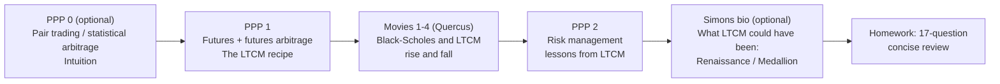
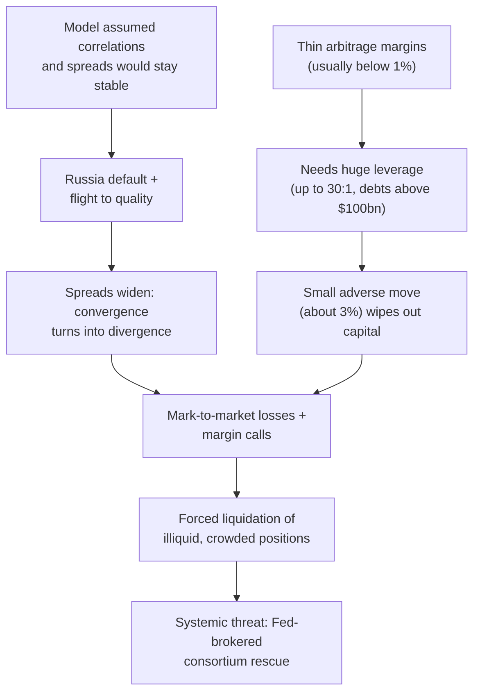

# APS1051: Session 4 Study Notes (English)
**Course:** APS1051: Portfolio Management under Real Market Constraints
**Institution:** University of Toronto | Master of Engineering (ELITE)
**Instructors:** Sabatino Costanzo & Loren Trigo
**Session theme:** The *other* side of portfolio management: **risk management**, told through statistical arbitrage, futures arbitrage and the rise and fall of **Long-Term Capital Management (LTCM)**.

**Source materials used**
* `S4B`: `A SESSION 4 README UP UPDATED.docx` (session roadmap)
* `S4B`: `PPP 0 THE INTUITION BEHIND STATISTICAL ARBITRAGE.pptx` (optional primer, 29 slides)
* `S4B`: `PPP 1 HOW LTCM USED FUTURES ARBITRAGE.pptx` + `COMMENTS ON PPP1 ...pdf`
* `S4B`: `PPP 2 LCTM RISK MANAGEMENT LESSONS.ppt` + `COMMENTS ON PPP2 ...pdf`
* `S4E`: `HOMEWORK SESSION 4.docx` (17 review questions), `READING JAMES SIMONS BIO.docx`, `3 THE TRILLION DOLLARS BET FULL MOVIE TRANSCRIPTION.pdf` (NOVA / PBS "Trillion Dollar Bet", 2000)

> **Notation note:** formulas are written in plain text (no LaTeX) so they render anywhere. "S4-PPP1 slide 7" means Session 4, PPP 1, slide 7.

---

## 0. The One-Page Big Picture

Sessions 1 to 3 were about **how to build and evaluate a portfolio** (Sharpe/Treynor/Alpha, Markowitz + momentum, solvers). In those portfolios, risk control is *passive*: it comes from diversification and from the constraints (long-only, caps, short lookback).

Session 4 asks the uncomfortable question: **what happens when a brilliant, diversified, hedged, quantitative strategy blows up?** LTCM is the case study. The session is deliberately ordered:

**The three ideas to leave with:**
1. Arbitrage on **converging spreads** earns tiny, "low-risk" margins, so you must **lever** it to make it worthwhile.
2. Leverage + **assumed-constant correlations** + illiquidity = a strategy that is right in the long run and bankrupt in the short run.
3. **Risk management deserves the same engineering effort as alpha generation.** This is the bridge to Session 5 (market breadth / regime filters).

---

## 1. PPP 0: The Intuition Behind Statistical Arbitrage (Pair Trading)

*(Optional primer, adapted from an article by D. Goodboy; useful if "pairs" is new to you.)*

### 1.1 Definition
* **Statistical arbitrage = pair trading** in plain English: buying one stock and (usually) simultaneously selling short another, based on the *relationship* between them rather than on the absolute direction of either (S4-PPP0 slide 7).
* Companies in the same sector tend to move together; they **cross, diverge for a moment, then return** to their usual behaviour (slide 8).
* The pair trader watches the relationship and trades whenever it is **out of sync**, assuming the historical correlation will resume (slide 9). Most **high-frequency trading** strategies rest on this principle (slide 10).

### 1.2 Why it works: the statistics (slide 15 and its commentary)
* Traders prefer **predictable** assets: you can tell when they are **overbought** (short them) or **oversold** (buy them).
* Prices are often roughly **log-normal**, and normally distributed series are **mean-reverting** around their centre.
* Not every asset is well behaved. Trick: **build** a well-behaved asset by taking **two highly correlated (or co-integrated) assets and trading their difference** (long one, short the other). That "difference asset" is almost surely mean-reverting.
* The 95% band rule: sell when the price touches the **upper edge** of the 95% band; buy when it touches the **lower edge** (slide 16). This is exactly the seed of the **regression channel** used in Session 5.

### 1.3 Examples on the slides
| Pair | Observation |
| :--- | :--- |
| Coca-Cola (KO) vs Pepsico (PEP) | Pepsico dropped out of sync near end of May; trader buys PEP, shorts KO; pair re-converged quickly (slides 11-17). |
| Wal-Mart (WMT) vs Target (TGT) | Target climbed out of the historical range: short TGT, long WMT, hold until correlation returns (slides 19-21). |
| Citibank (C) vs Harley-Davidson (HOG) | Non-obvious pair: correlation may be linked to consumer credit, "but that's only a guess" (slides 23-25). |
| GM vs Ford; groups of 3+ names | Same logic extends to baskets; software is typically needed (slide 18, 28). |

### 1.4 Risks (slide 27): the seed of the LTCM story
* Correlated pairs *usually* re-converge, but **there is no rule that says they must**. They can stay out of sync for a long time.
* Hence the need for an **indicator for entries and exits** (the regression channel), plus **stops and proper position sizing**.

> **My intuition:** a pair is like two dogs on one leash held by the same owner. They wander apart, but the leash (economic link) pulls them back. LTCM's whole story is about a leash that stretched much longer, and for much longer, than anyone's model allowed.

---

## 2. PPP 1: Futures and Futures Arbitrage (How LTCM Profited from Converging Spreads)

### 2.1 What a futures contract is: the Farmer and the Baker (slides 2-3)
* Contract: **100 pounds of wheat at $1 per pound, delivered in 6 months.**
* **Farmer = seller (short):** must **deliver** 100 lb of wheat at maturity.
* **Baker = buyer (long):** must **pay $100** at maturity and receives the wheat.
* They do **not** care where the wheat price goes: they are **hedgers**, not speculators. Both just want to eliminate uncertainty.
* **Hedgers vs speculators:** speculators bring **liquidity**; both are essential to the machine (PPP1 comments).
* Generalises to bonds, stocks, currencies, indexes, oil, REITs, thousands of underlyings at the Chicago exchange and others.

**Why are futures on liquid assets "more expensive" than on less liquid ones?** Because besides farmers and bakers, **speculators** also want to trade them (they need to enter and exit with ease because their horizons are short). Extra demand raises price. *General rule: liquidity tends to make an asset's price higher.*

### 2.2 The M bond vs J bond (slides 4-7)
* **M** = a 30-year Treasury auctioned **today** (e.g. March). **J** = an essentially identical 30-year Treasury auctioned a **few months earlier** (e.g. January).
* **Why is M more liquid?** Many large banks and corporations are mandated to buy **fresh** issues at each auction, so M has slightly more demand for a few weeks. Therefore the **M futures** price > **J futures** price (e.g. M = $100, J = $98).
* At maturity (say 6 months later) nobody cares which was issued first. They are "the same bond": same issuer, same coupon, same maturity, so **same price** (the prices **converge**).

**The recipe (LTCM's bread and butter):**
| Leg | Action | Contract price | At maturity (both worth V) |
| :--- | :--- | :--- | :--- |
| 1 | **Sell** M futures (the more liquid / expensive one) | receive 100 | you must hand over something worth V, net = 100 - V |
| 2 | **Buy** J futures (the less liquid / cheaper one) | pay 98 | you receive something worth V, net = V - 98 |
| **Total** | | | **(100 - V) + (V - 98) = +2, for any V** |

**Worked check (this is Homework Q2 b, c, d):**
| Convergence price V | Short M result | Long J result | Net |
| :--- | :--- | :--- | :--- |
| 105 | 100 - 105 = -5 | 105 - 98 = +7 | **+2** |
| 200 | 100 - 200 = -100 | 200 - 98 = +102 | **+2** |
| 50 | 100 - 50 = +50 | 50 - 98 = -48 | **+2** |

**Insight:** you are not betting on the *level* of V at all. You are monetising the **spread** (the initial 2). The strategy only requires that the two prices **converge**. That is why it is called **market-neutral** and considered **low-risk**.

### 2.3 Two vocabulary traps
* **Short-selling an asset** (borrow it, sell it, buy it back later) is **not** the same as **being the short side (seller) of a futures contract** (a symmetric position to the buyer). The only thing in common: both benefit if the price goes down.
* Volkswagen example in the comments: borrow neighbour's car, sell for $10,000, buy it back at $5,000, return it, keep $5,000. Same thing with a stock borrowed from a broker.

### 2.4 Black-Scholes and "volatility selling" (slides 8-10 + comments)
* Black-Scholes inputs (5): stock price, strike X, risk-free rate r, time to expiry T, and volatility sigma (standard deviation of the stock).
* Normally you plug in **sigma** to get the **fair option price**. Reverse it: plug the **market price** of the option and solve for sigma to get **implied volatility**, the *forward-looking* "publicly perceived" volatility.
* **Historical volatility** is backward-looking and known to everyone. **Implied volatility** is forward-looking and, according to the course, tells you more about near-term volatility. LTCM's edge was exactly this comparison.
* Option prices = price of **portfolio insurance**. Higher perceived risk, higher premium.
* **LTCM's reasoning:** if market-implied volatility is **above** the volatility they expect, options are overpriced, so **sell options (go short volatility)** and wait for it to converge down.
* **The fatal catch:** the market did revert, "but only when it was too late for the fund." Goldman Sachs even offered to buy the fund at one point and was refused (reportedly personal rivalries). Keynes: *"Markets can remain irrational longer than you can remain solvent."*

---

## 3. PPP 2: The LTCM Story and Its Risk-Management Lessons

### 3.1 Antecedents, team and funds
| Item | Detail (from slides; figures vary by source) |
| :--- | :--- |
| Founder | **John Meriwether**, legendary Salomon Brothers bond trader; fund created **1993/94**, dissolved **2000** |
| "Dream team" | Eric Rosenfeld, William Lasker (Harvard); Victor Haghani (LBS); Lawrence Hilibrand, Gregory Hawkins (MIT finance PhDs); David Mullins (Federal Reserve); **Myron Scholes** and **Merton Miller** (the slides list both as Nobel laureates; the movie also shows **Robert Merton** as a founding partner and Merton Miller as a commentator) |
| Funding | Min. investment **$10 million** (3-year lock-up in the movie), record raise for a new hedge fund; fees **2% of assets + 25% of gains**; investors included UBS and the China central bank |
| Structure | Long Term Capital Portfolio (Cayman Islands) + LTCM Delaware; operations in **Greenwich, Connecticut** (secretive, away from Wall Street) |
| Largest position | **$1.25 trillion** notional (comparable to the US federal budget, per the movie) |

Early returns were spectacular: about **+20%, +43%, +41%** net in the first three years (movie). Scholes: "a gigantic vacuum cleaner sucking up nickels from all over the world."

### 3.2 Operating methodology
* **Quantitative models, market-neutral bets.**
* Premises: **mean reversion, convergence, market efficiency (prices eventually fix), very high leverage, concentration in futures and other derivatives.**
* Used **dynamic hedging**, the practical insight of Black-Scholes (offset risk by taking opposite positions continuously).

### 3.3 The strategies (Homework Q5-Q8)
| Strategy | What it is | Risk note |
| :--- | :--- | :--- |
| **Bond arbitrage** | Using futures for leverage on 30-year Treasuries auctioned every 6 months: **long the least liquid, short the most liquid**; wait for convergence; keep the spread. | Only difference from PPP1: **extensive leverage**. Typical spreads < 1%. |
| **Correlation arbitrage** | Same logic with **pairs that are similar but not identical**: VW preferred vs regular shares, Royal Dutch vs Shell, French vs Swiss bonds. | Convergence is **not guaranteed**. Leveraged + illiquid positions can go badly. Strategy drift began once big cash inflows had to be deployed. |
| **Risk / merger arbitrage** | Betting on the price rise implied by announced mergers that sometimes do not happen. **30+ positions**, managed by V. Haghani. | Ironically one of the few books that **did not** lose in the Russian default. |
| **Volatility sale** | Options priced in at ~**20%** perceived volatility vs ~**15%** estimated by the team; so they **sold options on indexes** (short volatility), starting 1997. They called themselves "volatility salespeople". | Lost enormously when volatility rose globally. |

### 3.4 Chronology of events (Homework Q9)
1. **1997:** returns fall from about 40% to 17% (the game was imitated); LTCM **returned capital to partners but did not shrink assets**, so leverage rose sharply. Starts selling index options.
2. **Summer 1997:** Asian crisis (Thailand, then Japan/Indonesia banks).
3. **June 1998:** per SEC, owns shares of 77 companies (about $541 million); Russia is ~**8% of the portfolio, about $10 billion**, to widen product range for investor demand.
4. **17 July 1998:** press reports that Salomon Smith Barney is liquidating positions similar to LTCM's (crowded trade).
5. **17 August 1998:** **Russia defaults** on rouble and dollar debt.
6. **Flight to quality:** spreads widen instead of converging; **convergence becomes divergence**.
7. **Four days after default:** one-day loss of about **$500 million** (the models said daily loss ~**$50 million** at worst).
8. **End of August 1998:** estimated losses about **52%** of the fund.
9. **Sunday 20 September 1998:** Fed and Treasury officials go to Greenwich.
10. **Fed-organised rescue:** Wall Street and French banks pool about **$3.6 billion** (the slides also mention a $470 million recapitalisation by Chase and the Goldman offer). A consortium supervises trading and can veto partners' decisions.
11. **December 1999:** all banks fully repaid; **early 2000:** fund quietly closed.

### 3.5 Cause-and-effect map (Homework Q10-Q14)

* **Volatility increase:** LTCM, short volatility, took huge losses as vol rose worldwide instead of falling.
* **Russian bonds:** bought to broaden product range; default made ~**10% of the portfolio disappear**; it was the large, visible trigger (some argue LTCM would have failed anyway, just later).
* **Spread widening:** LTCM was **short liquid, long illiquid** bonds. Flight to quality made liquid bonds dearer, illiquid cheaper, exactly the wrong way.
* **Leverage as "a necessity with ill results":** needed to turn tiny margins into attractive returns, but it **multiplied the speed of losses** too.
* **Diversification failed:** Fed's Peter Fisher said everything "came up heads"; positions across all markets suddenly behaved the same way (correlations go to one in a crisis).

### 3.6 Rescue and aftermath (Homework Q15-Q16)
* **Life-saving procedure:** Fed intervention, stress-test check of positions, official offer to buy bond positions, recapitalisation, plus an earlier Goldman offer. Averted a global crisis.
* **After:** losses continued; talks with creditors resumed; **partners bought out** by the consortium; **debts fully paid**; clients suffered gigantic losses; world economy impact contained. Real extent of losses never known because many losers never reported.
* Documented losers (slide 25): LTCM partners about $1.1 bn, UBS $690 mm, Dresdner $145 mm, Banca d'Italia $100 mm, Sumitomo $100 mm, Credit Suisse $55 mm, bank executives $72 mm.

### 3.7 The risk-management lessons (Homework Q17)
**Slide-level list:** validation of risk models; **changing correlations**; need for **stress-testing scenarios**; **transparency** of information; **danger of credit lines**; the error of investing in "names" (reputations).

**Commentary-level lessons:**
1. **Rigid model, wrong invariants:** correlations were treated as constant; price-liquidity correlation was neglected: returns fell *as* liquidity vanished.
2. **Leverage + illiquidity + crowding** = fragility.
3. **Moral hazard:** being "too big to fail" (a predictable Fed intervention) encouraged more risk-taking.
4. **Weak outside supervision:** lenders were not critical enough; inadequate credit practices; lack of transparency.
5. **Hubris:** "the smartest people on earth can lose all their money when greed, overconfidence and excessive leverage collide" (Simons article). Fisher: *"If your business is to stand in random fields during lightning storms, you should anticipate the risks."*
6. **Meta-lesson:** give risk management as much weight as any other part of the strategy.

> **Models vs judgment** (movie closing): Greenspan asks how much to rely on models that can "get too far ahead of human judgment". Samuelson: "Elegance is for tailors: don't believe in something because it's a beautiful formula."

---

## 4. The Happy Ending: James Simons and Medallion (Optional Reading)

| Item | Detail |
| :--- | :--- |
| Background | MIT maths bachelor (1958), Berkeley PhD at 23; cryptographer at Institute for Defense Analyses; chair of Stony Brook maths; founded **Renaissance Technologies** |
| Hiring philosophy | Almost exclusively **mathematicians and scientists**; few finance PhDs, so models are not biased by conventional theory |
| Medallion fund | Began 1988; **-30% peak-to-trough by April 1989**; Simons rebuilt team and shortened horizon (holding period weeks/days changed to **intraday**) |
| Performance | **+98.2% in 2008** when the S&P 500 fell 37% (net of fees up to 5% of assets + 44% of profits); the course quotes 44%-66% per year for ~30 years |
| Secret sauce | **Many models, all asset classes** (diversification across models), constantly updated, large data, open research culture |
| Caveat | Quants become **victims of their own success**: trends fade or get arbitraged away; fund became too big, now closed to outsiders |
| Cautionary quant tales in the same article | Knight Trading (2012): untested program, $460 million lost in 45 minutes; Taleb's **black swan** (models never cover everything) |

**Why it matters for this course:** it shows that **markets are inefficient** (arbitrage opportunities exist) *if* approached with proper risk control. A statistical proof is promised in **Session 10**. Contrast the two funds: LTCM = few big levered convergence bets, long horizon, rigid model; Medallion = many small bets, short horizon, diversified, adaptive.

---

## 5. Homework 4 Cheat Sheet (17 Concise Review Questions)

| Q | Core of the answer (2-3 lines is enough) |
| :--- | :--- |
| 1a | Signing parties: farmer (seller/short) and baker (buyer/long); a **futures contract** (100 lb wheat, $1/lb, 6 months). |
| 1b | Quite unambiguous: quantity, price, date, asset and obligations are all defined. (Delivery location / grade are the usual extra details in real contracts.) |
| 1c | Yes: bonds, stocks, currencies, indexes, oil, etc. Example: a futures contract on a 30-year Treasury. |
| 1d | No, they are hedgers: they want to **remove** price uncertainty. |
| 1e | Farmer must deliver; baker must pay $100 and receives the wheat (rights mirror duties). |
| 1f | Liquid assets attract speculators in addition to hedgers, so more demand and higher price. |
| 2a | Fresh auction means more mandated demand, so M slightly more liquid for some weeks. |
| 2b-d | Sell M futures, buy J futures. Net profit **= initial spread = +2** whether convergence is at 105, 200 or 50. |
| 3-4 | LTCM team: Meriwether + Nobel/academic quants; methodology: quant, market-neutral, convergence + leverage. |
| 5-8 | Bond arbitrage (long illiquid/short liquid); correlation arbitrage (similar pairs, no guaranteed convergence); merger arbitrage; volatility sale (sell options when implied > expected volatility). |
| 9-14 | Chronology 1997 to Aug 1998; volatility rose; Russian default; spreads widened; leverage amplifies losses; margin calls; 52% loss by end-August. |
| 15-16 | Fed-led consortium; losses continued, partners bought out, debts repaid, crisis contained. |
| 17 | e.g. (1) correlations are not constant, so stress-test; (2) leverage + illiquidity kills; also transparency and credit-line discipline. |

---

## 6. Connections and Pitfalls

**Connections to earlier sessions**
* **S1:** A Sharpe ratio built on a short, calm sample overstated LTCM's quality: smooth returns can hide **tail risk** (selling insurance).
* **S2/S3:** Markowitz needs a **stable covariance matrix**; LTCM is the real-world case of "correlation estimates fail exactly when you need them". Diversification limits (S3) vs correlations going to one (S4).
* **S5 (next):** the lesson becomes engineering: **market breadth / regime filters** protect against the sudden moves LTCM could not survive.

**Common pitfalls**
* Thinking LTCM's strategy was "wrong". The **spreads did converge eventually**; the fund ran out of **time and capital**.
* Mixing up "short-selling" with "short side of a futures contract".
* Believing arbitrage = riskless. **Statistical** arbitrage has no guarantee of convergence.
* Confusing implied volatility (forward-looking, from option prices) with historical volatility.

## 7. Quick Revision Card

* Futures = obligation to trade X at price P on date T. Hedgers reduce uncertainty; speculators add liquidity.
* Spread arbitrage profit = initial price gap, independent of the convergence level.
* Implied vol = sigma that makes Black-Scholes price equal to the market price.
* LTCM leverage about 30:1, so about a 3% adverse move is fatal.
* Lessons: model validation, changing correlations, stress tests, transparency, credit limits, humility.
* Simons: many small, short-horizon, diversified, constantly updated bets; fight your own success decay.
