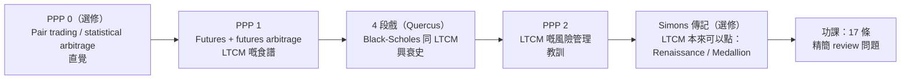
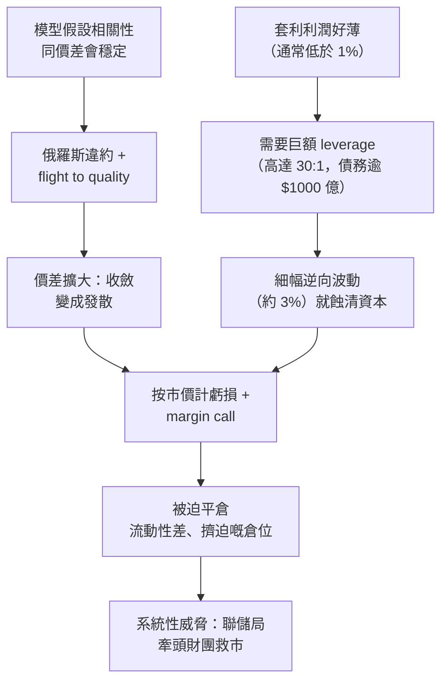

# APS1051：Session 4 溫書筆記（廣東話版）
**科目：** APS1051: Portfolio Management under Real Market Constraints
**學校：** University of Toronto | Master of Engineering (ELITE)
**導師：** Sabatino Costanzo & Loren Trigo
**今堂主題：** 投資組合管理嘅「另一邊」：**風險管理**。透過 statistical arbitrage、futures arbitrage，同埋 **Long-Term Capital Management (LTCM)** 嘅興衰史嚟學。

**參考資料**
* `S4B`：`A SESSION 4 README UP UPDATED.docx`（今堂路線圖）
* `S4B`：`PPP 0 THE INTUITION BEHIND STATISTICAL ARBITRAGE.pptx`（選修入門，29 張 slide）
* `S4B`：`PPP 1 HOW LTCM USED FUTURES ARBITRAGE.pptx` + `COMMENTS ON PPP1`
* `S4B`：`PPP 2 LCTM RISK MANAGEMENT LESSONS.ppt` + `COMMENTS ON PPP2`
* `S4E`：`HOMEWORK SESSION 4.docx`（17 條 review 問題）、`READING JAMES SIMONS BIO.docx`、`THE TRILLION DOLLARS BET`（NOVA / PBS 紀錄片逐字稿，2000 年）

> **記號說明：** 公式全部用純文字（冇 LaTeX），邊度都睇得到。「S4-PPP1 slide 7」即係 Session 4、PPP 1、第 7 張 slide。

---

## 0. 一頁睇晒大圖

Session 1 至 3 講**點樣砌同評估一個 portfolio**（Sharpe/Treynor/Alpha、Markowitz + momentum、solver）。嗰啲 portfolio 嘅風險控制係**被動**嘅：靠分散投資同限制條件（long-only、上限、短 lookback）。

Session 4 問一個好煩嘅問題：**一個勁到爆、有分散、有對沖嘅量化策略，如果爆煲會點？** LTCM 就係個案。今堂次序係特登安排嘅：

**三個一定要記住嘅重點：**
1. 做**價差收斂（converging spread）**嘅 arbitrage，每次賺得好少、而且「睇落低風險」，所以一定要**加 leverage** 先有意思。
2. Leverage + **以為相關性唔變** + 流動性差 = 長遠嚟講你啱，但短期內你破產。
3. **風險管理同 alpha 一樣重要，要用同等心機去做。** 呢點正正橋接去 Session 5（market breadth / regime filter）。

---

## 1. PPP 0：Statistical Arbitrage 嘅直覺（Pair Trading）

*（選修入門，改編自 D. Goodboy 篇文；如果你對 pair 完全冇概念就值得睇。）*

### 1.1 定義
* **Statistical arbitrage = pair trading**（講白啲）：同時買一隻股票、沽空另一隻，睇嘅係兩隻之間嘅**關係**，唔係任何一隻嘅絕對升跌（S4-PPP0 slide 7）。
* 同一行業嘅公司，股價通常貼住行，然後**交叉、分開一陣、再返去原本嘅行為**（slide 8）。
* Pair trader 睇住兩隻股票嘅關係，一旦**唔同步**就出手，假設歷史相關性會恢復（slide 9）。大部分**高頻交易（HFT）**都係建基於呢個原理（slide 10）。

### 1.2 點解行得通：統計學（slide 15 同評論）
* 交易者鍾意**可預測**嘅資產：知道幾時**超買（overbought）**就沽空、**超賣（oversold）**就買入。
* 股價大致上係 **log-normal**，而常態分佈嘅序列會圍住中心做**均值回歸（mean reversion）**。
* 但唔係每隻資產都乖。竅門：用**兩隻高度相關（或 co-integrated）嘅資產，交易佢哋嘅差價**（買一隻、沽一隻），呢個「差價資產」差唔多肯定會 mean-reverting。
* 95% 區間規則：價格觸及 95% band **上緣**就沽，觸及**下緣**就買（slide 16）。呢個就係 Session 5 **regression channel** 嘅雛形。

### 1.3 Slide 入面嘅例子
| 配對 | 觀察 |
| :--- | :--- |
| Coca-Cola (KO) vs Pepsico (PEP) | 五月尾 Pepsico 同 Coca-Cola 脫節；買 PEP、沽 KO；兩隻好快重新收斂（slide 11-17） |
| Wal-Mart (WMT) vs Target (TGT) | Target 升出咗歷史區間：沽 TGT、買 WMT，揸到相關性返嚟（slide 19-21） |
| Citibank (C) vs Harley-Davidson (HOG) | 唔明顯嘅 pair：可能同消費者借錢有關，「但只係估」（slide 23-25） |
| GM vs Ford；三隻或以上一籃子 | 同一邏輯可以擴展，通常要靠軟件（slide 18, 28） |

### 1.4 風險（slide 27）：LTCM 故事嘅伏筆
* 高度相關嘅股票對**通常**會重新同步，但**冇任何規則話一定會**。佢哋可以脫節好耐。
* 所以要有**入市同離場嘅指標**（regression channel），仲要**止蝕（stop）同控制倉位大細**。

> **我嘅直覺：** 一對 pair 就好似兩隻狗，條繩係同一個主人手上。佢哋可以行開，但條繩（經濟上嘅連繫）會拉返佢哋。LTCM 成個故事，就係條繩比所有人嘅模型預計嘅拉得**更長、更耐**。

---

## 2. PPP 1：Futures 同 Futures Arbitrage（LTCM 點樣賺收斂價差）

### 2.1 Futures contract 係乜：農夫同麵包師傅（slide 2-3）
* 合約：**100 磅小麥，每磅 $1，6 個月後交收。**
* **農夫 = 賣方（short）：** 到期一定要**交** 100 磅小麥。
* **麵包師傅 = 買方（long）：** 到期要**付 $100**，並收到小麥。
* 佢哋**唔關心**小麥價升定跌：佢哋係**對沖者（hedger）**，唔係投機者。兩個都只係想消除不確定性。
* **Hedger vs speculator：** 投機者帶嚟**流動性**；兩者都係部機器必要嘅一部分（PPP1 評論）。
* 可以推廣到債券、股票、貨幣、指數、石油、REITs，芝加哥同其他交易所有成千上萬種。

**點解流動性高嘅資產嘅 futures 會「貴啲」？** 因為除咗農夫同麵包師傅，**投機者**都想交易（佢哋要容易入、容易出，因為時間線短）。多咗需求，價錢就高。*一般規律：流動性令資產價格偏高。*

### 2.2 M 債券 vs J 債券（slide 4-7）
* **M** = 今日（例如三月）拍賣嘅 30 年期國債。**J** = 幾個月前（例如一月）拍賣嘅、幾乎一模一樣嘅 30 年期國債。
* **點解 M 流動性較高？** 好多大銀行同大公司有「每次拍賣都要買**新**債」嘅授權，所以拍賣完之後幾個星期，M 需求稍高。結果 **M futures** 價 > **J futures** 價（例如 M = $100、J = $98）。
* 到期（假設 6 個月後），冇人理邊隻先發行。佢哋「係同一隻債」：同一發行人、同一 coupon、同一到期日，所以**同價**（價格**收斂**）。

**食譜（LTCM 嘅看家本領）：**
| 腳 | 動作 | 合約價 | 到期（兩隻都值 V） |
| :--- | :--- | :--- | :--- |
| 1 | **沽** M futures（較流動／較貴） | 收 100 | 要交一件值 V 嘅貨，淨 = 100 - V |
| 2 | **買** J futures（較唔流動／較平） | 付 98 | 收一件值 V 嘅貨，淨 = V - 98 |
| **合計** | | | **(100 - V) + (V - 98) = +2，V 係幾多都一樣** |

**驗算（即係功課 Q2 b, c, d）：**
| 收斂價 V | 沽 M 結果 | 買 J 結果 | 淨額 |
| :--- | :--- | :--- | :--- |
| 105 | 100 - 105 = -5 | 105 - 98 = +7 | **+2** |
| 200 | 100 - 200 = -100 | 200 - 98 = +102 | **+2** |
| 50 | 100 - 50 = +50 | 50 - 98 = -48 | **+2** |

**重點：** 你根本唔係賭 V 嘅**水平**，而係變現個**價差**（最初嗰 2）。策略淨係要求兩個價錢**收斂**。所以叫 **market-neutral**，而且被視為**低風險**。

### 2.3 兩個容易搞亂嘅詞
* **沽空一隻資產（short-selling）**（借嚟、沽咗、遲啲買返）同**做 futures 合約嘅賣方（short side）**係**兩回事**。後者同買方嘅倉位完全對稱。兩者唯一共通點：價錢跌就賺。
* 評論入面嘅 Volkswagen 例子：問鄰居借部車，賣 $10,000，價跌到 $5,000 先買返部一樣嘅車，還返鄰居，袋住 $5,000。向經紀借股票沽空都係一樣道理。

### 2.4 Black-Scholes 同「沽 volatility」（slide 8-10 + 評論）
* Black-Scholes 有 5 個輸入：股價、行使價 X、無風險利率 r、到期時間 T、同波動率 sigma（股票嘅標準差）。
* 平時你放 **sigma** 入去，計到**期權合理價**。反過嚟：放期權**市價**入去，解返 sigma，就得到 **implied volatility（隱含波動率）**，即係**向前望**、「大眾感受到」嘅波動率。
* **Historical volatility** 係向後望、人人都知。**Implied volatility** 係向前望，按課程講法，更能反映短期未來波動。LTCM 嘅優勢就係比較呢兩樣嘢。
* 期權價錢 = **投資組合保險**價。感受到嘅風險愈高，保費愈貴。
* **LTCM 嘅推理：** 如果市場隱含波動率**高過**佢哋預期，期權就偏貴，所以**沽期權（short volatility）**，等佢收斂返落嚟。
* **致命位：** 市場最終都有回落，「但係個時候基金已經太遲」。Goldman Sachs 曾經出價收購，但被即時拒絕（傳聞係因為個人恩怨）。Keynes：*「市場可以不理性得比你可以保持償債能力更耐。」*

---

## 3. PPP 2：LTCM 故事同風險管理教訓

### 3.1 背景、團隊同資金
| 項目 | 詳情（來自 slide；數字視乎來源有出入） |
| :--- | :--- |
| 創辦人 | **John Meriwether**，Salomon Brothers 傳奇債券交易員；基金 **1993/94** 成立、**2000** 解散 |
| 「夢幻團隊」 | Eric Rosenfeld、William Lasker（Harvard）；Victor Haghani（LBS）；Lawrence Hilibrand、Gregory Hawkins（MIT 金融博士）；David Mullins（前聯儲局）；**Myron Scholes** 同 **Merton Miller**（slide 列為諾貝爾獎得主；紀錄片仲見到 **Robert Merton** 係創始合夥人） |
| 資金 | 最低投資 **$1,000 萬美元**（紀錄片話鎖定 3 年），創新基金集資紀錄；收費 **2% 資產 + 25% 盈利**；投資者包括 UBS 同中國央行 |
| 架構 | Long Term Capital Portfolio（開曼群島）+ LTCM Delaware；總部喺 **Connecticut 嘅 Greenwich**（好神秘、遠離華爾街） |
| 最大倉位 | 名義金額 **$1.25 萬億**（紀錄片比喻為相當於美國聯邦預算） |

頭三年表現驚人：淨回報大約 **+20%、+43%、+41%**（紀錄片）。Scholes 形容：「就好似一部巨型吸塵機，喺全世界吸五仙銀仔。」

### 3.2 運作方法
* **量化模型、market-neutral 押注。**
* 前提：**均值回歸、收斂、市場有效（價錢最終會校正）、極高 leverage、集中喺 futures 同其他衍生品。**
* 用 **dynamic hedging**（Black-Scholes 嘅實戰精華：不斷用相反倉位抵銷風險）。

### 3.3 策略（功課 Q5-Q8）
| 策略 | 係乜 | 風險重點 |
| :--- | :--- | :--- |
| **債券套利（Bond arbitrage）** | 用 futures 對每 6 個月拍賣一次嘅 30 年期國債加 leverage：**買最唔流動、沽最流動**；等收斂；食價差。 | 同 PPP1 唯一分別：**大量 leverage**。價差通常 < 1%。 |
| **相關性套利（Correlation arbitrage）** | 同一邏輯，但用**相似而非一模一樣**嘅 pair：VW 優先股 vs 普通股、Royal Dutch vs Shell、法國 vs 瑞士債券。 | 收斂**唔保證**。Leverage + 流動性差嘅倉位可能出事。大量資金湧入之後要揾地方放，策略開始走樣。 |
| **風險／併購套利（Risk / merger arbitrage）** | 押注已宣佈併購所隱含嘅股價升幅，但有時併購唔成事。**30 多個倉位**，由 V. Haghani 管理。 | 諷刺地，係少數喺俄羅斯違約中**冇蝕**嘅部門。 |
| **沽波動率（Volatility sale）** | 期權價反映約 **20%** 感受波動率，而團隊估計約 **15%**；所以由 1997 年起**沽指數期權**（short volatility）。佢哋自稱「volatility salespeople」。 | 全球波動率上升時蝕到大鑊。 |

### 3.4 事件時間線（功課 Q9）
1. **1997：** 回報由約 40% 跌到 17%（被人模仿）；LTCM **退咗資金畀合夥人，但冇縮減資產**，所以 leverage 急升。開始沽指數期權。
2. **1997 夏天：** 亞洲金融風暴（泰國，然後日本、印尼銀行）。
3. **1998 年 6 月：** 據 SEC，持有 77 間公司股票（約 $5.41 億）；俄羅斯佔組合約 **8%，即約 $100 億**，原因係為咗應付投資者需求而擴闊產品。
4. **7 月 17 日：** 報章報道 Salomon Smith Barney 正在平倉同 LTCM 類似嘅倉位（擠迫交易 crowded trade）。
5. **8 月 17 日：** **俄羅斯違約**，盧布同美元債務都無力償還。
6. **Flight to quality：** 價差反而擴大，**收斂變咗發散**。
7. **違約後四日：** 單日蝕約 **$5 億**（模型話每日最多蝕約 **$5,000 萬**）。
8. **1998 年 8 月底：** 估計蝕咗基金約 **52%**。
9. **1998 年 9 月 20 日（星期日）：** 聯儲局同財政部官員飛去 Greenwich。
10. **聯儲局牽頭拯救：** 華爾街同法國銀行合共注資約 **$36 億**（slide 仲提到 Chase 注資 $4.7 億同 Goldman 嘅收購要約）。財團接管監察交易，有權否決合夥人嘅決定。
11. **1999 年 12 月：** 還清所有銀行；**2000 年初：** 基金靜靜雞結業。

### 3.5 因果關係圖（功課 Q10-Q14）

* **波動率上升：** LTCM 沽緊 volatility，波動率全球上升而唔係下跌，蝕大錢。
* **俄羅斯債券：** 為咗擴闊產品而買；違約令組合約 **10% 消失**；係個巨大而顯眼嘅導火線（有人話就算冇佢 LTCM 都會失敗，只係遲啲）。
* **價差擴大：** LTCM 係**沽流動、買唔流動**嘅債券。Flight to quality 令流動嘅更貴、唔流動嘅更平，正正係錯誤方向。
* **Leverage 係「無可奈何但後果嚴重」：** 利潤太薄，唔加 leverage 賺唔到錢；但 leverage 同時**加快咗蝕錢嘅速度**。
* **分散投資失效：** 聯儲局嘅 Peter Fisher 話，所有嘢「全部出公仔」；全球各市場嘅倉位突然行為一致（危機時相關性趨近 1）。

### 3.6 拯救同後果（功課 Q15-Q16）
* **救命程序：** 聯儲局介入、為倉位做 stress test、官方要約收購債券倉位、注資，再加較早前 Goldman 嘅出價。避免咗全球危機。
* **之後：** 虧損繼續；同債權人重新談判；**合夥人被財團買斷**；**債務全數還清**；客戶損失巨大；對世界經濟嘅衝擊受控。真正損失規模無人知，因為好多蝕錢嘅人從來冇公開。
* 有記錄嘅輸家（slide 25）：LTCM 合夥人約 $11 億、UBS $6.9 億、Dresdner $1.45 億、意大利銀行 $1 億、住友銀行 $1 億、Credit Suisse $5,500 萬、銀行高層 $7,200 萬。

### 3.7 風險管理教訓（功課 Q17）
**Slide 列表：** 風險模型驗證；**相關性會變**；要做 **stress testing 情景**；資訊**透明度**；**信貸額度嘅危險**；投資「名氣」嘅錯誤。

**評論層面嘅教訓：**
1. **模型太死板、假設錯咗常數：** 相關性當咗恆定；忽略咗價格同流動性嘅關係：流動性消失嘅同時回報下跌。
2. **Leverage + 流動性差 + 擠迫** = 脆弱。
3. **道德風險：** 大到「不能倒」（預期聯儲局會介入）令佢哋承擔更多風險。
4. **外部監管薄弱：** 銀行唔夠批判；信貸做法不當；缺乏透明度。
5. **傲慢：** 「世上最聰明嘅人，當貪婪、過度自信同過高 leverage 撞埋一齊，都可以蝕晒所有錢」（Simons 篇文）。Fisher：*「如果你嘅生意係喺雷暴中企喺空曠嘅田度，你應該更認真預計風險。」*
6. **總結：** 風險管理要同策略其他部分一樣重視。

> **模型 vs 判斷**（紀錄片結尾）：Greenspan 問，金融模型「可能走得比人嘅判斷快太多」，應該依賴幾多？Samuelson：「優雅係裁縫嘅事：唔好因為條公式靚就信。」

---

## 4. 美好結局：James Simons 同 Medallion（選修閱讀）

| 項目 | 詳情 |
| :--- | :--- |
| 背景 | MIT 數學學士（1958），23 歲 Berkeley 博士；Institute for Defense Analyses 密碼學家；Stony Brook 數學系主任；創立 **Renaissance Technologies** |
| 用人哲學 | 幾乎全部係**數學家同科學家**；好少金融博士，咁模型就唔會被傳統理論影響 |
| Medallion 基金 | 1988 年開始；**1989 年 4 月高低位跌 30%**；Simons 重組團隊、縮短時間線（平均持倉由數星期／日變成**日內**） |
| 表現 | **2008 年 +98.2%**（當年 S&P 500 跌 37%；已扣除最高 5% 資產費 + 44% 盈利費）；課程引述約 30 年每年 44%-66% |
| 秘訣 | **好多模型、所有資產類別**（模型間分散）、不斷更新、大量數據、開放嘅研究文化 |
| 警告 | Quant 會成為**自己成功嘅受害者**：趨勢消退或者被 arbitrage 走晒；基金太大，而家唔對外開放 |
| 同一篇文嘅量化警世例子 | Knight Trading（2012）：未測試嘅程式，45 分鐘蝕 $4.6 億；Taleb 嘅 **black swan**（模型永遠覆蓋唔到所有情況） |

**同今堂有咩關係：** 佢證明**市場並非有效**（有 arbitrage 機會），**前提係**你有好好嘅風險控制。統計證明會喺 **Session 10** 講。兩個基金對比：LTCM = 少數大額加 leverage 嘅收斂押注、時間線長、模型死板；Medallion = 好多細額押注、時間線短、分散、會適應。

---

## 5. 功課 4 速查表（17 條精簡 review 問題）

| 題 | 答案要點（2-3 行就夠） |
| :--- | :--- |
| 1a | 簽約雙方：農夫（賣方／short）同麵包師傅（買方／long）；係一份 **futures contract**（100 磅小麥、$1/磅、6 個月）。 |
| 1b | 好清晰：數量、價錢、日期、資產同義務都定義咗。（真實合約通常仲會補交收地點／等級。） |
| 1c | 可以：債券、股票、貨幣、指數、石油等。例：30 年期國債 futures。 |
| 1d | 唔關心，佢哋係 hedger：想**消除**價格不確定性。 |
| 1e | 農夫要交貨；麵包師傅要付 $100 並收貨（權利對應義務）。 |
| 1f | 流動資產除咗 hedger 仲吸引投機者，需求多，價錢高。 |
| 2a | 新拍賣有指定買家需求，M 幾個星期內稍為流動啲。 |
| 2b-d | 沽 M futures、買 J futures。淨利潤 **= 初始價差 = +2**，收斂喺 105、200 或 50 都一樣。 |
| 3-4 | LTCM 團隊：Meriwether + 諾貝爾／學術量化精英；方法：量化、market-neutral、收斂 + leverage。 |
| 5-8 | 債券套利（買唔流動／沽流動）；相關性套利（相似 pair，收斂無保證）；併購套利；沽 volatility（隱含波動率 > 預期時沽期權）。 |
| 9-14 | 1997 至 1998 年 8 月時間線；波動率上升；俄羅斯違約；價差擴大；leverage 放大虧損；margin call；8 月底蝕 52%。 |
| 15-16 | 聯儲局牽頭財團；損失持續、合夥人被買斷、債務還清、危機受控。 |
| 17 | 例如 (1) 相關性唔係常數，要 stress test；(2) leverage + 流動性差會致命；另有透明度同信貸額度紀律。 |

---

## 6. 連繫同常見陷阱

**同之前 Session 嘅連繫**
* **S1：** 喺短而平靜嘅樣本入面計出嚟嘅 Sharpe ratio 高估咗 LTCM 嘅質素：平滑嘅回報可以隱藏**尾部風險**（沽緊保險）。
* **S2/S3：** Markowitz 需要**穩定嘅 covariance matrix**；LTCM 係「相關性估計喺你最需要佢嘅時候失靈」嘅真實個案。S3 講分散投資嘅極限，S4 見到相關性喺危機中趨向 1。
* **S5（下一堂）：** 教訓變成工程：用 **market breadth / regime filter** 保護自己，免受 LTCM 捱唔過嘅突發波動。

**常見陷阱**
* 以為 LTCM 嘅策略「錯咗」。**價差最終係有收斂**；基金係用晒**時間同資本**。
* 將「short-selling」同「futures 合約嘅 short side」搞亂。
* 以為 arbitrage = 無風險。**Statistical** arbitrage 並冇收斂保證。
* 搞亂 implied volatility（向前望、來自期權價）同 historical volatility。

## 7. 速溫卡

* Futures = 喺日期 T 以價錢 P 交易 X 嘅義務。Hedger 減少不確定性；投機者增加流動性。
* 價差套利利潤 = 初始價差，同收斂水平無關。
* Implied vol = 令 Black-Scholes 價等於市價嘅 sigma。
* LTCM leverage 約 30:1，所以大約 3% 逆向波動就致命。
* 教訓：驗證模型、相關性會變、stress test、透明度、信貸限制、謙虛。
* Simons：好多細額、短時間線、分散、不斷更新嘅押注；要對抗自己成功之後嘅衰減。
