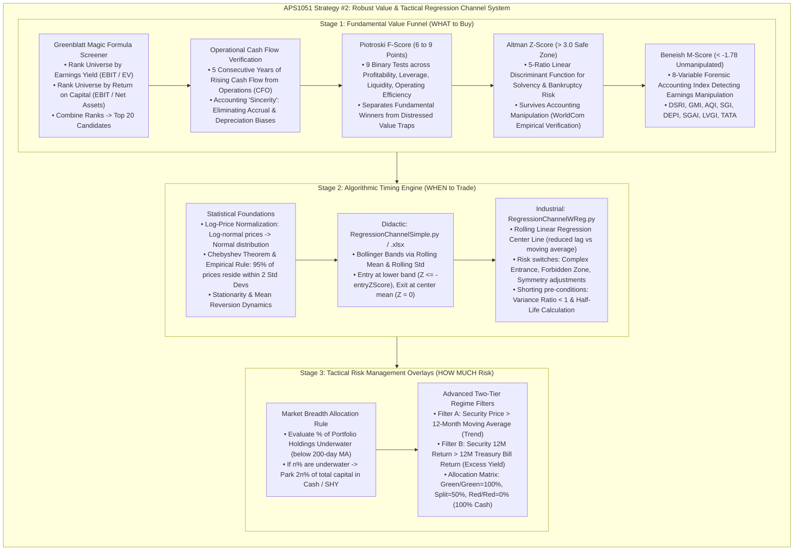

# APS1051: Session 5 Bilingual Study Notes
# 第五堂雙語深度溫習筆記：基本面價值篩選、迴歸通道演算法與市場寬度戰術風控體系

**Course / 課程：** APS1051: Portfolio Management under Real Market Constraints (真實市場限制下之投資組合管理)  
**Institution / 學府：** University of Toronto | Master of Engineering (ELITE Program)  
**Instructors / 導師：** Sabatino Costanzo & Loren Trigo  
**Primary Source Materials / 核心教學資源：**
* `S5A`: `YYYYY0 SESSION 5 README FIRST R (1).docx` (Session Rationale & 5-Strategy Roadmap)
* `S5A`: `PPP1 ROBUST FUNDAMENTAL ANALYSIS METHOD FOR STOCK SELECTION.pptx` (Fundamental Ratios & Quality Scoring Funnel)
* `S5A`: `PPP2 ENTERING & EXITING TRADES WITH THE REGRESSION CHANNEL.pptx` (Mean Reversion & Multi-Timeframe Regression Channels)
* `S5A`: `PPP3 MARKET BREADTH AND REGIME RISK MANAGEMENT SYSTEMS.pptx` (Tactical Market Breadth & 200MA / T-Bill Regime Filters)
* `S5A`: `REGRESSION CHANNEL PROGRAM SIMPLE` & `... W REG` (+ Instructor Comments PDF Guides)
* `S5D`: `HOMEWORK SESSION 5` (README FIRST (HOMEWORK).docx, Dow Jones 30 Database, Code implementations)
* `S5D`: `BONUS1 GRAHAM BUFFETT & VALUE INVESTMENT.docx` (Benjamin Graham, Warren Buffett & Economic Moats)
* `S5D`: `BONUS2 WhatIsATradingSystem` & `BONUS3 RegressionChannelClassic`

---

## Master Architecture of Session 5
## 第五堂總體架構導覽

---

## Section 1: The Robust Fundamental Value Funnel (PPP 1)
## 第一節：穩健基本面價值篩選漏斗

### English Technical Foundation:
Strategy #1 of this curriculum (Classical Asset Allocation / Modified Markowitz from Sessions 2 and 3) relies on passive mathematical diversification across broad asset class ETFs. Strategy #2 introduces a fundamental, individual-equity selection framework engineered to construct portfolios characterized by superior intrinsic value, explosive operational growth potential, immaculate balance-sheet solvency, and verified accounting transparency.

A pervasive failure mode in traditional fundamental value investing is falling into a **"Value Trap"**—purchasing a company that appears inexpensive on a trailing Price-to-Earnings (P/E) or Price-to-Book (P/B) ratio, but whose underlying business fundamentals are deteriorating toward structural collapse. To insulate the quantitative portfolio from value traps, Session 5 establishes an uncompromising multi-stage screening funnel:

### The Five-Stage Screening Funnel Architecture:
1. **Initial Value Universe Generation:** Select the top 20 candidate companies using **Joel Greenblatt's Magic Formula** screener, or mandate companies exhibiting at least **five consecutive years of strictly increasing Cash Flow from Operations (CFO)**.
2. **Growth & Quality Screening:** Filter the survivors to retain exclusively those possessing a **Piotroski F-Score between 6 and 9** (or >= 7), ensuring that operational momentum is accelerating.
3. **Bankruptcy & Distress Elimination:** Exclude any company with an **Altman Z-Score below 3.0**, guaranteeing robust solvency and zero structural default probability.
4. **Forensic Accounting Audit:** Filter remaining companies to eliminate financial statement manipulators by requiring a **Beneish M-Score below -1.78**, verifying that historical reported earnings are unadulterated.
5. **Execution & Rebalancing:** The surviving companies represent high-grade, resilient value assets. Under Greenblatt's classic methodology, an investor holds these equal-weighted for 12 months before annual rebalancing. Under the APS1051 curriculum, these curated names advance to the **Regression Channel Algorithmic Trading Engine** to harvest intraday and multi-week mean-reverting price oscillations.

> 💡 **廣東話實戰直覺與註解：**  
> **點解唔可以就咁買「市盈率（P/E）平」嘅股票？**  
> 喺金融市場，平嘢通常都有佢平嘅原因。好多股票 PE 得 4 倍、股價跌咗 80%，好多散戶以為執到寶，點知嗰間公司其實就快破產、或者帳目做假（呢啲就係典型嘅「價值陷阱 Value Trap」）。  
> 今堂教嘅「五層漏斗過濾網」，就係要用最嚴苛嘅工程學手段，將所有定時炸彈續個拆除：  
> 1. 先用 **Greenblatt 綠魔公式** 或者 **連續 5 年現金流增長** 撈出一批又平又賺錢嘅底子；  
> 2. 再用 **Piotroski F-Score** 確認佢嘅盈利同營運效率真係向上緊；  
> 3. 再用 **Altman Z-Score** 踢走所有幾年內有機會執笠嘅公司；  
> 4. 最後用 **Beneish M-Score** 照妖鏡，睇下佢間公司有冇煮盤假數出嚟呃人！  
> 只有通過晒呢四道鬼門關嘅股票，先有資格進入我哋嘅投資組合。

---

## Section 2: Mathematical Breakdown of All Fundamental Scores
## 第二節：四大基本面量化指標的數學公式與判讀準則

### 2.1 Cash Flow from Operations (CFO) Priority (PPP 2, Slide 2)
In corporate financial reporting, Net Income and Earnings Per Share (EPS) are vulnerable to management accrual discretion, capitalization of operational expenses, and subjective depreciation schedules. 
CFO = Operating Income + Depreciation & Amortization - Taxes Paid - Changes in Non-Cash Working Capital
Cash Flow from Operations represents the true, unadulterated cash velocity generated by core commercial activities. A business with rising CFO over five consecutive years proves durable pricing power, operational efficiency, and organic capital generation.

### 2.2 Joel Greenblatt's Magic Formula (PPP 1, Slides 12-40)
Joel Greenblatt (Columbia Business School adjunct and Gotham Capital founder) popularized the Magic Formula in *The Little Book That Beats the Market* (2006). The strategy identifies above-average businesses trading at below-average prices using two fundamental metrics:
1. **Earnings Yield (Bargain Price Metric):**
   Earnings Yield = EBIT / Enterprise Value (EV)
   where EV = Market Capitalization + Total Debt - Cash & Cash Equivalents. Unlike simple P/E, this formulation accounts for capital structure variations and tax rate differences across firms.
2. **Return on Capital (ROC - Business Quality Metric):**
   ROC = EBIT / (Net Working Capital + Net Fixed Assets)
   Measures operational profit generated per unit of tangible capital employed, penalizing capital-intensive businesses.

**Ranking Algorithm:** Rank the entire stock universe from 1 to N by Earnings Yield (highest = 1). Rank from 1 to N by ROC (highest = 1). Sum the two individual ranks: Combined Rank = Rank(Earnings Yield) + Rank(ROC). Select the top 20 to 30 lowest combined ranks.

### 2.3 Joseph Piotroski's F-Score (PPP 1, Slides 42-59)
Formulated by Stanford Professor Joseph Piotroski (2000), the F-Score is an integer metric ranging from **0 to 9**, evaluating year-over-year operational improvement across three distinct corporate dimensions. Each test awards 1 point if satisfied and 0 points otherwise:

* **Category 1: Profitability Signals**
  1. Return on Assets (ROA): ROA_t = Net Income_t / Total Assets_t > 0 (1 pt)
  2. Cash Flow from Operations: CFO_t > 0 (1 pt)
  3. Change in ROA: ROA_t > ROA_t-1 (1 pt)
  4. Accrual Quality: CFO_t / Total Assets_t > ROA_t (1 pt, proves cash flow exceeds accounting earnings)
* **Category 2: Leverage, Liquidity & Source of Funds**
  5. Change in Long-Term Debt: LongTermDebt_t / Assets_t < LongTermDebt_t-1 / Assets_t-1 (1 pt, lower leverage)
  6. Change in Current Ratio: CurrentRatio_t > CurrentRatio_t-1 (1 pt, improving short-term liquidity)
  7. Capital Dilution: Common Shares Issued_t <= Common Shares Issued_t-1 (1 pt, no dilutive share issuance)
* **Category 3: Operating Efficiency**
  8. Change in Gross Margin: GrossMargin_t > GrossMargin_t-1 (1 pt)
  9. Change in Asset Turnover: Sales_t / Assets_t > Sales_t-1 / Assets_t-1 (1 pt)

**Interpretation:** **F-Score 7 to 9 = High Quality / Growth Winner**; **F-Score 0 to 2 = Low Quality / High Distress Danger**.

### 2.4 Edward Altman's Z-Score (PPP 1, Slides 60-78)
Developed by NYU Professor Edward Altman (1968), the Z-Score is a multivariate linear discriminant analysis (LDA) model forecasting the probability of corporate bankruptcy within a 2-year horizon:
Z = 1.2 * X1 + 1.4 * X2 + 3.3 * X3 + 0.6 * X4 + 1.0 * X5
* X1 = Working Capital / Total Assets (measures near-term balance sheet liquidity)
* X2 = Retained Earnings / Total Assets (measures cumulative profitability and leverage endurance)
* X3 = EBIT / Total Assets (measures asset productivity and operational yield)
* X4 = Market Value of Equity / Total Liabilities (measures capital cushion before insolvency)
* X5 = Sales / Total Assets (measures asset utilization and competitive market velocity)

**Decision Zones:**
* **Z > 3.0:** **Safe Zone** (Bankruptcy probability is statistically negligible; mandatory hurdle for APS1051)
* **1.8 <= Z <= 3.0:** **Grey Zone** (Indeterminate distress risk; exercise caution)
* **Z < 1.8:** **Distress Zone** (High probability of financial collapse within 24 months)

*The WorldCom Case Study (2002):* Prior to filing the largest corporate bankruptcy in history ($100B in losses), WorldCom management cooked books by improperly capitalizing operating costs. Even though fraudulent earnings boosted X3 (EBIT/TA), the artificially inflated total asset base drastically shrunk X1, X2, and X5. As a result, the Z-Score collapsed into the danger zone well ahead of bankruptcy, demonstrating the model's resistance to accounting fraud.

### 2.5 Messod Beneish's M-Score (PPP 1, Slides 79-92)
Formulated by Professor Messod Beneish (1999), the M-Score is an econometric forensic model designed to detect corporate earnings manipulation. The full 8-variable model is:
M = -4.84 + 0.920*DSRI + 0.528*GMI + 0.404*AQI + 0.892*SGI + 0.115*DEPI - 0.172*SGAI + 4.679*TATA - 0.327*LVGI
* **DSRI (Days Sales in Receivables Index):** (Receivables_t / Sales_t) / (Receivables_t-1 / Sales_t-1). Disproportionate surges signal revenue pre-booking.
* **GMI (Gross Margin Index):** GrossMargin_t-1 / GrossMargin_t. Index > 1 indicates deteriorating profit margins, increasing temptation to manipulate.
* **AQI (Asset Quality Index):** [1 - (CurrentAssets_t + PP&E_t + Securities_t) / TotalAssets_t] / [Prior Year]. AQI > 1 indicates capitalization of non-tangible costs.
* **SGI (Sales Growth Index):** Sales_t / Sales_t-1. Fast growth pressures executives to cook books when growth decelerates.
* **DEPI (Depreciation Index):** DeprRate_t-1 / DeprRate_t. DEPI > 1 means depreciation rate slowed down, extending asset lives to inflate income.
* **SGAI (Sales, General & Administrative Index):** (SGA_t / Sales_t) / (SGA_t-1 / Sales_t-1).
* **LVGI (Leverage Index):** TotalDebt_t / TotalAssets_t / [Prior Year].
* **TATA (Total Accruals to Total Assets):** (Operating Income - CFO) / Total Assets. High positive accruals indicate paper earnings unbacked by cash.

**Decision Rule:**
* **M-Score > -1.78:** **High Likelihood of Accounting Manipulation** (Red Flag; exclude stock)
* **M-Score < -1.78:** **Unmanipulated, Clean Financials** (Mandatory hurdle for APS1051; note that -2.5 is cleaner than -1.78)

> 💡 **廣東話實戰直覺與註解：**  
> **四大名捕嘅角色分工速查：**  
> * **CFO：** 最誠實嘅真金白銀，連續 5 年向上代表間公司真係識生金蛋。  
> * **F-Score（0 到 9 分）：** 睇間公司係咪進步緊。6 至 9 分就合格，7 分以上最好；低過 3 分就千祈唔好掂。  
> * **Z-Score：** 破產預測器。一定要**大過 3.0**！如果細過 1.8，間公司隨時兩年內執笠。當年 WorldCom 做假帳呃到全世界，都呃唔過 Z-Score。  
> * **M-Score：** 捉造假帳神捕。特別注意呢個係**負數**！臨界點係 **-1.78**。分數一定要**細過 -1.78**（例如 -2.5、-3.0）先算帳目清白；如果大過 -1.78（例如 -1.2 或者正數），代表間公司好可能「煮過盤數」！

---

## Section 3: Regression Channel Mechanics & Statistics (PPP 2)
## 第三節：迴歸通道交易法與統計學底層原理

### English Technical Foundation:
Traditional buy-and-hold investing in fundamental value stocks exposes capital to substantial opportunity costs: high-grade, inexpensive companies frequently trade in horizontal sideways ranges for years before the broader market recognizes their intrinsic worth (e.g., Microsoft's extended consolidation period). The **Regression Channel Trading Technique** resolves this inefficiency by actively harvesting mean-reverting price swings.

### The Statistical Foundation:
1. **Lognormal to Normal Transformation:** While raw asset prices S_t are constrained to non-negative values and exhibit positive skewness (approximating a lognormal distribution), the natural logarithm of prices:
   p_t = ln(S_t)
   transforms the process into a bell-shaped, approximately normal distribution.
2. **Chebyshev's Theorem and the Empirical Rule:**
   For a normally distributed variable:
   * Approximately **68.2%** of price occurrences reside within Mean +/- 1 Standard Deviation.
   * Approximately **95.4%** of price occurrences reside within Mean +/- 2 Standard Deviations.
   * Approximately **99.7%** of price occurrences reside within Mean +/- 3 Standard Deviations.
3. **Mean Reversion Mechanics:**
   A price excursion to the lower 2-standard-deviation boundary (Z = -2.0) is a statistically rare event occurring less than 5% of the time. Because underlying fundamentals remain intact, economic forces and arbitrageurs will drive the price back toward its rolling central mean.

### Quantitative Trading Rules:
* **Long Entry Signal:** When log-price pierces the lower regression barrier:
  Z_t <= -entryZScore (e.g., Z_t <= -2.0) -> Buy the stock.
* **Neutralize / Exit Signal:** When log-price reverts to the central regression line:
  Z_t >= exitZscore (e.g., Z_t >= 0.0) -> Sell the position and return to cash.
* **Short Entry (Optional / Hedged):** When log-price pierces the upper regression barrier:
  Z_t >= +entryZScore (e.g., Z_t >= +2.0) -> Short the stock (only if mean-reversion stationarity tests pass).

### Multi-Timeframe Alignment (PPP 2, Slides 20-26):
Institutional signal reliability increases exponentially when multiple observation windows align simultaneously:
1. Quadrant 1: 1-Year Weekly Frame (Macro Trend)
2. Quadrant 2: 3-Month Daily Frame (Intermediate Cycle)
3. Quadrant 3: 90-Day Hourly Frame (Tactical Swing)
4. Quadrant 4: 10-Day 15-Minute Frame (Execution Timing)
When an asset (e.g., SPY or an industry ETF like IHE) touches its lower 2-SD boundary across all four frames simultaneously, the probability of an immediate sharp mean-reverting rally is maximized.

> 💡 **廣東話實戰直覺與註解：**  
> **點解迴歸通道（Regression Channel）比死揸（Buy and Hold）更有效？**  
> 就算你揀中一隻超級好股，佢隨時橫行盤整兩三年都唔升（好似 2000 年後嘅微軟）。死揸嘅機會成本極大。迴歸通道嘅精髓，就係認清**「股價 95% 嘅時間都喺 2 個標準差嘅管道入面遊走」**。  
> 當股價跌穿下軌（Z-Score <= -2），代表佢已經跌到極唔合理嘅恐慌超賣區。根據統計學定律，佢有極大機率會彈返去中心線。我哋喺下軌接貨，彈到中間平均值（Z = 0）就食糊離場，返返去揸現金。咁做既可以食盡佢嘅震盪利潤，又唔需要承擔大市向下深潛嘅長期套牢風險！

---

## Section 4: Algorithmic Implementation: Simple vs. Advanced Programs
## 第四節：演算法實踐：教學版與高階滾動迴歸程式剖析

The curriculum provides two Python programs within `S5D` demonstrating the implementation of the regression channel strategy:

### 4.1 Didactic Script: `RegressionChannelSimple.py` / `.xlsx`
* **Center Line Methodology:** Employs a simple rolling moving average: `dfP['mean'] = dfP['Close'].rolling(window).mean()`.
* **Band Computation:** Computes rolling standard deviation: `dfP['std'] = dfP['Close'].rolling(window).std()`, setting upper band `U-B = mean + entryZscore * std` and lower band `L-B = mean - entryZscore * std`.
* **7 Structural Steps of Every Backtester:**
  1. Data downloading and pre-processing via `yfinance`
  2. Signal engineering (Bollinger bands & Z-score)
  3. Trading rule logic (Long when Z <= -entryZscore)
  4. Stance calculation (net units held: 0 or +1)
  5. Cumulative return & equity curve derivation
  6. First-level evaluation metrics (Total Return, CAGR, Sharpe Ratio, Max Drawdown)
  7. Second-level significance testing (**White's Reality Check**)

### 4.2 Advanced Script: `RegressionChannelWReg.py`
* **Center Line Innovation:** Replaces lagging moving averages with a **Rolling Linear Regression**:
  p_t = alpha + beta * t
  The rolling regression hugs the price trajectory with significantly reduced phase lag, preventing false trend-breakout signals.
* **Risk Control Parameters:**
  * `entryZscore = 2.0`: Wide 2-SD gauge appropriate for volatile assets (e.g., energy ETF `IYE`).
  * `exitZscore = 0.0`: Exits position strictly at channel center.
  * `window = 40`: 40 trading days (~2 months) ensures standard deviation does not whiplash wildly.
  * `complex_entrance = 1`: Requires the price to pierce outside the band and then **cross back toward the center** before firing the order (ensures momentum has actually reversed).
  * `forbidden = 1`: Prohibits opening new long trades if the price collapses more than 1 additional SD beyond the lower entry barrier (circuit-breaker against structural collapse).
  * `delay = 1`: Immediate realistic execution delay.
  * `shorts = 0`: Shorts deactivated until statistical mean-reversion is formally proven.

### 4.3 Pre-Conditions for Enabling Short Selling:
Before setting `shorts = 1`, the quantitative manager must execute two econometric tests located at the bottom of `RegressionChannelWReg.py`:
1. **Lo-MacKinlay Variance Ratio Test (`vratio`):**
   VR(q) = Var(R_t^q) / [q * Var(R_t)]
   If `vratio < 1.0` with `p-value < 0.05`, the price series exhibits negative serial correlation (proven mean reversion). If `vratio >= 1.0`, the series is trending or a random walk, making short selling hazardous.
2. **Ornstein-Uhlenbeck Half-Life of Mean Reversion:**
   Calculated by regressing Delta p_t on p_t-1:
   Delta p_t = -lambda * p_t-1 + epsilon_t,  Half-Life = ln(2) / lambda
   `2 * Half-Life` equals the expected wait time for the price to return to equilibrium. The lookback `window` must be set to a small multiple of the half-life. If half-life is excessively long, capital opportunity cost renders shorting unfeasible.

> 💡 **廣東話實戰直覺與註解：**  
> **點解進階版用「滾動線性迴歸」好過普通「移動平均線（MA）」？**  
> 移動平均線最大嘅缺點就係「滯後（Lag）」。如果隻股票喺度單邊上升，普通 MA 線會被遠遠拋喺後面，搞到個通道走晒樣。進階版用 Linear Regression 做中線，條線本身就帶有斜率（Slope），能夠緊緊貼住股價嘅上升或下跌通道。  
> **想沽空？一定要做兩大身體檢查：**  
> 1. **Variance Ratio (VR)：** 一定要細過 1 而且 p 值細過 0.05，證明隻股票真係有「回頭」嘅習慣，唔係一去不復返嘅大趨勢。  
> 2. **Half-Life（半衰期）：** 計下佢由極端位彈返去中間要幾多日。如果半衰期太長（例如要等半年先彈），你借貨沽空嘅利息成本同機會成本就會食晒你啲利潤！

---

## Section 5: Tactical Market Breadth & Regime Risk Management (PPP 3)
## 第五節：戰術性市場寬度與體系轉換（Regime）風控機制

### English Technical Foundation:
The catastrophic failure of LTCM demonstrated that standalone trade-level optimization is defenseless against macroeconomic regime shifts. In Session 5, the curriculum integrates a **Tactical Risk Management Overlay** that dynamically governs portfolio cash exposure based on broader market breadth and trend indicators.

### 5.1 Basic Market Breadth Allocation Rule (PPP 3, Slides 1-3)
Market Breadth measures the internal participation of individual components within an index or portfolio. The curriculum formalizes the following proportional cash rule:
"If n% of the stocks in the portfolio are 'underwater' (trading below their individual 200-day moving averages), exactly [2n %] of total portfolio capital must immediately transition to Cash (e.g., Treasury Bills or SHY ETF)."

**Operational Allocations:**
* If 0% are underwater -> 0% in cash (100% invested in active equities)
* If 25% are underwater -> 2 * 25% = **50% in cash** (remaining 50% divided among healthy stocks)
* If 50% are underwater -> 2 * 50% = **100% in cash** (0% equity exposure; complete capital protection)

### 5.2 Advanced Dual-Filter Regime Allocation (PPP 3, Slides 4-6)
Once the allocation to a specific screened stock is determined, the capital must pass through two independent trend and yield filters before execution proceeds:
* **Risk Filter 'A' (Trend Regime):** The asset's current price must exceed its **12-Month Moving Average** (or 200 trading days). (Flashes Green if P_t > MA_12M; otherwise Flashes Red).
* **Risk Filter 'B' (Opportunity Cost / Excess Yield Regime):** The asset's trailing 12-month return must exceed the trailing 12-month return of the **Risk-Free Treasury Bill**. (Flashes Green if Return_12M > R_f,12M; otherwise Flashes Red).

**The Master Allocation Matrix:**
| Filter A (Price > 200MA) | Filter B (Return > T-Bill) | Portfolio Capital Allocated to Asset | Capital Held in Cash / SHY |
| :---: | :---: | :---: | :---: |
| **GREEN** | **GREEN** | **100%** | **0%** |
| **GREEN** | **RED** | **50%** | **50%** |
| **RED** | **GREEN** | **50%** | **50%** |
| **RED** | **RED** | **0%** | **100%** |

### Tactical vs. Strategic Risk Management:
* **Tactical Systems (Session 5):** Reactive mechanisms. They do not forecast disasters; they execute rapid, rules-based de-risking as soon as market breadth deteriorates, limiting max drawdown.
* **Strategic Systems (Upcoming Sessions 9-11):** Predictive and insurance overlays, including the **Altman Market Crash Indicator** (a macroeconomic early-warning canary) and **Index Options Hedging** (dynamic put options on the S&P 500 and TLT).

> 💡 **廣東話實戰直覺與註解：**  
> **市場寬度（Market Breadth）風控點解咁犀利？**  
> 好多時大市指數（S&P 500）望落好似冇跌，但其實入面有八成嘅股票已經跌穿咗 200 日線（全靠幾隻巨頭股頂住指數）。如果淨睇指數，你死咗都唔知點解。  
> **2n 規則極度簡單而殘暴：** 組合入面只要有 25% 股票跌穿 200 日線，即刻斬一半倉位去揸現金（50% 現金）；如果有 50% 股票跌穿，**百分之百全現金避險**！  
> 呢種做法完全唔同市場拗頸。佢唔去估幾時係底，只要風頭火勢唔對路，就自動鎖定利潤避入防空洞。回測證明，加咗呢層風控之後，組合嘅最大回撤（Drawdown）即刻腰斬，夏普比率大幅提升！

---

## Section 6: Historical Foundations: Benjamin Graham, Warren Buffett & Economic Moats (Bonus 1)
## 第六節：思想源頭：班傑明·葛拉漢、巴菲特與護城河理論

### English Technical Foundation:
Bonus Document 1 establishes the intellectual lineage of Strategy #2, tracing its quantitative lineage to **Benjamin Graham** (the Father of Value Investing) and **Warren Buffett**.

### Benjamin Graham's Quantitative Discipline:
Graham pioneered the concept of an equity share as a fractional deed of ownership in an operating business rather than a speculative ticker tape. His core principle, the **Margin of Safety**, mandates buying assets at a steep discount to their verifiable intrinsic liquidation value:
1. **Net-Net Working Capital Strategy:**
   Net-Net Value = Cash & Cash Equivalents + (0.75 * Accounts Receivable) + (0.50 * Inventory) - Total Liabilities
   If Market Capitalization < Net-Net Value, the business is trading for less than its pure liquidation value, providing an impenetrable margin of safety. Graham's partnerships generated ~20% annualized returns over two decades using this deep-value method.
2. **Graham's 7 Defensive Investor Criteria:**
   * Adequate enterprise size (> $600M in today's dollars)
   * Strong financial condition (Current Ratio >= 2.0; Long-Term Debt < Net Current Assets)
   * Earnings stability (Positive net income for 10 consecutive years)
   * Unbroken dividend record (Uninterrupted dividends for at least 20 years)
   * Organic earnings growth (At least 33% earnings expansion over 10 years)
   * Moderate P/E ratio (Price <= 15x trailing 3-year average earnings)
   * Moderate P/B ratio (Price <= 1.5x book value; alternatively P/E * P/B <= 22.5)

### Buffett's Evolution: The Economic Moat:
Under the influence of Charlie Munger, Warren Buffett evolved from Graham's pure "cigar-butt" net-net approach toward purchasing exceptional businesses possessing sustainable competitive advantages—an **Economic Moat**:
* **Porter's Five Forces Alignment:** Threat of new entrants, threat of substitutes, bargaining power of customers, bargaining power of suppliers, and industry rivalry.
* **Morningstar's 5 Moat Sources:**
  1. *Network Effects:* Utility scales with user count (e.g., Visa, American Express, eBay).
  2. *Intangible Assets:* Irreplaceable brand equity, patents, or regulatory licenses (e.g., Coca-Cola, Disney).
  3. *Cost Advantage:* Scale efficiencies enabling lowest-cost production (e.g., Walmart).
  4. *Switching Costs:* Prohibitive procedural friction to replace software/services.
  5. *Efficient Scale:* Natural monopolies serving localized niche infrastructure.

*2008 Financial Crisis Validation:* In September 2008, while commercial banks leveraged at 30:1 collapsed, Buffett deployed Berkshire's massive cash float into Goldman Sachs ($5B) and GE Capital ($3B) 10% preferred shares with lucrative equity warrants, reaping billions in profits. Strategy #2 encapsulates Graham's balance sheet metrics via F/Z/M scores and Buffett's survival discipline via regime cash management.

> 💡 **廣東話實戰直覺與註解：**  
> **葛拉漢同巴菲特畀我哋嘅終極啟示：**  
> 葛拉漢教我哋「數簿入面嘅安全邊際」——用量化指標（Net-Net、流動比率）死守底線；巴菲特則教我哋「商業競爭嘅護城河」——一間有定價權嘅偉大公司可以抗衡通脹幾十年。  
> **2008 年危機嘅對比最發人深省：** 貝爾斯登、雷曼兄弟用 30 倍槓桿炒 subprime 債券，結果灰飛煙滅；而巴菲特手握巨額現金「浮存金（Float）」，喺全市場最恐慌嗰陣，以皇帝般嘅苛刻條件借錢畀高盛同 GE（年息 10% 再加認股權證）。呢個就係今堂最深刻嘅主題：**「有風控、有現金嘅人，先係金融風暴入面最後嘅贏家。」**

---

## Section 7: Homework Session 5 Step-by-Step Implementation Guide
## 第七節：第五堂課後作業手把手實戰指南

本堂作業為綜合性量化實戰項目，無另外單獨嘅課堂 Exercise。

### Step 1: Universe Selection (Dow Jones 30 Database)
* Access `DOW JONES STOCKS FINANCIAL DATA.zip`. Inspect 10 years of financial history for the 30 constituent companies.
* Identify 3 to 5 premier stocks meeting:
  1. Piotroski F-Score >= 7 (consistently high score)
  2. Altman Z-Score > 3.0 (safe distance from bankruptcy)
  3. Beneish M-Score < -1.78 (unmanipulated accounting records)
  4. At least 5 consecutive years of rising Cash Flow from Operations (CFO).

### Step 2: In-Sample Training & Calibration (60% Data)
* Download daily price history for each chosen stock via `yfinance`:
  * **Training Window:** `start_date = '2015-01-01'` to `end_date = '2018-01-01'`.
* In `RegressionChannelWReg.py`, calibrate:
  * `entryZscore` (test across 1.0, 1.5, 2.0 to ensure trading frequency is healthy)
  * `window` (test across 20, 40, 60 trading days)
* Target an in-sample **Sharpe Ratio approaching 1.0** with a smooth, upward-sloping equity curve.

### Step 3: Out-of-Sample Testing & Verification (40% Data)
* Freeze the optimal parameters (`entryZscore` and `window`) obtained from Step 2.
* Feed the out-of-sample **Testing Window:** `start_date = '2018-01-01'` to `end_date = '2020-01-01'`.
* If out-of-sample Sharpe Ratio remains comparable to the training phase, the parameters are robust (not overfitted). Retain the stock for final portfolio aggregation.

### Step 4: Portfolio Aggregation & Performance Reporting
* For each validated stock, extract its cumulative equity curve from `Results/dfP.csv` (Column AA).
* Combine the 3 to 5 equity curve vectors into an Excel spreadsheet or Jupyter Notebook. The aggregate portfolio equity curve is the equal-weighted average across all individual stock curves.
* Calculate final summary performance metrics:
  1. **Absolute Total Return:** `(Ending Capital / Starting Capital) - 1`
  2. **Compound Annual Growth Rate (CAGR):** `(Ending / Starting)^(1 / Years) - 1`
  3. **Annualized Sharpe Ratio:** `mean(Daily Strategy Returns) / std(Daily Strategy Returns) * sqrt(252)`
  4. **Jensen's Alpha:** Alpha = Portfolio Return - [Risk-Free Rate + Beta * (Benchmark Return - Risk-Free Rate)]
  5. **Tactical Overlay (Optional but Recommended):** Incorporate the 200-day moving average filter (parking money in Cash/SHY when stock is below 200MA) to demonstrate volatility reduction.
