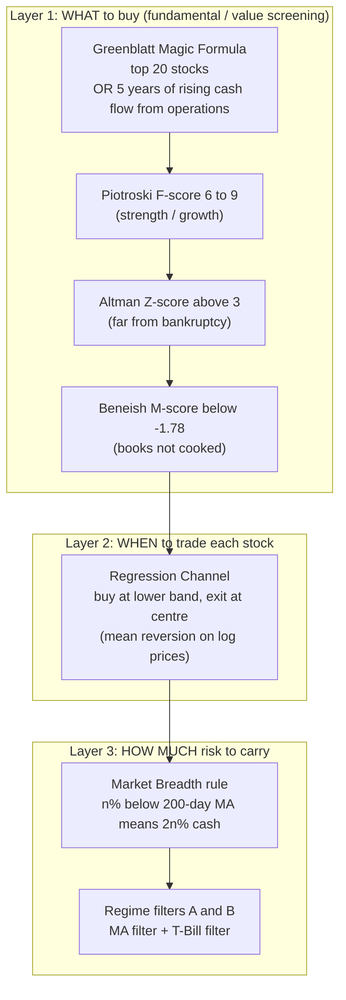

# APS1051: Session 5 Study Notes (English)
**Course:** APS1051: Portfolio Management under Real Market Constraints
**Institution:** University of Toronto | Master of Engineering (ELITE)
**Instructors:** Sabatino Costanzo & Loren Trigo
**Session theme:** **Strategy #2 of 5**: pick stocks on *Value* with fundamental scores, trade them with the **Regression Channel**, and protect the book with a **Market Breadth / Regime** risk-management overlay (the lesson of LTCM turned into code).

**Source materials used**
* `S5A`: `YYYYY0 SESSION 5 README FIRST R (1).docx`
* `S5A`: `PPP1 ROBUST FUNDAMENTAL ANALYSIS METHOD FOR STOCK SELECTION.pptx` (92 slides) + comments
* `S5A`: `PPP2 ENTERING & EXITING TRADES WITH THE REGRESSION CHANNEL.pptx` (28 slides) + comments
* `S5A`: `PPP3 MARKET BREADTH AND REGIME RISK MANAGEMENT SYSTEMS.pptx` (8 slides) + comments
* `S5A`: `REGRESSION CHANNEL PROGRAM SIMPLE` and `... W REG` (+ comment PDFs)
* `S5D`: `HOMEWORK SESSION 5` (README FIRST (HOMEWORK).docx, Dow Jones financial data zip, `RegressionChannelSimple.py/.xlsx`, `RegressionChannelWReg.py`), `BONUS1 GRAHAM BUFFETT & VALUE INVESTMENT.docx`, `BONUS2 WhatIsATradingSystem`, `BONUS3 RegressionChannelClassic`

> **Notation note:** plain-text formulas, no LaTeX. Where the original slide shows a formula only as a picture, I give the standard published definition and mark it **(standard def.)**.

---

## 0. The One-Page Big Picture

Strategy #1 (Modified Markowitz / Momentum, Sessions 2 and 3) controls risk **passively** through diversification. Strategy #2 is a **three-layer machine** with **active** risk control:

**Why this structure?** Good companies can sit in a sideways market for years; waiting for an up-trend is slow. The channel lets us **trade the oscillations** of already-good stocks. And because LTCM showed that models fail abruptly, we bolt on a **tactical** overlay that moves to cash when the market regime turns.

**Homework warning:** this is an important homework, so there are **no separate session exercises** this week.

---

## 1. PPP 1: Robust Fundamental Analysis for Stock Selection

### 1.1 The funnel (slides 3-7)
| Step | Filter | Rationale |
| :--- | :--- | :--- |
| 1 | **20 best stocks** per the Greenblatt screener (magicformulainvesting.com), *or* simply stocks with **increasing cash flow from operations** (5 consecutive years) | Basically good, relatively small and inexpensive |
| 2 | **Piotroski F-score between 6 and 9** | Growth will actually happen |
| 3 | **Altman Z-score above 3** | Growth is sustainable; low bankruptcy risk |
| 4 | **Beneish M-score below -1.78** | Books are not manipulated |
| 5 | Invest in survivors; Greenblatt: hold **1 year**, then re-run annually (20-30 names for a casual investor) | |

> **Slide inconsistency to remember:** slide 15 says "invest only where F-score is greater than 8", while the funnel (slide 4) says **6 to 9**. Slide 49 says **7-9 = good, 0-2 = weak**. In the homework we use "good" scores, and the Dow Jones database provides F, Z, M history so larger companies can qualify too.

### 1.2 Why cash flow from operations (CFO)? (S5-PPP2 slide 2, Brethauer quote)
* Net income / EPS is only a portion of what a company earns and can be shaped by accounting choices (depreciation, working-capital changes).
* **CFO = earnings adjusted for depreciation and working-capital changes**; the "sincere" version of earnings and the cash used to grow the business.
* Claim in the slides: stocks whose CFO has risen **every year for at least 5 years** have historically risen above the index. Quality of cash beats quality of story.

### 1.3 Greenblatt's Magic Formula (slides 12-40)
* Joel Greenblatt: hedge-fund manager and Columbia adjunct; book *The Little Book That Beats the Market* (2006).
* **Two things you want:** (1) a **bargain price** and (2) a **good business**.
  * **Earnings yield** = EBIT / Enterprise Value (inverse of a P/E; cheaper = higher). **(standard def.)**
  * **Return on Capital (ROC)** = EBIT / (Net Working Capital + Net Fixed Assets). **(standard def.)**
* **Procedure:** rank all stocks by earnings yield, rank all by ROC, **add the two ranks**, buy the lowest combined ranks. Result = above-average businesses at below-average prices.
* Evidence and caveats from the slides:
  * Greenblatt claims >30%/year; independent back-tests find less, but the consensus is it still beats the market after costs and taxes.
  * **Warning 1:** cheap can stay cheap for a long time (e.g. Microsoft sat on the screen for years).
  * **Warning 2:** some listed names are not investable at the moment (e.g. Dell during the going-private dispute).
  * Market-cap minimum can be as low as $50 million, but beware **small, illiquid stocks** (a *real market constraint*!). The list can be widened from 30 to 50 names.
* Philosophy link: buying good, profitable companies cheaply is what **Buffett** did for decades; Greenblatt made it **systematic**.

### 1.4 Piotroski F-score (slides 42-59)
* Joseph Piotroski (Stanford), 2000 paper *Value Investing: The Use of Historical Financial Information to Separate Winners from Losers*. Starts from **low price-to-book (high book-to-market)** stocks and separates winners from losers. Reported ~**23%/yr** average gain 1976-1996.
* **9 binary tests, 1 point each**, year-over-year (maximum 9):

| Group | Criterion (slide 48) | Point if (standard def.) |
| :--- | :--- | :--- |
| Profitability | 1. Return on Assets | ROA > 0 |
| | 2. Cash Flow from Operations | CFO > 0 |
| | 3. Increase of ROA | ROA this year > last year |
| | 4. Cash Flow > ROA (accruals) | CFO / assets > ROA |
| Leverage / liquidity | 5. Long-term debt to assets | ratio **decreased** |
| | 6. Increase in liquidity | current ratio **increased** |
| | 7. Dilution | **no new shares** issued |
| Operating efficiency | 8. Gross margin | margin **increased** |
| | 9. Asset turnover | turnover **increased** |

* **Reading:** 7-9 good (strong), 0-2 weak.

### 1.5 Altman Z-score (slides 60-78)
* Edward Altman (NYU), late 1960s: distil **five** ratios into one bankruptcy-risk number.
* Formula **(standard def.)**: `Z = 1.2*(WC/TA) + 1.4*(RE/TA) + 3.3*(EBIT/TA) + 0.6*(ME/TL) + 1.0*(Sales/TA)`

| Ratio | What it tells you (slides 68-72) |
| :--- | :--- |
| WC/TA (working capital / total assets) | Negative WC = trouble paying short-term obligations |
| RE/TA (retained earnings / total assets) | High = history of profitability, can survive a loss year; low = financed by borrowing |
| EBIT/TA | A version of ROA: ability to squeeze profit from assets before interest and tax |
| ME/TL (market value of equity / total liabilities) | How far market value can fall before liabilities exceed assets; market confidence |
| Sales/TA | Asset efficiency, competitiveness; falling = losing market share |

* **Zones:** Z **> 3** unlikely to go bankrupt (our requirement); **1.8 to 3** grey zone; **< 1.8** heading for bankruptcy.
* **WorldCom test:** Z moved from grey into the danger zone in 2000-2001, before the 2002 bankruptcy (about $100 billion of investor losses), *even though management inflated earnings*. Inflated assets shrink three of the five ratios, so cooking the books tends to push Z **down**, which is why Z is hard to fool.

### 1.6 Beneish M-score (slides 79-92)
* Messod Beneish: detects **earnings manipulation** (cooked books), a cousin of Altman but optimised for fraud. Built on Compustat 1982-1992.
* **Eight indices:** DSRI (days-sales-in-receivables: revenue inflation), GMI (gross margin index: deterioration > 1), AQI (asset quality), SGI (sales growth: pressure to keep up appearances), DEPI (depreciation: > 1 means slower depreciation, income-friendly), SGAI (SG&A), LVGI (leverage > 1 means more debt), TATA (total accruals / total assets).
* **8-variable formula (slide 91):**
  `M = -4.84 + 0.920*DSRI + 0.528*GMI + 0.404*AQI + 0.892*SGI + 0.115*DEPI - 0.172*SGAI + 4.679*TATA - 0.327*LVGI`
* **Decision rule:** M **> -1.78** means likely manipulator; so we **require M < -1.78** (more negative = cleaner). Out-of-sample: caught **76%** of manipulators, wrongly flagged **17.5%** of non-manipulators.
* 5-variable version (slide 92): `M = -6.065 + 0.823*DSRI + 0.906*GMI + 0.593*AQI + 0.717*SGI + 0.107*DEPI`. The slide text says it excludes "SGAI, DEPI and LEVI" as not significant, but the formula keeps DEPI and drops SGAI, LVGI and TATA, so the slide text looks like a typo.

### 1.7 Where to get the scores (practical)
* Greenblatt top-20 list: magicformulainvesting.com (free, daily).
* F, Z, M scores today: GuruFocus (stock page, "definitions").
* **Homework:** a zipped **Dow Jones 30 financial database** with 10 years of Piotroski, Altman, Beneish and CFO.

> **My intuition:** F-score asks "is this company getting *healthier*?", Z-score asks "will it *survive*?", M-score asks "can I *trust the numbers*?". Three different failure modes, three different filters. Each filter is imperfect, but their intersection is much cleaner than any single ratio.

---

## 2. PPP 2: Entering and Exiting Trades with the Regression Channel

### 2.1 The statistics behind it
* Stock **returns** are roughly normal; stock **prices** roughly **log-normal**. There are many more observations near the mean than beyond the 1st or 2nd standard-deviation "fences".
* The empirical rule (applies to bell-shaped data): about **68%** within 1 sd, **95%** within 2 sd, **99.7%** within 3 sd.
* So a price touching the 2-sd edge happens only ~5% of the time, and the next move most likely goes **back inside** the band: **mean reversion**. This is the practical meaning of **statistical arbitrage** from Session 4.
* **Trading rule (slide 12):**
  * Price touches the **upper edge** of the 95% band: **sell** (expect move down to centre, even lower edge).
  * Price touches the **lower edge**: **buy** (expect move up to centre and beyond).
* **Trading or investing?** Depends on time frame: on daily/weekly charts long positions can last **months**; on intraday they last hours. Selling is **temporary**: you exit to avoid falling with the market and **re-buy** when it climbs again. Objective: **minimise volatility and maximise capital gains, as conservatively as possible**.

### 2.2 Multi-time-frame view (slides 20-26)
Four frames viewed simultaneously: **1 year weekly**, **3 months daily**, **90 days hourly**, **10 days 15-minute**.
* Hedge ETF SDS: touching upper 2-sd in 15-min, daily and weekly, upper 1-sd hourly: all frames at resistance, so price may fall.
* SPY and IHE ETF: near the lower edge in all frames, ready to rise.
* Lockheed Martin: bouncing in 15-min only, near the mean in higher frames, so likely a slow drift up (follow the regression line slope).
* **Principle:** the more frames agree, the stronger the signal.

### 2.3 The "toy" program: `RegressionChannelSimple` (comments PDF)
**Mean-reversion vocabulary**
* A **stationary** series has constant mean, variance, etc. over time, so mean-reversion trading works.
* **Long** = buy; **short** = borrow and sell; **neutralise** = reverse the trade.
* We work with the **log of prices** (log-normal becomes normal) and the rolling mean and standard deviation: **Bollinger bands** = MA, MA + k*sd, MA - k*sd.
* **Z-score** = (log price - rolling mean) / rolling std.

**Rules**
* Long when z <= -entryZscore; short when z >= +entryZscore (only if shorts = 1); **exit** when z returns to exitZscore (centre, 0).
* Bimodal price distributions are possible (two means); then a more stringent Chebyshev bound (**at least 75% within 2 sd**, any shape) applies. The course keeps the simple version.

**Parameters in the toy example**
| Parameter | Meaning | Toy value |
| :--- | :--- | :--- |
| `entryZscore` | channel width in sd; must be **reachable** by the z-score or the system never trades | 0.5 (more frequent trades) |
| `exitZscore` | where to close | centre |
| `window` | look-back for mean and sd; short is better here | 3 weeks (15 days) |
| `shorts` | allow short selling (1) or not (0) | 0 |
| `delay` | 1 = execute immediately, 2 = wait a day | 1 |
| `tcost` | transaction cost | 0 (always make this realistic later!) |

**The 7 building blocks of any back-test** (slide 8):
1. Data download and pre-processing → 2. Signal engineering → 3. Trading rule → 4. **Stance** (net units held) → 5. Equity curve → 6. First-level metrics (annual return, CAGR, Sharpe, drawdown) → 7. **Second-level metric**: statistical significance (**White's Reality Check**).

**Data subtlety:** *Adjusted close* (dividends, splits) gets **re-written** across the whole history; *close* is better for signals, *adjusted close* for profit calculation. The course uses one series (adjusted) for simplicity. **Be aware of this in real life.**

**Performance metrics** (plain-text formulas)
| Metric | Formula | Comment |
| :--- | :--- | :--- |
| Annual return | `(End/Start - 1) / years` (non-compounded, linear) | intuitive |
| **CAGR** | `(End/Start)^(1/years) - 1` | compounded; standard for strategies |
| **Sharpe** (course version) | `mean(strategy returns) / std(strategy returns) * sqrt(252)` | daily data; use 12 for monthly |
| Max drawdown | largest peak-to-trough loss | downside risk |
| Calmar | annual compounded return / max drawdown | for reference |
| White's Reality Check p-value | want **p <= 0.10** (best < 0.10) | else good returns may be luck |

* Python returns are **percentage** returns (log version given in comments). Excel version matches but uses a **360-day** year, so results differ slightly.
* Tip: run in Spyder (variable explorer).

### 2.4 The functional program: `RegressionChannelWReg.py`
Upgrades over the toy:
* **Centre of channel = rolling regression** (`regression = 1`) instead of a moving average: hugs price better with less lag.
* Extra **risk-control switches** (each removes some risk **at the cost of profit**):

| Parameter | Effect |
| :--- | :--- |
| `symbol` | demo: IYE (iShares US Energy ETF): very volatile, so a wide gauge |
| `entryZScore = 2` | 2 sd either side (≈95% inside, ~5% triggers). Lower = more risk-tolerant, but price must actually reach it |
| `exitZscore = 0` | exit at centre |
| `window = 40` | look-back for regression **and** std (about 2 months; 40 is a minimum to avoid std whiplash) |
| `shorts = 0` | shorting is risky; only enable after mean-reversion tests |
| `regression = 1` | rolling-regression centre |
| `complex_entrance = 0` | only enter when the barrier has just been crossed **back toward centre** (fewer, better entries) |
| `forbidden = 0` | no open positions > 1 sd beyond entry band (or e.g. price below 200-day MA) |
| `delay = 1` | execution lag; real execution would need intraday data |
| `log_price = 1` | work in log prices (Z-values assume normality) |
| `tcost` | transaction costs (set to zero in the demo) |

* **Symmetry simplification:** bands are symmetric around the mean, but real prices fall faster than they rise, so the lower barrier "should" be wider.
* **Short-selling tests (later in the course):** **variance ratio (vratio)**: < 1 (not too close to 1) and p < 0.05 suggests mean reversion; **half-life**: wait time ≈ 2 × half-life; short half-life makes shorts feasible; set look-back to a small multiple of the half-life. For now **keep shorts = 0**.
* Outputs: `Results/dfP.csv` (equity curve in the column corresponding to Excel's "AA"), plus White's Reality Check p-value.

---

## 3. PPP 3: Market Breadth and Regime Risk Management

**Context:** After LTCM, every strategy needs a risk system. These are **tactical** systems: they **react** (move to cash when prices turn), they do not **anticipate**. **Strategic** systems anticipate (coming sessions): the **Altman Market Crash Indicator** (a "canary in the coal mine") and **index options hedging** (portfolio insurance).

### 3.1 Basic: Market Breadth rule (slides 1-3)
* "If **n%** of the stocks in the portfolio are below water (each below its **own 200-day MA**), keep **2n%** of capital in **cash**."
* Examples: 25% below → 50% cash (the rest split equally among remaining stocks); **50% below → 100% cash**.
* Breadth = **how many** components are healthy, not just whether the index is.

### 3.2 Advanced: two risk filters per asset (slides 4-6)
* **Filter A:** price **above its 12-month MA** (12 months = 52 weeks = ~200 trading days). Otherwise stay in cash.
* **Filter B (regime):** the asset's performance **exceeds the 12-month return of the T-Bill**. *(The slide literally says "price exceeds the return of the T-Bill"; I read this as asset's 12-month return vs T-bill's 12-month return, i.e. absolute momentum. Worth confirming with the instructors.)*

| Filter A | Filter B | Invest in asset | Cash |
| :--- | :--- | :--- | :--- |
| green | green | **100%** | 0% |
| green | red | 50% | 50% |
| red | green | 50% | 50% |
| red | red | **0%** | 100% |

* After the allocation criterion gives a "buy" signal (e.g. channel signal), apply A and B to size it.
* 10-year backtest of this raw model: surprisingly good equity curve for such a simple system.
* **Homework optional step (10):** if stock < 12-month (200-day) MA, park its allocation in cash (e.g. **SHY** ETF); else invest. Alternative: use the T-bill return as regime benchmark, or build a **spreadsheet** version.

> **My intuition:** this is the antidote to LTCM-style "it will converge, just wait". The rule *does not argue with the market*: if the trend is down for enough names, it simply goes to cash, accepting whipsaw costs in exchange for surviving the crash.

---

## 4. Homework 5: Step-by-Step Workflow

**Goal:** select, calibrate, test and risk-manage a small value portfolio.

| Step | Action |
| :--- | :--- |
| 1 | Locate the Dow Jones financial database and the `RegressionChannelSingleAssetPrograms` folder |
| 2 | Choose **3-5 Dow stocks** with good Piotroski, Altman, Beneish scores and, if possible, 5 straight years of rising CFO |
| 3 | Download 5-6 years of daily Yahoo data; split ≈ **60% training / 40% testing** |
| 4-5 | Feed **training** data; tune `lookback` and `entryZscore` until the equity curve is good (Sharpe near **1**): **calibration** |
| 6-7 | Run **testing** data with the same parameters. If testing Sharpe is reasonably close to training Sharpe, **keep the stock + parameters** (out-of-sample check against overfitting) |
| 8-9 | Trade each stock separately following its signals |
| 10 | (Optional) add the 200-day-MA / T-bill regime filter, or a spreadsheet version |
| 11 | Repeat for each stock |
| 12 | **Report:** absolute return, Sharpe ratio, **Jensen's alpha**, equity curve (average of individual equity curves) |

**Recommended dates (from README):** training `2015-01-01` to `2018-01-01`; testing `2018-01-01` to `2020-01-01`. Optimise `entryZscore` and look-back (look-back may be very short or long: the std-whipsaw does not matter here because no portfolio variance is being minimised). Equity curve from `Results/dfP.csv`, column "AA"; portfolio curve = **average** of the stock curves (same height, same dates).

**Study order recommended by the instructors:** `RegressionChannelSimple.pptx` + guide → compare `.py` with `.xlsx` → then `RegressionChannelWReg.pptx` + guide → run `RegressionChannelWReg.py`.

**Pitfalls to watch**
* **Overfitting:** a great training Sharpe means nothing without the testing check. White's Reality Check is the formal tool (explained later).
* Setting `entryZscore` higher than the z-score ever reaches → **no trades**.
* Ignoring transaction costs, slippage and execution delay (all set to zero in the demos) inflates results.
* Jensen's alpha and Sharpe need a benchmark and a risk-free rate: be explicit about which ones you use.

---

## 5. Where the Strategies Come From: Graham and Buffett (Bonus 1)

| Idea | Graham | Buffett (evolution) |
| :--- | :--- | :--- |
| View of a stock | **Ownership of a business**, not a ticker | same |
| Core concept | **Margin of safety**: buy at a clear discount to value | keeps it |
| Quant tests | Net-Net (cash + conservative receivables/inventory - all liabilities > market value); 7 defensive criteria (size, financial strength current ratio >= 2, 10 years positive earnings, 20 years dividends, 33% growth in 10 years, P/E <= 15, P/B <= 1.5); later "30 stocks with P/E < 10 and D/E < 50%, sell at +50% or after 2 years" (~15%/yr) | Pays up for **quality** with a **moat** (hold "forever") |
| Moat frameworks | | Porter's 5 forces; Morningstar: network effect, intangibles, cost advantage, switching cost, efficient scale |
| Returns | Graham-Newman ~20%/yr (1936-56) | S&P +11,355% vs Berkshire +1,600,000% (1965-2015) |
| Mean reversion | past losers become future winners: **same engine as the regression channel** | |

* **Answer to the Buffett puzzle (README):** the method is both quantitative *and* judgmental: Graham's discipline (margin of safety, financial ratios) + Buffett's qualitative moat assessment.
* **Link to the course:** Greenblatt/Piotroski/Altman/Beneish = quantified versions of Graham's balance-sheet discipline; the regression channel = mean reversion; breadth/regime = the survival lesson (the article's 2008 crisis story: houses bought at 5:1 leverage, banks at 30:1 or more, the same ratio that sank LTCM, while Buffett invested calmly in Goldman and GE Capital because he was not over-levered).

---

## 6. Connections, Pitfalls and Review

**How S4 and S5 fit together**
| S4 lesson (LTCM) | S5 answer |
| :--- | :--- |
| Correlations are not constant | Use **single-stock** signals and a **breadth** rule rather than relying on a correlation matrix |
| Leverage amplifies losses | Long-only, unlevered stocks; cash buffer when regime turns |
| Illiquid / crowded positions | Beware small illiquid Greenblatt names; choose large Dow stocks |
| Need for stress testing / early exit | Tactical filters A and B + (later) crash indicator and options hedge |
| Convergence may take longer than you can stay solvent | Exit rules and regime filters limit holding through a prolonged divergence |

**Common pitfalls**
* Treating scores as **predictions**: they are **filters** that raise the odds.
* Applying the 200-day MA rule to the *index* instead of counting **each stock** (breadth).
* Confusing **entryZscore** (where to enter) with **exitZscore** (where to leave).
* Thinking the Sharpe from training data is the strategy's quality: only the **testing** Sharpe matters.

## 7. Quick Revision Card

* Funnel: Greenblatt top 20 → F in 6-9 → Z > 3 → M < -1.78 → hold 1 year.
* F: 9 yes/no tests. Z: 1.2, 1.4, 3.3, 0.6, 1.0 weights; > 3 safe, < 1.8 danger. M: 8 indices; > -1.78 suspect.
* Channel: log price, rolling mean ± k·sd; buy at -k, exit at centre; 95% rule at k = 2.
* Metrics: CAGR = (End/Start)^(1/years) - 1; Sharpe = mean/std × sqrt(252); White's p ≤ 0.10.
* Breadth: n% below 200MA → 2n% cash. Filters A and B → 100 / 50 / 50 / 0.
* Tactical = react; strategic (coming) = anticipate.
