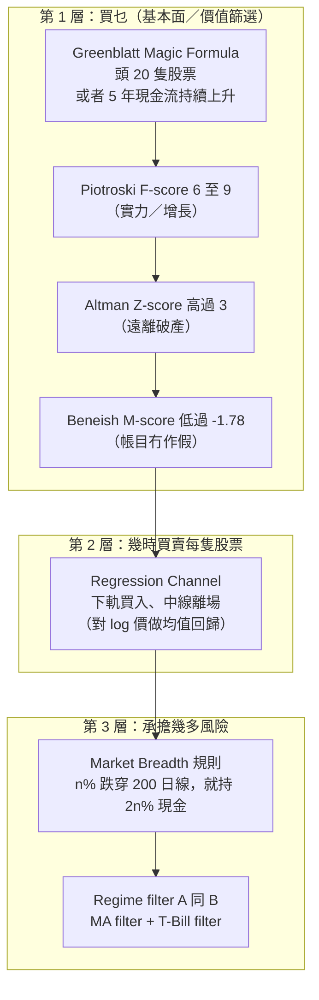

# APS1051：Session 5 溫書筆記（廣東話版）
**科目：** APS1051: Portfolio Management under Real Market Constraints
**學校：** University of Toronto | Master of Engineering (ELITE)
**導師：** Sabatino Costanzo & Loren Trigo
**今堂主題：** **五大策略之第二個**：用基本面分數揀 *Value* 股票，用 **Regression Channel** 交易，再加上 **Market Breadth / Regime** 風險管理層（即係將 LTCM 嘅教訓寫成規則）。

**參考資料**
* `S5A`：`YYYYY0 SESSION 5 README FIRST R (1).docx`
* `S5A`：`PPP1 ROBUST FUNDAMENTAL ANALYSIS METHOD FOR STOCK SELECTION.pptx`（92 張 slide）+ 評論
* `S5A`：`PPP2 ENTERING & EXITING TRADES WITH THE REGRESSION CHANNEL.pptx`（28 張）+ 評論
* `S5A`：`PPP3 MARKET BREADTH AND REGIME RISK MANAGEMENT SYSTEMS.pptx`（8 張）+ 評論
* `S5A`：`REGRESSION CHANNEL PROGRAM SIMPLE` 同 `... W REG`（連評論 PDF）
* `S5D`：`HOMEWORK SESSION 5`（README FIRST (HOMEWORK).docx、Dow Jones 財務數據 zip、`RegressionChannelSimple.py/.xlsx`、`RegressionChannelWReg.py`）、`BONUS1 GRAHAM BUFFETT & VALUE INVESTMENT.docx`、`BONUS2 WhatIsATradingSystem`、`BONUS3 RegressionChannelClassic`

> **記號說明：** 公式用純文字，冇 LaTeX。如果原 slide 啲公式只係圖片，我會寫返標準公開定義，並標明 **(標準定義)**。

---

## 0. 一頁睇晒大圖

策略 #1（Modified Markowitz / Momentum，Session 2 同 3）靠分散投資做**被動**風險控制。策略 #2 係一部**三層機器**，有**主動**風險控制：

**點解要咁設計？** 好公司可以橫行幾年；乾等佢升浪好慢。Channel 令我哋可以**交易呢啲好股票嘅上落波動**。而 LTCM 教咗我哋模型會突然失靈，所以要加一層**戰術性（tactical）**嘅保護，市況轉差就轉去現金。

**功課提示：** 今堂功課好重要，所以今次**冇另外嘅 session exercises**。

---

## 1. PPP 1：穩健嘅基本面分析揀股方法

### 1.1 篩選漏斗（slide 3-7）
| 步驟 | 篩選條件 | 原因 |
| :--- | :--- | :--- |
| 1 | Greenblatt screener（magicformulainvesting.com）揀**頭 20 隻**，*或者*揀**現金流（CFO）連續 5 年上升**嘅股票 | 基本上好、相對細、相對平 |
| 2 | **Piotroski F-score 喺 6 至 9** | 增長真係會發生 |
| 3 | **Altman Z-score 高過 3** | 增長可持續；破產風險低 |
| 4 | **Beneish M-score 低過 -1.78** | 帳目冇被操縱 |
| 5 | 投資剩低嘅股票；Greenblatt 建議揸 **1 年**，然後每年重做（一般投資者揸 20-30 隻） | |

> **Slide 前後唔一致，要記住：** slide 15 話「F-score 高過 8 先投資」，但漏斗（slide 4）係 **6 至 9**。Slide 49 話 **7-9 = 好、0-2 = 弱**。功課入面用「好」分數；Dow Jones 數據庫有 F、Z、M 歷史，令大公司都有機會入選。

### 1.2 點解睇經營現金流（CFO）？（S5-PPP2 slide 2，Brethauer 引文）
* 純利／EPS 只係公司賺到嘅一部分，仲可以受會計處理（折舊、營運資金變動）影響。
* **CFO = 盈利扣除折舊同營運資金變動之後**嘅數；係「老實版」盈利，亦係公司用嚟擴張嘅錢。
* Slide 嘅講法：**連續至少 5 年每年上升 CFO** 嘅股票，歷史上長期跑贏指數。現金質素勝過故事質素。

### 1.3 Greenblatt Magic Formula（slide 12-40）
* Joel Greenblatt：對沖基金經理兼 Columbia 兼任教授；著作 *The Little Book That Beats the Market*（2006）。
* **你要兩樣嘢：** (1) **平嘅價錢**，同 (2) **好嘅生意**。
  * **Earnings yield（盈利收益率）** = EBIT / Enterprise Value（即係 P/E 嘅倒數；愈平愈高）**(標準定義)**
  * **Return on Capital (ROC)** = EBIT / (Net Working Capital + Net Fixed Assets) **(標準定義)**
* **做法：** 全部股票按 earnings yield 排名，再按 ROC 排名，**兩個名次加埋**，買合併名次最低（最好）嘅股票。結果就係用低過平均嘅價錢買高過平均嘅公司。
* Slide 入面嘅證據同警告：
  * Greenblatt 聲稱年回報 >30%；獨立回測結果較低，但普遍認為扣除成本同稅之後都跑贏市場。
  * **警告 1：** 平嘅股票可以平好耐（例如 Microsoft 喺 screen 上面企咗幾年）。
  * **警告 2：** 有啲股票喺被推介嗰陣其實唔適合投資（例如 Dell 當時私有化爭議）。
  * 市值下限可以低至 $5,000 萬，但要小心**細價、流動性差嘅股票**（呢個正係*真實市場限制*！）。名單可以由 30 隻擴到 50 隻。
* 哲學連繫：買好嘅賺錢公司、價錢平，就係 **Buffett** 做咗幾十年嘅嘢；Greenblatt 將佢**系統化**。

### 1.4 Piotroski F-score（slide 42-59）
* Joseph Piotroski（Stanford），2000 年論文 *Value Investing: The Use of Historical Financial Information to Separate Winners from Losers*。由**低市帳率（P/B 低，即 book-to-market 高）**股票出發，分開贏家同輸家。據報 1976-1996 年平均年增約 **23%**。
* **9 條是非題，每條 1 分**，按年同比較（最高 9 分）：

| 類別 | 準則（slide 48） | 得分條件（標準定義） |
| :--- | :--- | :--- |
| 盈利能力 | 1. Return on Assets | ROA > 0 |
| | 2. 經營現金流 | CFO > 0 |
| | 3. ROA 上升 | 今年 ROA > 舊年 |
| | 4. 現金流 > ROA（應計項目） | CFO / 資產 > ROA |
| 槓桿／流動性 | 5. 長期負債對資產 | 比率**下降** |
| | 6. 流動性上升 | 流動比率**上升** |
| | 7. 攤薄 | **冇發行新股** |
| 營運效率 | 8. 毛利率 | 毛利率**上升** |
| | 9. 資產周轉率 | 周轉率**上升** |

* **解讀：** 7-9 好（強），0-2 弱。

### 1.5 Altman Z-score（slide 60-78）
* Edward Altman（NYU），1960 年代尾：將**五個**比率濃縮成一個破產風險分數。
* 公式 **(標準定義)**：`Z = 1.2*(WC/TA) + 1.4*(RE/TA) + 3.3*(EBIT/TA) + 0.6*(ME/TL) + 1.0*(Sales/TA)`

| 比率 | 話你知乜（slide 68-72） |
| :--- | :--- |
| WC/TA（營運資金／總資產） | 營運資金為負 = 短期債務有問題 |
| RE/TA（留存盈利／總資產） | 高 = 有盈利歷史，捱得過虧損年；低 = 靠借貸融資 |
| EBIT/TA | 一種 ROA：未計利息同稅前，由資產榨出利潤嘅能力 |
| ME/TL（股本市值／總負債） | 市值最多跌幾多先會令負債多過資產；市場信心 |
| Sales/TA | 資產效率、競爭力；下降 = 失去市場份額 |

* **區間：** Z **> 3** 唔易破產（我哋嘅要求）；**1.8 至 3** 灰色地帶；**< 1.8** 行緊向破產。
* **WorldCom 測試：** Z 喺 2000-2001 年由灰色地帶跌入危險區，之後 2002 年破產（投資者損失約 $1,000 億），*就算管理層虛報盈利*。虛增資產會令五個比率入面三個縮細，所以做假帳通常令 Z 向**下**，咁就好難呃到 Z。

### 1.6 Beneish M-score（slide 79-92）
* Messod Beneish：偵測**盈利操縱**（做假帳），同 Altman 相似，但係針對欺詐優化。用 1982-1992 Compustat 數據建立。
* **八個指數：** DSRI（應收帳款天數指數：虛報收入）、GMI（毛利率指數：> 1 即惡化）、AQI（資產質素）、SGI（銷售增長：有壓力維持表面風光）、DEPI（折舊：> 1 即折舊放慢，有利收入）、SGAI（銷售及行政開支）、LVGI（槓桿 > 1 即負債增加）、TATA（總應計項目／總資產）。
* **8 變數公式（slide 91）：**
  `M = -4.84 + 0.920*DSRI + 0.528*GMI + 0.404*AQI + 0.892*SGI + 0.115*DEPI - 0.172*SGAI + 4.679*TATA - 0.327*LVGI`
* **判斷規則：** M **> -1.78** 即好可能係操縱者；所以我哋**要求 M < -1.78**（愈負愈乾淨）。樣本外測試：抓到 **76%** 操縱者，誤判 **17.5%** 非操縱者。
* 5 變數版本（slide 92）：`M = -6.065 + 0.823*DSRI + 0.906*GMI + 0.593*AQI + 0.717*SGI + 0.107*DEPI`。Slide 文字話排除「SGAI、DEPI 同 LEVI」，但公式其實保留 DEPI、剔走 SGAI、LVGI 同 TATA，所以 slide 文字睇落係筆誤。

### 1.7 喺邊度揾到呢啲分數（實用）
* Greenblatt 頭 20 名：magicformulainvesting.com（免費、每日更新）。
* 而家嘅 F、Z、M 分數：GuruFocus（股票頁面，「definitions」）。
* **功課：** 壓縮咗嘅 **Dow Jones 30 財務數據庫**，包含 10 年 Piotroski、Altman、Beneish 同 CFO。

> **我嘅直覺：** F-score 問「呢間公司係咪愈嚟愈*健康*？」，Z-score 問「佢會唔會*生存*到？」，M-score 問「啲數字*信唔信得過*？」三種唔同嘅失敗模式，三個唔同嘅 filter。每個 filter 都唔完美，但三個交集乾淨好多，勝過任何單一比率。

---

## 2. PPP 2：用 Regression Channel 入市同離場

### 2.1 背後嘅統計
* 股票**回報**大致常態；股**價**大致 **log-normal**。靠近平均值嘅觀察值，遠多過第 1 或第 2 個標準差「圍欄」之外。
* 經驗法則（適用於鐘形數據）：約 **68%** 喺 1 sd 內、**95%** 喺 2 sd 內、**99.7%** 喺 3 sd 內。
* 所以價格觸到 2-sd 邊緣只係約 5% 時間，而下一步最可能係**返入 band 內**：**均值回歸**。呢個就係 Session 4 講嘅 **statistical arbitrage** 嘅實際意思。
* **交易規則（slide 12）：**
  * 價格觸到 95% band **上緣**：**沽**（預期向中心跌，甚至去到下緣）。
  * 價格觸到**下緣**：**買**（預期向中心升，甚至更高）。
* **交易定投資？** 視乎時間框架：日線／週線嘅 long 倉可以持**幾個月**；日內就只係幾個鐘。沽出只係**暫時**：避免跟住市場跌，等股票再升就**重新買入**。目標：**盡量保守咁壓低波動、最大化資本增值**。

### 2.2 多時間框架睇法（slide 20-26）
同時睇四個框架：**1 年週線**、**3 個月日線**、**90 日小時線**、**10 日 15 分鐘線**。
* 對沖 ETF SDS：15 分鐘、日線、週線都觸 2-sd 上緣，小時線觸 1-sd 上緣：所有框架都撞到阻力，價格可能會跌。
* SPY 同 IHE ETF：所有框架都貼近下緣，準備上升。
* Lockheed Martin：只有 15 分鐘線反彈，較高框架貼近中線，所以應該係慢慢向上（跟 regression line 嘅斜率）。
* **原則：** 愈多框架一致，訊號愈強。

### 2.3 教學版程式：`RegressionChannelSimple`（評論 PDF）
**均值回歸詞彙**
* **Stationary（平穩）** 序列嘅平均值、方差等隨時間不變，所以均值回歸交易行得通。
* **Long** = 買；**short** = 借嚟沽；**neutralize（中和）** = 反向交易平倉。
* 我哋用**價格嘅 log**（log-normal 變常態）同滾動平均、滾動標準差：**Bollinger bands** = MA、MA + k*sd、MA - k*sd。
* **Z-score** = (log 價格 - 滾動平均) / 滾動標準差。

**規則**
* z <= -entryZscore 就 long；z >= +entryZscore 就 short（只限 shorts = 1）；z 返到 exitZscore（中線，0）就**離場**。
* 價格分佈可以係雙峰（有兩個平均值）；呢種情況用較嚴格嘅 Chebyshev 界限（**任何形狀至少 75% 喺 2 sd 內**）。課程為咗簡單，用簡單版。

**教學例子嘅參數**
| 參數 | 意思 | 教學值 |
| :--- | :--- | :--- |
| `entryZscore` | channel 闊度（sd 數）；一定要 z-score **去得到**，否則系統永遠唔買賣 | 0.5（交易較頻密） |
| `exitZscore` | 幾時平倉 | 中線 |
| `window` | 計平均值同 sd 嘅回望期；呢個策略短啲好 | 3 星期（15 日） |
| `shorts` | 容唔容許沽空（1）定唔容許（0） | 0 |
| `delay` | 1 = 即時執行，2 = 等一日 | 1 |
| `tcost` | 交易成本 | 0（之後記得要改返貼近現實！） |

**任何回測程式嘅 7 個組件**（slide 8）：
1. 下載同預處理數據 → 2. 訊號工程 → 3. 交易規則 → 4. **Stance**（持有淨單位）→ 5. Equity curve → 6. 第一層指標（年回報、CAGR、Sharpe、drawdown）→ 7. **第二層指標**：統計顯著性（**White's Reality Check**）。

**數據細節：** *Adjusted close*（已調整股息、拆股）會令成段歷史被**重寫**；用 *close* 計訊號、用 *adjusted close* 計利潤較啱。課程為咗簡單，淨係用一個序列（adjusted）。**現實入面要留意。**

**表現指標**（純文字公式）
| 指標 | 公式 | 備註 |
| :--- | :--- | :--- |
| 年回報 | `(End/Start - 1) / 年數`（單利、線性） | 直觀 |
| **CAGR** | `(End/Start)^(1/年數) - 1` | 複利；策略最常用 |
| **Sharpe**（課程版） | `mean(策略回報) / std(策略回報) * sqrt(252)` | 日數據；月數據用 12 |
| 最大回撤 | 最大嘅高位到低位虧損 | 下行風險 |
| Calmar | 年複合回報 / 最大回撤 | 供參考 |
| White's Reality Check p 值 | 要 **p <= 0.10** | 否則好回報可能係靠運 |

* Python 用**百分比**回報（評論入面有 log 版本）。Excel 版本一樣，但用 **360 日**一年，所以結果有少少出入。
* 提示：用 Spyder 行（有 variable explorer）。

### 2.4 功能版程式：`RegressionChannelWReg.py`
比教學版升級嘅地方：
* **Channel 中心 = 滾動回歸**（`regression = 1`）而唔係移動平均：貼價更緊、滯後更少。
* 額外**風險控制開關**（每個都係**以犧牲利潤**換少啲風險）：

| 參數 | 作用 |
| :--- | :--- |
| `symbol` | Demo：IYE（iShares 美國能源 ETF）：好波動，所以用闊 gauge |
| `entryZScore = 2` | 兩邊各 2 sd（約 95% 喺入面，約 5% 觸發）。愈低 = 愈進取，但價格一定要真係去到 |
| `exitZscore = 0` | 喺中線離場 |
| `window = 40` | 回歸**同** std 嘅回望期（約 2 個月；40 係最少，避免 std 亂跳） |
| `shorts = 0` | 沽空風險高；做完均值回歸測試先開 |
| `regression = 1` | 用滾動回歸做中心 |
| `complex_entrance = 0` | 淨係喺價格剛剛**向中心方向**穿越邊界先入市（入市次數少咗但質素高啲） |
| `forbidden = 0` | 超出入市 band 多過 1 sd 就唔開倉（或者例如價格低於 200 日線） |
| `delay = 1` | 執行延遲；真實執行要用日內數據 |
| `log_price = 1` | 用 log 價錢計（Z-value 假設常態） |
| `tcost` | 交易成本（demo 設為 0） |

* **對稱簡化：** Band 圍住平均值對稱，但現實價格跌得比升得急，所以下軌「應該」拉闊啲。
* **沽空測試（之後課程會教）：** **variance ratio (vratio)**：< 1（唔好太近 1）同 p < 0.05 表示有均值回歸；**half-life（半衰期）**：等待時間 ≈ 2 × half-life；half-life 短先適合沽空；回望期用 half-life 嘅細倍數。而家**保持 shorts = 0**。
* 輸出：`Results/dfP.csv`（equity curve 喺相當於 Excel「AA」嘅一欄），加 White's Reality Check p 值。

---

## 3. PPP 3：Market Breadth 同 Regime 風險管理

**背景：** LTCM 之後，每個策略都要有風險系統。呢啲係**戰術性（tactical）**系統：佢哋**反應**（價格轉勢就轉去現金），唔係**預測**。**策略性（strategic）**系統先會預測（之後幾堂）：**Altman Market Crash Indicator**（「煤礦中嘅金絲雀」）同**指數期權對沖**（投資組合保險）。

### 3.1 基本版：Market Breadth 規則（slide 1-3）
* 「如果組合入面 **n%** 嘅股票「喺水下」（每隻都低過**自己嘅 200 日線**），就持有 **2n%** 嘅資金做**現金**。」
* 例子：25% 喺水下 → 50% 現金（餘下嘅平均分配畀其餘股票）；**50% 喺水下 → 100% 現金**。
* Breadth = 睇**有幾多隻**成份股健康，唔係淨係睇指數。

### 3.2 進階版：每隻資產兩個風險 filter（slide 4-6）
* **Filter A：** 價格**高過 12 個月 MA**（12 個月 = 52 週 = 約 200 個交易日）。否則留喺現金。
* **Filter B（regime）：** 資產嘅表現**高過 T-Bill 嘅 12 個月回報**。*（Slide 字面寫「price exceeds the return of the T-Bill」；我理解為資產 12 個月回報 vs T-bill 12 個月回報，即係 absolute momentum。值得同導師確認。）*

| Filter A | Filter B | 投資落資產 | 現金 |
| :--- | :--- | :--- | :--- |
| 綠 | 綠 | **100%** | 0% |
| 綠 | 紅 | 50% | 50% |
| 紅 | 綠 | 50% | 50% |
| 紅 | 紅 | **0%** | 100% |

* 當配置準則（例如 channel 訊號）畀出「買」訊號之後，先用 A 同 B 去決定買幾多。
* 呢個原始模型 10 年回測：對一個咁簡單嘅系統嚟講，equity curve 好令人驚喜。
* **功課選做步驟（10）：** 如果股票低過 12 個月（200 日）MA，就將佢嘅配額擺落現金（例如 **SHY** ETF）；否則投資。另一做法：用 T-bill 回報做 regime 基準，或者砌**試算表**版本。

> **我嘅直覺：** 呢個係 LTCM 式「佢遲早會收斂，等就得」嘅解藥。呢條規則*唔同市場爭論*：如果夠多股票趨勢向下，就直接轉現金，接受來回被洗嘅成本，換取捱得過崩盤。

---

## 4. 功課 5：逐步流程

**目標：** 揀、校準、測試同做風險管理一個細型價值投資組合。

| 步驟 | 動作 |
| :--- | :--- |
| 1 | 搵 Dow Jones 財務數據庫同 `RegressionChannelSingleAssetPrograms` 資料夾 |
| 2 | 揀 **3-5 隻 Dow 股票**，Piotroski、Altman、Beneish 分數要好，可能嘅話 CFO 連續 5 年上升 |
| 3 | 由 Yahoo 下載 5-6 年日數據；分成約 **60% 訓練 / 40% 測試** |
| 4-5 | 餵**訓練**數據；調 `lookback` 同 `entryZscore` 直到 equity curve 好（Sharpe 近 **1**）：即**校準（calibration）** |
| 6-7 | 用同樣參數行**測試**數據。如果測試 Sharpe 同訓練 Sharpe 相差唔遠，就**保留呢隻股票 + 參數**（樣本外檢查，防 overfitting） |
| 8-9 | 每隻股票分開按訊號交易 |
| 10 | （選做）加 200 日線／T-bill regime filter，或者做試算表版 |
| 11 | 每隻股票重複 |
| 12 | **報告：** 絕對回報、Sharpe ratio、**Jensen's alpha**、equity curve（各股 equity curve 嘅平均） |

**README 建議日期：** 訓練 `2015-01-01` 至 `2018-01-01`；測試 `2018-01-01` 至 `2020-01-01`。優化 `entryZscore` 同回望期（回望期可以好短或好長：因為呢個程式冇最細化組合方差，所以 std 亂跳都冇所謂）。Equity curve 喺 `Results/dfP.csv`「AA」一欄；組合曲線 = 各股曲線嘅**平均**（同高度、同日期）。

**導師建議嘅學習次序：** `RegressionChannelSimple.pptx` + guide → 對比 `.py` 同 `.xlsx` → 然後 `RegressionChannelWReg.pptx` + guide → 行 `RegressionChannelWReg.py`。

**要小心嘅陷阱**
* **Overfitting：** 訓練 Sharpe 好冇意義，除非有測試數據驗證。White's Reality Check 係正式工具（之後會講）。
* `entryZscore` 設得比 z-score 永遠去唔到嘅位更高 → **完全冇交易**。
* 忽略交易成本、滑價同執行延遲（demo 全部設為零）會灌水結果。
* Jensen's alpha 同 Sharpe 要有基準同無風險利率：要清楚講明你用邊個。

---

## 5. 策略嘅源頭：Graham 同 Buffett（Bonus 1）

| 概念 | Graham | Buffett（演變） |
| :--- | :--- | :--- |
| 點睇股票 | **企業嘅擁有權**，唔係一個代號 | 一樣 |
| 核心概念 | **安全邊際（margin of safety）**：以明顯折讓買入 | 保留 |
| 量化測試 | Net-Net（現金 + 保守計算嘅應收／存貨 - 全部負債 > 市值）；7 個防守型準則（規模、財務穩健：流動比率 >= 2、10 年盈利為正、20 年派息、10 年增長 33%、P/E <= 15、P/B <= 1.5）；後期簡化版「30 隻 P/E < 10 同 D/E < 50% 嘅股票，升 50% 或 2 年後沽」（約 15%/年） | 肯為**質素**付出代價，要有**護城河（moat）**（「永遠」持有） |
| 護城河框架 | | Porter 五力；Morningstar：網絡效應、無形資產、成本優勢、轉換成本、有效規模 |
| 回報 | Graham-Newman 約 20%/年（1936-56） | S&P +11,355% vs Berkshire +1,600,000%（1965-2015） |
| 均值回歸 | 過去輸家變將來贏家：**同 regression channel 同一個引擎** | |

* **Buffett 謎題嘅答案（README）：** 方法既係量化，亦有判斷：Graham 嘅紀律（安全邊際、財務比率）+ Buffett 對護城河嘅定性評估。
* **同課程嘅連繫：** Greenblatt/Piotroski/Altman/Beneish = Graham 資產負債表紀律嘅量化版；regression channel = 均值回歸；breadth/regime = 生存教訓（篇文講 2008 年金融危機：買樓 5:1 leverage、銀行 30:1 或以上，同沉咗 LTCM 嘅比率一樣；而 Buffett 因為自己冇過度借貸，所以可以冷靜注資 Goldman 同 GE Capital）。

---

## 6. 連繫、陷阱同溫習

**S4 同 S5 點樣連埋一齊**
| S4 教訓（LTCM） | S5 回應 |
| :--- | :--- |
| 相關性唔係常數 | 用**個別股票**訊號同 **breadth** 規則，唔好靠相關矩陣 |
| Leverage 放大虧損 | Long-only、冇 leverage 嘅股票；市況轉差就有現金緩衝 |
| 流動性差／擠迫倉位 | 小心 Greenblatt 入面細價、流動性差嘅股；揀大型 Dow 股票 |
| 需要 stress test／及早離場 | 戰術 filter A 同 B +（之後）崩盤指標同期權對沖 |
| 收斂可能比你撐得住嘅時間更耐 | 離場規則同 regime filter 限制你喺長期發散中硬撐 |

**常見陷阱**
* 將分數當成**預測**：佢哋係提高勝算嘅 **filter**。
* 將 200 日線規則用喺*指數*，而唔係逐隻股票數（breadth）。
* 搞亂 **entryZscore**（幾時入）同 **exitZscore**（幾時走）。
* 以為訓練數據嘅 Sharpe 就係策略質素：只有**測試** Sharpe 先重要。

## 7. 速溫卡

* 漏斗：Greenblatt 頭 20 → F 喺 6-9 → Z > 3 → M < -1.78 → 揸 1 年。
* F：9 條是非題。Z：權重 1.2、1.4、3.3、0.6、1.0；> 3 安全、< 1.8 危險。M：8 個指數；> -1.78 可疑。
* Channel：log 價、滾動平均 ± k·sd；-k 買、中線走；k = 2 即 95% 規則。
* 指標：CAGR = (End/Start)^(1/年數) - 1；Sharpe = mean/std × sqrt(252)；White's p ≤ 0.10。
* Breadth：n% 低過 200 日線 → 2n% 現金。Filter A 同 B → 100 / 50 / 50 / 0。
* 戰術 = 反應；策略性（之後會教）= 預測。
