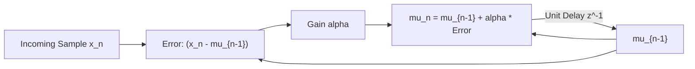
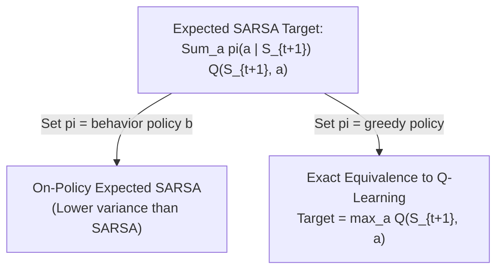

# APS1080: Intro to Reinforcement Learning
# Lecture 4 Study Notes: Temporal-Difference (TD) Learning
**Textbook Reference**: Sutton & Barto (2020), Chapter 6  
**Course Schedule**: Lecture 4 (Sept 30)  
**Code Reference**: [`chapter06/cliff_walking.py`](file:///C:/Users/hklov/Local/UToronto/aps1080/chapter06/cliff_walking.py), [`chapter06/random_walk.py`](file:///C:/Users/hklov/Local/UToronto/aps1080/chapter06/random_walk.py), [`chapter06/windy_grid_world.py`](file:///C:/Users/hklov/Local/UToronto/aps1080/chapter06/windy_grid_world.py)

> [!IMPORTANT]
> **Test 1 Syllabus Scope (`study_outline_test_1.md`)**:
> - **Chapter 6**: Read **ALL of Chapter 6 EXCEPT Sections 6.3, 6.7, and 6.8** ("skip 6.3, 6.7, 6.8").
>   - *Excluded*: 6.3 Batch TD vs. MC, 6.7 Maximization Bias & Double Q-Learning, 6.8 Games and Afterstates.
> - **Examinable Scope**: 6.1 TD Prediction (TD(0)), 6.2 Advantages of TD, 6.4 Sarsa: On-Policy TD Control, 6.5 Q-Learning: Off-Policy TD Control, 6.6 Expected Sarsa.
> - **Mandatory Professor Additions**: Non-stationary tracking via first-order IIR/EWMA low-pass filtering (Equations 4.1–4.2), mobile robot self-damage paradox, online MC to TD(0) bootstrapping across Q-table rows (Equations 4.3–4.6), Sarsa $\epsilon = 1/t$ schedule, Q-learning as fanatically-optimal policy, and Expected Sarsa variance elimination.

---

## 1. Motivation: Why Relax Episodic Knowledge? (Outline Section IV)

Up to this point, Monte Carlo methods relaxed the need for an environment model ($p(s', r \mid s, a)$). However, Monte Carlo introduced a severe limitation: **the absolute requirement for episodic knowledge**.

### 1.1 The Pitfalls of Requiring Full Episodes
1. **Real-Time Performance**: Waiting until an entire episode concludes before performing any update violates real-time control constraints in embedded or online systems.
2. **Artificial Horizon Cutoffs**: It sensitizes the agent designer to arbitrary heuristics about how long an episode should be allowed to run.
3. **Inapplicable to Continuing Tasks**: Tasks without a natural terminal state cannot be handled by standard Monte Carlo.
4. **The Mobile Robot Self-Damage Paradox**:
   > *Professor's Core Thought Experiment*: Suppose we are designing an AI for a mobile robot. If the terminal state is one where the robot has damaged itself against a wall or obstacle, is a learning approach that requires us to reach the terminal state of being damaged really reasonable or practical?

---

## 2. From Stationary Averages to IIR / EWMA Low-Pass Filters

In Chapter 2 and Lecture 4, we examine how the mathematical formulation of an average dictates an agent's ability to operate in real-world, non-stationary environments.

### 2.1 Stationary Sample Average (Outline Eq 4.1)
For an observed reward sequence $\{x_i\}_{i=1}^n$, the incremental sample average is:
$$\mu_n = \mu_{n-1} + \frac{1}{n}(x_n - \mu_{n-1})$$
* **The Stationarity Trap**: This formulation weights every historical observation equally with weight $\frac{1}{n}$. It is mathematically meaningful **only if the environment is strictly stationary** (statistics never drift).

### 2.2 Tracking Non-Stationary Environments: Constant Step-Size $\alpha$ (Outline Eq 4.2)
To handle non-stationary environments, we bias our average in favor of recent history using a constant parameter $\alpha \in (0, 1]$:
$$\mu_n = \mu_{n-1} + \alpha (x_n - \mu_{n-1})$$



* **Systems Engineering / DSP Interpretation**:
  This update is a discrete-time **first-order Infinite Impulse Response (IIR) low-pass filter**, commonly known as an **Exponentially Weighted Moving Average (EWMA) filter**.
  - **Extreme $\alpha = 1$**: $\mu_n = x_n$. The filter has zero memory; the estimate is identical to the latest sample.
  - **As $\alpha$ decreases ($0 < \alpha < 1$)**: The filter opens a wider window into past history, attenuating high-frequency noise while smoothly tracking drifting underlying means.

---

## 3. The Genesis of TD(0): Relaxing Episodic Knowledge (Outline Eqs 4.3–4.6)

### 3.1 Step 1: Upgrading Online Monte Carlo for Non-Stationarity
In an online Monte Carlo setting, the sample average update:
$$Q(S_t, A_t) \leftarrow Q(S_t, A_t) + \frac{1}{N(S_t)} \left[ G_t - Q(S_t, A_t) \right] \quad \text{(Outline Eq 4.3)}$$
is trivially updated for non-stationary environments using constant $\alpha$:
$$Q(S_t, A_t) \leftarrow Q(S_t, A_t) + \alpha \left[ G_t - Q(S_t, A_t) \right] \quad \text{(Outline Eq 4.4)}$$

### 3.2 Step 2: Bootstrapping to Eliminate the Need for $G_t$
The requirement for episodes arises entirely because we are estimating returns $G_t$ by sampling the full trajectory $\{R_i\}$. However, via the Bellman recursive identity:
$$G_t \approx R_{t+1} + \gamma V(S_{t+1}) \quad \text{or} \quad R_{t+1} + \gamma Q(S_{t+1}, A_{t+1}) \quad \text{(Outline Eq 4.5)}$$

Substituting this one-step approximation into Eq (4.4) produces the **TD(0) update rule**:
$$Q(S_t, A_t) \leftarrow Q(S_t, A_t) + \alpha \left[ R_{t+1} + \gamma Q(S_{t+1}, A_{t+1}) - Q(S_t, A_t) \right] \quad \text{(Outline Eq 4.6)}$$

### 3.3 Core Insights on TD(0):
1. **Bootstrapping across Table Rows**:
   We refine an estimate $Q(S_t, A_t)$ using another estimate $Q(S_{t+1}, A_{t+1})$. In tabular RL, these two quantities are stored in **different rows of our Q-table data structure**. Like Dynamic Programming, TD bootstraps; but unlike DP, it samples without a model.
2. **Temporal Difference**:
   There is a 1-step temporal difference between the time indices of the two estimates ($t$ and $t+1$), giving rise to the name **TD(0)**.
3. **The Five-Point "Take Stock" Synthesis**:
   - Relaxed the need for an environment model (model-free).
   - Incorporates exploratory actions (via $\epsilon$-soft policies).
   - Handles non-stationary environments (via constant $\alpha$ / EWMA filtering).
   - Does **NOT** require episodic knowledge (updates at every time step).
   - Formulations are strictly **online**.

> 💡 **粵語解構 (點解 TD 係全個 RL 最強神作？)**:  
> Professor 嘅思路清晰無比：  
> 1. 第一步：用 $\alpha$（EWMA 低通濾波器）取代 $\frac{1}{n}$，解決「世界會變動（Non-stationary）」嘅問題。  
> 2. 第二步：MC 每次都要等成局玩完先計到 $G_t$。如果撞車係 Terminal State，架車撞爛咗先學，一早就破產！  
> 3. 所以 TD 話：用下一格 Q-table row 嘅數值 $R_{t+1} + \gamma Q(S_{t+1}, A_{t+1})$ 嚟充當 $G_t$！每行一步就即刻 update！  
> 唔洗 Model、唔洗等成局完、線上即時學、仲識濾波雜音——呢個就係 TD(0) 稱霸 RL 嘅秘密！

---

## 4. SARSA: On-Policy TD Control (Textbook 6.4 & Outline 4.1)

SARSA is the direct application of TD(0) prediction to action-values using the 1-step transition sequence:
$$(S_t, A_t, R_{t+1}, S_{t+1}, A_{t+1})$$

### 4.1 Update Law
$$Q(S_t, A_t) \leftarrow Q(S_t, A_t) + \alpha \left[ R_{t+1} + \gamma Q(S_{t+1}, A_{t+1}) - Q(S_t, A_t) \right]$$

### 4.2 Exploration and the $\epsilon = 1/t$ Schedule
- For behavioral diversity / coverage, we require policy $\pi$ to be soft ($\epsilon > 0$).
- For optimal behavior, we require policy $\pi$ to become greedy as $t \to \infty$.
- **Convergence Guarantee Schedule**: By putting $\epsilon$ on a time-decay schedule:
  $$\epsilon_t = \frac{1}{t}$$
  SARSA satisfies the GLIE (Greedy in the Limit with Infinite Exploration) conditions, guaranteeing that $\pi \to \pi^*$ in the limit.

---

## 5. Q-Learning: Off-Policy TD Control (Textbook 6.5 & Outline 4.2)

### 5.1 The "Fanatically-Optimal Policy" Formulation
Q-learning (Watkins, 1989) updates $Q$ in a manner consistent with what a **"fanatically-optimal policy"** would do, rather than what the actual behavior policy did:
- A *fanatically-optimal policy* pursues the strict mathematical optimum by greedily choosing $\arg\max_a Q(S_{t+1}, a)$.
- In contrast, $\epsilon$-soft / $\epsilon$-greedy behavior policies are *not* fanatical because they deliberately permit exploratory, sub-optimal actions.

### 5.2 The Q-Learning Update Law
$$Q(S_t, A_t) \leftarrow Q(S_t, A_t) + \alpha \left[ R_{t+1} + \gamma \max_{a} Q(S_{t+1}, a) - Q(S_t, A_t) \right]$$

* **Off-Policy Decoupling**:
  - $(S_t, A_t)$ comes from the exploratory behavior policy.
  - $R_{t+1}$ and $S_{t+1}$ come from the environment.
  - The target action $a^*$ comes from the **optimal action according to $Q$**, not the current behavior policy!
* **Role of the Behavior Policy**:
  The sole role of the behavior policy during Q-learning is to **ensure adequate sampling of the state-action space $S \times A$** so that $Q$ is effectively approximated. Once $Q \approx q_*$, the optimal control policy is directly extracted via $\pi(s) = \arg\max_a Q(s, a)$.

---

## 6. Expected SARSA (Textbook 6.6 & Outline 4.3)

Expected SARSA is a major algorithmic improvement that bridges SARSA and Q-learning, supporting both on-policy and off-policy control.

### 6.1 Motivation: Eliminating Sampling Variance
- In standard SARSA, we update $Q(S_t, A_t)$ using a single sampled action $A_{t+1} \sim \pi(\cdot \mid S_{t+1})$. This sample introduces random fluctuations and variance into the update trajectory.
- In **Expected SARSA**, rather than waiting for $Q(S_t, A_t)$ to reach its expected value over time through noisy random sampling, **we compute the expected value directly in a single step**:

### 6.2 The Expected SARSA Update Law
$$Q(S_t, A_t) \leftarrow Q(S_t, A_t) + \alpha \left[ R_{t+1} + \gamma \sum_{a} \pi(a \mid S_{t+1}) Q(S_{t+1}, a) - Q(S_t, A_t) \right]$$

### 6.3 Key Properties & Comparison:
1. **Variance Elimination**:
   Computing $\mathbb{E}_\pi[Q(S_{t+1}, \cdot)] = \sum_a \pi(a \mid S_{t+1}) Q(S_{t+1}, a)$ eliminates the variance caused by the random selection of $A_{t+1}$ under $\pi$.
2. **On-Policy Performance**:
   Empirical evidence demonstrates that despite the slight additional computational expense of computing the expectation sum, **Expected SARSA consistently outperforms standard SARSA**.
3. **Off-Policy Generalization & Equivalence to Q-Learning**:
   - Expected SARSA can use an exploratory sampling behavior policy $b$ to generate transitions, while computing the expectation under an optimizing target control policy $\pi$.
   - **Theorem / Equivalence**: When the target policy $\pi$ is chosen to be the deterministic greedy policy ($\pi(a \mid S_{t+1}) = 1$ for $a = \arg\max_{a'} Q(S_{t+1}, a')$ and $0$ otherwise), the expectation reduces to:
     $$\sum_a \pi(a \mid S_{t+1}) Q(S_{t+1}, a) = \max_a Q(S_{t+1}, a)$$
     **Expected SARSA becomes mathematically identical to Q-Learning!**



> 💡 **粵語解構 (Expected SARSA：數學期望一步到位)**:  
> 普通 Sarsa 每次擲粒骰仔揀 $A_{t+1}$，因為粒骰仔有隨機性，所以學習曲線震盪得好犀利。  
> **Expected SARSA** 就聰明好多：佢話「我明明知自己粒骰仔每面出嘅機率係幾多（$\pi(a|s)$），點解仲要擲骰？我直接計個期望值出嚟，一步消除所有採樣方差（Variance）！」  
> 更加震撼嘅係：如果你將個目標策略設成 100% 貪婪（$\pi = \text{greedy}$），期望值就會自動變成 $\max_a Q$，Expected SARSA 即刻變身成為 Q-Learning！一個公式，包攬晒全部 TD Control！

---

## 7. Comparative Case Study: Cliff Walking (Textbook 6.5)

```text
[S] . . . . . . . . . . [G]
 C   C   C   C   C   C   C   (Cliff: Reward = -100, reset to S)
```

In the Cliff Walking environment ([`chapter06/cliff_walking.py`](file:///C:/Users/hklov/Local/UToronto/aps1080/chapter06/cliff_walking.py)):
- Step Reward: $-1$ per transition; Cliff Penalty: $-100$ and reset to start $[S]$.

### Behavioral Divergence Under $\epsilon = 0.1$:
1. **Q-Learning**:
   - Learns the **optimal path** (skirting right along the edge of the cliff).
   - *Online Performance*: Poor! Because it explores with $\epsilon = 0.1$, it occasionally falls off the cliff into the $-100$ abyss. Its online average reward is low (~$-45$).
2. **Sarsa**:
   - Learns the **safe path** (taking the long detour around the top of the grid).
   - *Online Performance*: Excellent! It accounts for its own exploratory nature ($\epsilon$), actively protecting itself from accidental falls. Its online average reward is much higher (~$-20$).
3. **If $\epsilon \to 0$**: Both converge to the exact same optimal edge path.

---

## 8. Summary Comparison of TD Control Methods

| Feature | Sarsa (On-Policy) | Q-Learning (Off-Policy) | Expected Sarsa |
| :--- | :--- | :--- | :--- |
| **Backup Target** | $R_{t+1} + \gamma Q(S_{t+1}, A_{t+1})$ | $R_{t+1} + \gamma \max_a Q(S_{t+1}, a)$ | $R_{t+1} + \gamma \sum_a \pi(a \mid S_{t+1}) Q(S_{t+1}, a)$ |
| **Target Policy** | Behavior policy $\pi$ ($\epsilon$-soft) | Greedy policy $\arg\max_a Q$ ("fanatic") | Any policy $\pi$ (on or off policy) |
| **Sampling Variance** | Moderate to High (from $A_{t+1}$) | Moderate | **Lowest** (expectation over $a$) |
| **Safety in Cliff Walking** | Safe path (considers exploration) | Risky optimal path (ignores exploration) | Configurable by target $\pi$ |
| **Computational Cost** | Lowest ($O(1)$) | Fast ($O(|\mathcal{A}|)$ for max) | Moderate ($O(|\mathcal{A}|)$ for sum) |

---

## 9. Non-Examinable Supplemental Sections (Per `study_outline_test_1.md`)

> [!NOTE]
> *Per the official Test 1 Study Outline, textbook sections 6.3, 6.7, and 6.8 are explicitly excluded from the exam.*
> - **Section 6.3 (Batch TD vs. Batch MC)**: Shows Batch TD converges to the certainty-equivalence estimate (maximum likelihood Markov model), whereas Batch MC minimizes sample MSE.
> - **Section 6.7 (Maximization Bias & Double Q-Learning)**: Solves the positive bias $\mathbb{E}[\max Q] \ge \max \mathbb{E}[Q]$ by decoupling selection ($Q_1$) from evaluation ($Q_2$).
> - **Section 6.8 (Games, Afterstates, and Other Summary Examples)**: Evaluates state transitions after an agent's move in two-player games.
