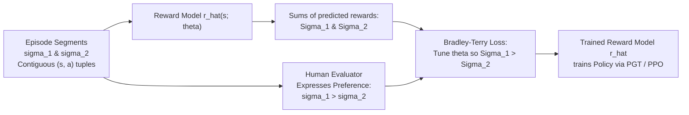

# APS1080: Intro to Reinforcement Learning
# Test 1 Master Study Notes & Comprehensive Exam Review
**Course**: APS1080 – Intro to Reinforcement Learning (University of Toronto)  
**Primary Reference**: Sutton & Barto (2020), *Reinforcement Learning: An Introduction* (2nd Ed.)  
**Official Syllabus Scope**: `study_outline_test_1.md` (Lectures 1 to 6)  
**Format**: High-Yield Theoretical Rigor + Deep Engineering Intuition (**粵語解構 Cantonese Insights**)

---

## Master Table of Contents
1. [Official Test 1 Scope, Reading Guide & Exclusions](#1-official-test-1-scope-reading-guide--exclusions)
2. [Module 1: Foundations, Bandits & Finite MDPs (L01 — Ch 1, 2.4–2.5, Ch 3)](#2-module-1-foundations-bandits--finite-mdps-l01--ch-1-2425-ch-3)
3. [Module 2: Dynamic Programming & Generalized Policy Iteration (L02 — Ch 4)](#3-module-2-dynamic-programming--generalized-policy-iteration-l02--ch-4)
4. [Module 3: Monte Carlo Methods & Importance Sampling (L03 — Ch 5)](#4-module-3-monte-carlo-methods--importance-sampling-l03--ch-5)
5. [Module 4: Temporal-Difference Learning: TD(0), SARSA & Expected SARSA (L04 — Ch 6)](#5-module-4-temporal-difference-learning-td0-sarsa--expected-sarsa-l04--ch-6)
6. [Module 5: Prediction & Control with Function Approximation (L05 & L06 — Ch 9, 10, DQN)](#6-module-5-prediction--control-with-function-approximation-l05--l06--ch-9-10-dqn)
7. [Module 6: Policy Gradient & Human Preference Learning / RLHF (L05–L06 Scope — Ch 13 & Christiano et al.)](#7-module-6-policy-gradient--human-preference-learning--rlhf-l05l06-scope--ch-13--christiano-et-al)
8. [Module 7: Planning, MCTS & AlphaGo (L05–L06 Scope — Ch 8 & Section 16.6)](#8-module-7-planning-mcts--alphago-l05l06-scope--ch-8--section-166)
9. [Module 8: Master Formula Cheatsheet & High-Yield Exam Traps](#9-module-8-master-formula-cheatsheet--high-yield-exam-traps)

---

## 1. Official Test 1 Scope, Reading Guide & Exclusions

| Lecture | Core Topics Covered | Required Textbook Sections (`RLbook2020.pdf`) | Explicitly EXCLUDED Sections |
| :--- | :--- | :--- | :--- |
| **Lecture 1** | RL Paradigm, Evaluative Feedback, Incremental Tracking, Finite MDPs | **Ch 1** (all except 1.7)<br>**Ch 2** (skim intro; **read 2.4 & 2.5 ONLY**)<br>**Ch 3** (all of Ch 3) | **Section 1.7** (History)<br>**Sections 2.6–2.10** (UCB, Optimistic Init, Gradient Bandits are non-examinable context) |
| **Lecture 2** | Dynamic Programming (Policy Eval, Policy Improvement, PI, VI, GPI, DP Efficiency) | **Ch 4** (Sections 4.1, 4.2, 4.3, 4.4, 4.6, 4.7) | **Section 4.5** (Asynchronous Dynamic Programming) |
| **Lecture 3** | Monte Carlo Prediction, MC Control, On-Policy vs. Off-Policy, Importance Sampling | **Ch 5** (Sections 5.1, 5.2, 5.3, 5.4, 5.5, 5.6, 5.7) | **Sections 5.8 & 5.9** (Discounting-aware & Per-decision IS) |
| **Lecture 4** | Temporal-Difference Learning, TD(0), SARSA, Q-Learning, Expected SARSA | **Ch 6** (Sections 6.1, 6.2, 6.4, 6.5, 6.6) + **Professor's explicit lecture text** | **Sections 6.3, 6.7, 6.8** (Batch TD vs MC, Maximization Bias / Double Q, Afterstates) |
| **Lecture 5 & 6** | Function Approximation Prediction & Control, Deadly Triad, Deep Q-Networks (DQN) | **Ch 9** (9.1, 9.2, 9.3, 9.4, 9.7, 9.12)<br>**Ch 10** (10.1, 10.2)<br>**Ch 16.5** (cited as 15.6 in outline) + Mnih et al. | Sections 9.5, 9.6, 9.8–9.11, 10.3–10.6 |
| **L5–L6 Addition** | **Policy Gradient Methods & Human Preference Learning (RLHF)** | **Ch 13** (13.1, 13.2, 13.3) + Christiano et al. (2017) *Deep RL from Human Preferences* | Actor-Critic (13.5), Continuous PG (13.7) |
| **L5–L6 Addition** | **Model Learning, Planning & AlphaGo** | **Ch 8** (8.1, 8.2, 8.9/8.11, 8.10/8.12) + **Ch 16.6** (*AlphaGo*) | 8.3–8.8, 8.13 |

---

## 2. Module 1: Foundations, Bandits & Finite MDPs (L01 — Ch 1, 2.4–2.5, Ch 3)

### 2.1 The Reinforcement Learning Paradigm
Reinforcement learning models an active agent interacting with an uncertain environment to maximize cumulative scalar rewards.

| Machine Learning Paradigm | Nature of Feedback | Objective | Core Difficulty |
| :--- | :--- | :--- | :--- |
| **Supervised Learning** | *Instructive* (Ground-truth target $\mathbf{y}^*$ given by teacher) | Minimize prediction error on labeled data | Generalization to unseen inputs |
| **Unsupervised Learning** | *Unlabeled* (No external feedback signal) | Uncover geometric structure, density, clusters | Representation quality |
| **Reinforcement Learning** | *Evaluative* (Scalar reward score assessing chosen action) | Maximize cumulative discounted return $G_t$ | Credit assignment, exploration vs exploitation |

> 💡 **粵語解構 (Evaluative vs Instructive)**:  
> - **Instructive（指導性）**：教練直接話你知標準答案：「頭先嗰球波你應該反手抽擊！」  
> - **Evaluative（評價性）**：教練只係打個分數：「頭先嗰下得 2 分！」因為教練無講其他打法有幾多分，你**必須親自去試錯（Trial-and-Error）**，呢個就係 RL 存在 **Exploration vs Exploitation（探索與利用）** 兩難嘅根本原因！

### 2.2 Tracking Non-Stationary Processes: Constant $\alpha$ as an IIR / EWMA Filter (Outline Lines 39–48)
Let $R_n$ denote the reward received upon the $n$-th selection of an action.

#### 1. Stationary Case: Incremental Sample Average (Outline Eq 4.1)
$$\mu_n = \mu_{n-1} + \frac{1}{n}(x_n - \mu_{n-1})$$
* Treats all past historical samples equally with weight $\frac{1}{n}$.
* **Stationarity Requirement**: Meaningful *only* if the underlying process statistics never drift over time.

#### 2. Non-Stationary Case: Constant Step-Size $\alpha$ (Outline Eq 4.2)
$$\mu_n = \mu_{n-1} + \alpha(x_n - \mu_{n-1}) \quad \text{where } 0 < \alpha \le 1$$
Unrolling the recursion backwards to initial estimate $\mu_0$:
$$\mu_n = (1 - \alpha)^n \mu_0 + \sum_{i=1}^n \alpha (1 - \alpha)^{n-i} x_i$$

* **Systems Engineering / DSP Interpretation**:
  This equation is a discrete-time **first-order Infinite Impulse Response (IIR) low-pass filter**, also known as an **Exponentially Weighted Moving Average (EWMA) filter**.
  - **Extreme $\alpha = 1$**: $\mu_n = x_n$. The filter has zero memory; the estimate is identical to the latest sample.
  - **As $\alpha$ decreases ($0 < \alpha < 1$)**: The filter widens its memory window into the past, smoothing high-frequency noise while smoothly tracking drifting means.
* **Proof that Weights Sum to 1**:
  $$(1 - \alpha)^n + \sum_{i=1}^n \alpha (1 - \alpha)^{n-i} = (1 - \alpha)^n + \alpha \frac{1 - (1 - \alpha)^n}{1 - (1 - \alpha)} = (1 - \alpha)^n + 1 - (1 - \alpha)^n = 1 \quad \blacksquare$$

#### 3. Stochastic Approximation: Robbins-Monro Convergence Conditions
Convergence to the true mean with probability 1 requires:
1. $\sum_{n=1}^\infty \alpha_n = \infty$ (large enough to overcome any arbitrary initial conditions $\mu_0$).
2. $\sum_{n=1}^\infty \alpha_n^2 < \infty$ (small enough to guarantee eventual convergence without perpetual oscillation).
* **Sample average ($\alpha_n = 1/n$)**: Satisfies both ($\sum \frac{1}{n} = \infty, \sum \frac{1}{n^2} = \frac{\pi^2}{6} < \infty$). Converges in stationary settings.
* **Constant step-size ($\alpha_n = \alpha$)**: Fails condition 2 ($\sum \alpha^2 = \infty$). It never stops updating—**the exact desired property for tracking non-stationary environments!**

### 2.3 Finite Markov Decision Processes (MDPs - Chapter 3)
* **Agent-Environment Boundary**: Anything that cannot be changed arbitrarily by the agent is considered part of the environment (e.g., motor voltages, hardware limits, battery level).
* **Markov Property**: The future is conditionally independent of the past given the present:
  $$\Pr(S_{t+1}=s', R_{t+1}=r \mid S_t=s, A_t=a, S_{t-1}=s_{t-1}, \dots, S_0=s_0) = p(s', r \mid s, a)$$
* **Returns & Discounting**:
  $$G_t \doteq R_{t+1} + \gamma R_{t+2} + \gamma^2 R_{t+3} + \dots = \sum_{k=0}^\infty \gamma^k R_{t+k+1} = R_{t+1} + \gamma G_{t+1}$$
  - $\gamma = 0$: Purely myopic ($G_t = R_{t+1}$).
  - $\gamma \to 1$: Farsighted. If continuing tasks, $\gamma < 1$ prevents the sum from diverging to infinity.
  - *Absorbing State Convention*: Unifies episodic and continuing tasks by modeling episode termination as entering an absorbing state that transitions only to itself with reward $0$ and $\gamma = 1$.

### 2.4 Bellman Equations: The Fundamental Two-Step Ladder (Exercises 3.12, 3.18, 3.19)
The Bellman equations decompose value functions across a two-step alternating ladder between state nodes and action nodes:

```text
Backup Diagrams (Open circle = State, Solid bullet = Action):

       v_pi(s)                q_pi(s, a)                 v_*(s)                 q_*(s, a)
         (s)                     • (s, a)                 (s)                    • (s, a)
       /  |  \                 /    \                     / \ (max a)            /    \
      •   •   •               (s')  (s'')               •    •                 (s')  (s'')
     / \ / \ / \               |      |                                         |      |  (max a')
    (s')(s')(s')              •'     •''                                       •'     •''
```

#### The Alternating Ladder Equations:
1. $v_\pi(s) = \sum_{a \in \mathcal{A}(s)} \pi(a \mid s) q_\pi(s, a)$
2. $q_\pi(s, a) = \sum_{s', r} p(s', r \mid s, a) [r + \gamma v_\pi(s')]$

#### Full Bellman Expectation Equations (Linear System):
$$v_\pi(s) = \sum_a \pi(a \mid s) \sum_{s', r} p(s', r \mid s, a) [r + \gamma v_\pi(s')]$$
$$q_\pi(s, a) = \sum_{s', r} p(s', r \mid s, a) \left[ r + \gamma \sum_{a'} \pi(a' \mid s') q_\pi(s', a') \right]$$
* **Matrix Solution**: $\mathbf{v}_\pi = \mathbf{r}_\pi + \gamma \mathbf{P}_\pi \mathbf{v}_\pi \implies \mathbf{v}_\pi = (\mathbf{I} - \gamma \mathbf{P}_\pi)^{-1} \mathbf{r}_\pi$. Matrix inversion takes $O(|\mathcal{S}|^3)$, which is intractable for large state spaces.

#### Full Bellman Optimality Equations (Non-Linear System):
$$v_*(s) = \max_{a \in \mathcal{A}(s)} \sum_{s', r} p(s', r \mid s, a) [r + \gamma v_*(s')]$$
$$q_*(s, a) = \sum_{s', r} p(s', r \mid s, a) \left[ r + \gamma \max_{a'} q_*(s', a') \right]$$

#### Action Selection: $v_*$ vs. $q_*$ (Crucial Exam Concept!):
* **With $v_*$, action selection is Model-Based**:
  $$\pi_*(s) = \arg\max_a \sum_{s', r} p(s', r \mid s, a) [r + \gamma v_*(s')]$$
  *(Must perform a 1-step lookahead into all possible next states $s'$, requiring transition dynamics $p(s', r \mid s, a)$).*
* **With $q_*$, action selection is Model-Free**:
  $$\pi_*(s) = \arg\max_a q_*(s, a)$$
  *(Requires NO lookahead and NO environment model; simply select the maximizing cached action value!).*

---

## 3. Module 2: Dynamic Programming & Generalized Policy Iteration (L02 — Ch 4)

### 3.1 Policy Evaluation (Prediction)
Computes $v_\pi$ for a given policy $\pi$ via iterative application of the Bellman expectation equation:
$$v_{k+1}(s) \leftarrow \sum_a \pi(a \mid s) \sum_{s', r} p(s', r \mid s, a) [r + \gamma v_k(s')]$$
* **Two Arrays vs. In-Place**:
  - Two-array version: updates into a separate array; strictly requires two copies of $V$.
  - In-place (one-array) version: overwrites $V(s)$ immediately. Values updated earlier in the sweep are immediately used by later states. **Converges significantly faster** and is proven to converge to $v_\pi$.
* **Stopping Rule**: Stop when $\Delta \leftarrow \max_{s} |v(s) - v_{\text{old}}(s)| < \theta$.

### 3.2 The Policy Improvement Theorem & Proof
If $q_\pi(s, \pi'(s)) \ge v_\pi(s)$ for all $s \in \mathcal{S}$, then $v_{\pi'}(s) \ge v_\pi(s)$ for all $s \in \mathcal{S}$.

#### Step-by-Step Recursive Unrolling Proof:
$$\begin{aligned}
v_\pi(s) &\le q_\pi(s, \pi'(s)) \\
&= \mathbb{E}_{\pi'} \left[ R_{t+1} + \gamma v_\pi(S_{t+1}) \mid S_t = s \right] \\
&\le \mathbb{E}_{\pi'} \left[ R_{t+1} + \gamma q_\pi(S_{t+1}, \pi'(S_{t+1})) \mid S_t = s \right] \\
&= \mathbb{E}_{\pi'} \left[ R_{t+1} + \gamma R_{t+2} + \gamma^2 v_\pi(S_{t+2}) \mid S_t = s \right] \\
&\ \ \vdots \\
&\le \mathbb{E}_{\pi'} \left[ \sum_{k=0}^\infty \gamma^k R_{t+k+1} \mid S_t = s \right] = v_{\pi'}(s) \quad \blacksquare
\end{aligned}$$

### 3.3 Policy Iteration vs. Value Iteration

```text
Policy Iteration:   π_0 → (Eval to convergence) → v_π_0 → (Greedy Improve) → π_1 → ... → π_*
Value Iteration:    V_0 → (1 Bellman Optimality Sweep) → V_1 → ... → V_* → (Extract π_*)
```

| Dimension | Policy Iteration (PI) | Value Iteration (VI) |
| :--- | :--- | :--- |
| **Inner Loop** | Multiple sweeps until $\Delta < \theta$ (full policy evaluation) | Exactly **ONE** sweep per iteration ($\max_a$) |
| **Equation Used** | Bellman **Expectation** Equation ($\sum_a \pi$) | Bellman **Optimality** Equation ($\max_a$) |
| **Policy Representation** | Explicitly maintained throughout ($\pi(s)$ array) | Implicit; extracted only at the very end ($\arg\max_a$) |
| **Loop Termination** | Boolean flag `policy-stable == True` | Value tolerance condition $\Delta < \theta$ |

### 3.4 Efficiency of Dynamic Programming (Section 4.7)
* **Polynomial Time**: DP finds an optimal policy in polynomial time in the number of states $n$ and actions $m$ (typically bounded by $O(m n^2)$ per sweep).
* **Exponential Speedup over Direct Search**: Exhaustive search over all deterministic policies requires evaluating $m^n$ policies (exponential in $n$). DP provides an astronomical, exponential speedup.
* **DP vs. Linear Programming**: While LP also has polynomial worst-case guarantees, DP methods are orders of magnitude faster in practice and scale to millions of states.
* **The True Bottleneck (The Curse of Dimensionality)**: DP's limitation is not the complexity per state, but the fact that the number of states $n$ grows exponentially with the number of state variables.

---

## 4. Module 3: Monte Carlo Methods & Importance Sampling (L03 — Ch 5)

### 4.1 Monte Carlo Prediction (Model-Free, No Bootstrapping)
* Updates value estimates based on observed empirical episode returns $G_t$:
  $$V(S_t) \leftarrow V(S_t) + \alpha [G_t - V(S_t)]$$
* **First-Visit MC**: Averages returns following the first occurrence of state $s$ in each episode. Produces independent, identically distributed (i.i.d.) samples; **unbiased** estimate of $v_\pi(s)$; variance decreases at rate $1/\sqrt{n}$.
* **Every-Visit MC**: Averages returns following all visits to $s$ in each episode. Has a slight finite-sample bias, but often lower MSE.

### 4.2 Importance Sampling for Off-Policy Prediction
We want to evaluate target policy $\pi$ while generating trajectories using behavior policy $b$.
* **Coverage Assumption**: $\pi(a \mid s) > 0 \implies b(a \mid s) > 0$ for all $s, a$.
* **Trajectory Probability Ratio & Environmental Dynamics Cancellation**:
  $$\rho_{t:T-1} \doteq \frac{\prod_{k=t}^{T-1} \pi(A_k \mid S_k) p(S_{k+1} \mid S_k, A_k)}{\prod_{k=t}^{T-1} b(A_k \mid S_k) p(S_{k+1} \mid S_k, A_k)} = \prod_{k=t}^{T-1} \frac{\pi(A_k \mid S_k)}{b(A_k \mid S_k)}$$
  *(All transition probabilities $p(S_{k+1} \mid S_k, A_k)$ cancel out completely, proving off-policy learning is 100% model-free!).*

### 4.3 Ordinary vs. Weighted Importance Sampling
Given $n$ observed trajectories:
1. **Ordinary Importance Sampling (OIS)**:
   $$V(s) \doteq \frac{\sum_{i=1}^n \rho_i G_i}{n} \implies \text{Unbiased, but variance can be INFINITE/unbounded.}$$
2. **Weighted Importance Sampling (WIS)**:
   $$V(s) \doteq \frac{\sum_{i=1}^n \rho_i G_i}{\sum_{i=1}^n \rho_i} \implies \text{Biased for small } n \text{ (bias } \to 0\text{), but variance is BOUNDED.}$$

### 4.4 Incremental Implementation of Weighted IS (Section 5.6)
Let $W_k$ be the importance weight for return $G_k$. Maintain cumulative weight sum $C_n \doteq \sum_{k=1}^n W_k$ (with $C_0 \doteq 0$):
$$C_{n+1} = C_n + W_{n+1}$$
$$V_{n+1} = V_n + \frac{W_{n+1}}{C_{n+1}} [G_{n+1} - V_n] \quad (n \ge 1)$$

### 4.5 Off-Policy MC Control Algorithm (Section 5.7)
1. Initialize $Q(s, a)$ arbitrarily, $C(s, a) \leftarrow 0$, target policy $\pi(s) \leftarrow \arg\max_a Q(s, a)$.
2. Loop over episodes generated with exploratory policy $b$. Traverse backward $t = T-1, \dots, 0$:
   $$G \leftarrow \gamma G + R_{t+1}$$
   $$C(S_t, A_t) \leftarrow C(S_t, A_t) + W$$
   $$Q(S_t, A_t) \leftarrow Q(S_t, A_t) + \frac{W}{C(S_t, A_t)} [G - Q(S_t, A_t)]$$
   $$\pi(S_t) \leftarrow \arg\max_a Q(S_t, a)$$
3. **The Early Exit Condition**:
   $$\text{If } A_t \neq \pi(S_t), \text{ then BREAK from the backward loop (exit to next episode)!}$$
   *Why?* Because target policy $\pi$ is deterministic greedy, $\pi(A_t \mid S_t) = 0$ for non-greedy actions. Thus $W \leftarrow W \frac{\pi(A_t \mid S_t)}{b(A_t \mid S_t)} = 0$, causing importance weights for all earlier time steps to collapse to zero.

---

## 5. Module 4: Temporal-Difference Learning: TD(0), SARSA & Expected SARSA (L04 — Ch 6)

### 5.1 Why TD? The Critique of Episodic Knowledge (Outline Lines 37–92)
* Monte Carlo requires waiting for an entire episode to finish:
  - Violates real-time performance requirements.
  - Inapplicable to continuing tasks.
  - **The Mobile Robot Damage Paradox**: If terminal state = robot damages itself against a wall, an algorithm requiring reaching termination to learn is absurd!
* TD(0) resolves this by substituting the return $G_t$ with the 1-step bootstrap estimate:
  $$G_t \approx R_{t+1} + \gamma V(S_{t+1})$$
  $$V(S_t) \leftarrow V(S_t) + \alpha [R_{t+1} + \gamma V(S_{t+1}) - V(S_t)]$$
* **Bootstrapping across Q-Table Rows**:
  $$Q(S_t, A_t) \leftarrow Q(S_t, A_t) + \alpha [R_{t+1} + \gamma Q(S_{t+1}, A_{t+1}) - Q(S_t, A_t)]$$
  Updating an estimate using another estimate from *different rows of the Q-table data structure*.

### 5.2 SARSA: On-Policy Control (Textbook 6.4 & Outline 4.1)
* Transition sequence: $(S_t, A_t, R_{t+1}, S_{t+1}, A_{t+1})$.
* Target: $R_{t+1} + \gamma Q(S_{t+1}, A_{t+1})$ where $A_{t+1}$ is chosen by the behavior policy $\pi$.
* **Convergence Guarantee Schedule**: Putting exploration on a decay schedule:
  $$\epsilon_t = \frac{1}{t}$$
  guarantees asymptotic convergence $\pi \to \pi^*$.

### 5.3 Q-Learning: Off-Policy Control (Textbook 6.5 & Outline 4.2)
* Target: $R_{t+1} + \gamma \max_a Q(S_{t+1}, a)$.
* **The "Fanatically-Optimal Policy" Formulation**:
  Updates $Q$ consistent with what a *fanatically-optimal policy* pursuing $\max_a Q$ would do, independent of the actual behavior policy.
* **Role of Behavior Policy**: Exclusively to **ensure adequate sampling of $S \times A$** so $Q$ is effectively approximated.

### 5.4 Expected SARSA: Eliminating Sampling Variance (Textbook 6.6 & Outline 4.3)
$$Q(S_t, A_t) \leftarrow Q(S_t, A_t) + \alpha \left[ R_{t+1} + \gamma \sum_a \pi(a \mid S_{t+1}) Q(S_{t+1}, a) - Q(S_t, A_t) \right]$$
* **Variance Elimination**: Computes the expectation directly in one step, eliminating the variance caused by random selection of $A_{t+1} \sim \pi$.
* **On-Policy Performance**: Empirically outperforms SARSA across benchmarks despite the small extra sum computation.
* **Equivalence to Q-Learning**: When target policy $\pi$ is set to greedy ($\pi(a \mid S_{t+1}) = 1$ for maximizing action), Expected SARSA is **mathematically identical to Q-Learning**!

### 5.5 Cliff Walking Benchmark
- **Q-Learning**: Learns the optimal path along the cliff edge. However, because $\epsilon = 0.1$, it occasionally falls off the cliff into the $-100$ penalty (poor online reward $\approx -45$).
- **SARSA**: Learns the safe detour around the top, accounting for its own $\epsilon$-exploration (superior online reward $\approx -20$).

---

## 6. Module 5: Prediction & Control with Function Approximation (L05 & L06 — Ch 9, 10, DQN)

### 6.1 The Prediction Objective: Mean Squared Value Error ($\overline{\text{VE}}$)
$$\overline{\text{VE}}(\mathbf{w}) \doteq \sum_{s \in \mathcal{S}} \mu(s) \left[ v_\pi(s) - \hat{v}(s, \mathbf{w}) \right]^2$$
* $\mu(s) \ge 0, \sum_s \mu(s) = 1$: **On-policy state distribution** (fraction of time spent in $s$ under $\pi$). Frequently visited states receive high priority; rarely visited states matter less.

### 6.2 SGD vs. Semi-Gradient Methods
$$\mathbf{w}_{t+1} = \mathbf{w}_t + \alpha \left[ U_t - \hat{v}(S_t, \mathbf{w}_t) \right] \nabla_{\mathbf{w}} \hat{v}(S_t, \mathbf{w}_t)$$
* **True SGD (Monte Carlo)**: Target $U_t = G_t$ is an unbiased sample of $v_\pi(S_t)$ ($\mathbb{E}[G_t \mid S_t] = v_\pi(S_t)$). Guarantees convergence to local optimum.
* **Semi-Gradient TD(0)**: Target $U_t = R_{t+1} + \gamma \hat{v}(S_{t+1}, \mathbf{w}_t)$ depends on weights $\mathbf{w}_t$. Dropping the target derivative $\nabla_{\mathbf{w}} U_t$ makes it a *semi-gradient* method. Does not follow a true gradient, but converges reliably for linear function approximation.

### 6.3 Linear Function Approximation & The TD Fixed Point
$$\hat{v}(s, \mathbf{w}) \doteq \mathbf{w}^T \mathbf{x}(s) = \sum_{i=1}^d w_i x_i(s) \implies \nabla_{\mathbf{w}} \hat{v}(s, \mathbf{w}) = \mathbf{x}(s)$$
$$\mathbf{w}_{t+1} = \mathbf{w}_t + \alpha \delta_t \mathbf{x}(S_t)$$
* **TD Fixed Point $\mathbf{w}_{\text{TD}}$**:
  $$\mathbf{w}_{\text{TD}} = \mathbf{A}^{-1}\mathbf{b} \quad \text{where } \mathbf{A} \doteq \mathbf{X}^T \mathbf{D} (\mathbf{I} - \gamma \mathbf{P}_\pi) \mathbf{X}, \quad \mathbf{b} \doteq \mathbf{X}^T \mathbf{D} \mathbf{r}_\pi$$
* **Error Bound**: $\overline{\text{VE}}(\mathbf{w}_{\text{TD}}) \le \frac{1}{1 - \gamma} \min_{\mathbf{w}} \overline{\text{VE}}(\mathbf{w})$.

### 6.4 Tile Coding (Section 9.7)
* Receptive fields partitioned into multiple overlapping grids (tilings) with asymmetrical offsets.
* Produces sparse binary feature vector $\mathbf{x}(s) \in \{0, 1\}^d$ where exactly $m$ features are active (1 per tiling).
* **Step-Size Rule**: Set $\alpha = \frac{1}{\tau \cdot m}$ where $\tau$ is the desired number of experiences to adapt.

### 6.5 Episodic Semi-Gradient Control & $n$-Step Sarsa (Chapter 10)
* **Semi-Gradient Sarsa**:
  $$\mathbf{w}_{t+1} \leftarrow \mathbf{w}_t + \alpha \left[ R_{t+1} + \gamma \hat{q}(S_{t+1}, A_{t+1}, \mathbf{w}_t) - \hat{q}(S_t, A_t, \mathbf{w}_t) \right] \nabla_{\mathbf{w}} \hat{q}(S_t, A_t, \mathbf{w}_t)$$
* **Semi-Gradient $n$-Step Sarsa (Section 10.2)**:
  $$G_{t:t+n} \doteq R_{t+1} + \gamma R_{t+2} + \dots + \gamma^{n-1} R_{t+n} + \gamma^n \hat{q}(S_{t+n}, A_{t+n}, \mathbf{w}_{t+n-1})$$
  $$\mathbf{w}_{t+n} \leftarrow \mathbf{w}_{t+n-1} + \alpha \left[ G_{t:t+n} - \hat{q}(S_t, A_t, \mathbf{w}_{t+n-1}) \right] \nabla_{\mathbf{w}} \hat{q}(S_t, A_t, \mathbf{w}_{t+n-1})$$
  *Trade-off*: Intermediate $n \in [4, 8]$ achieves superior convergence over $n=1$ in benchmarks like Mountain Car.

### 6.6 The Deadly Triad & Deep Q-Networks (DQN - Section 16.5 / Mnih et al. 2015)
The **Deadly Triad** causes catastrophic divergence ($\mathbf{w} \to \infty$) when three elements are combined:
1. **Function Approximation** (generalization across states).
2. **Bootstrapping** (updating from estimated successor values).
3. **Off-Policy Learning** (behavior distribution differs from target policy).

#### DQN Innovations Taming the Triad:
1. **Experience Replay Buffer $\mathcal{D}$**: Stores transitions $(s, a, r, s')$. Mini-batches sampled uniformly at random **break temporal correlations** and satisfy i.i.d. SGD assumptions.
2. **Target Network $\mathbf{w}^-$**: Freezes the target parameters for $C$ steps, eliminating the moving-target instability:
   $$L_i(\mathbf{w}_i) = \mathbb{E}_{(s, a, r, s') \sim \mathcal{D}} \left[ \left( r + \gamma \max_{a'} Q(s', a'; \mathbf{w}_i^-) - Q(s, a; \mathbf{w}_i) \right)^2 \right]$$

---

## 7. Module 6: Policy Gradient & Human Preference Learning / RLHF (L05–L06 Scope — Ch 13 & Christiano et al.)

### 7.1 Motivation: Degraded State Feedback (POMDPs) (Outline Lines 146–154)
* When agents receive degraded state feedback (**observations** instead of true Markov states $\mathcal{S}$), value functions suffer from **state aliasing** (two distinct physical states look identical).
* In partially observable environments, the optimal policy is often **stochastic** (e.g., Short Corridor, Poker). Value-based $\epsilon$-greedy methods cannot learn arbitrary mixed strategies and can get trapped in endless cycles.
* Direct policy parameterization learns $\pi(a \mid s, \boldsymbol{\theta})$ smoothly and handles continuous action spaces naturally.

### 7.2 Classification Neural Network Policy Architecture
* For $k$ discrete actions, place $k$ scalar neural network heads mapping observation $s$ to $\mathbb{R}^k$.
* Pass the output logits $h(s, a, \boldsymbol{\theta})$ through a **softmax function**:
  $$\pi(a \mid s, \boldsymbol{\theta}) \doteq \frac{\exp(h(s, a, \boldsymbol{\theta}))}{\sum_{b=1}^k \exp(h(s, b, \boldsymbol{\theta}))}$$
* The output is a probability vector in $(0, 1)^k$ summing strictly to 1, where the $i$-th element is $\Pr(A_t = a_i \mid S_t = s)$.

### 7.3 The Policy Gradient Theorem (PGT - Section 13.2)
With objective $J(\boldsymbol{\theta}) \doteq v_{\pi_{\boldsymbol{\theta}}}(s_0)$, the gradient with respect to $\boldsymbol{\theta}$ does **NOT** depend on the unknown derivatives of the state distribution:
$$\nabla_{\boldsymbol{\theta}} J(\boldsymbol{\theta}) \propto \sum_{s \in \mathcal{S}} \mu(s) \sum_{a \in \mathcal{A}} q_\pi(s, a) \nabla_{\boldsymbol{\theta}} \pi(a \mid s, \boldsymbol{\theta}) = \mathbb{E}_\pi \left[ q_\pi(S_t, A_t) \nabla_{\boldsymbol{\theta}} \ln \pi(A_t \mid S_t, \boldsymbol{\theta}) \right]$$

#### REINFORCE (Monte Carlo Policy Gradient - Section 13.3):
Replaces $q_\pi(S_t, A_t)$ with the empirical return $G_t$:
$$\boldsymbol{\theta}_{t+1} \leftarrow \boldsymbol{\theta}_t + \alpha \gamma^t G_t \nabla_{\boldsymbol{\theta}} \ln \pi(A_t \mid S_t, \boldsymbol{\theta}_t)$$

### 7.4 Learning Reward from Human Preferences (Christiano et al. 2017 & Modern RLHF)
In complex real-world tasks, defining a mathematical reward function $r(s, a)$ by hand is exceedingly difficult and prone to reward hacking. Christiano et al. (2017) introduced **Deep RL from Human Preferences**:



#### The Algorithmic Formulation (Outline Lines 155–165):
1. **Segment Extraction**: Extract two short trajectory segments $\sigma_1, \sigma_2$, each composed of contiguous $(s, a)$ tuples.
2. **Reward Accumulation**: Pass states through reward neural network $\hat{r}_\theta(s)$ to compute predicted cumulative segment rewards:
   $$\Sigma_1 \doteq \sum_{t} \hat{r}_\theta(s_t^1), \quad \Sigma_2 \doteq \sum_{t} \hat{r}_\theta(s_t^2)$$
3. **Human Preference Signal**: Provide visualizations (e.g., short video clips) to human judge, who specifies whether $\sigma_1 \succ \sigma_2$, $\sigma_2 \succ \sigma_1$, or equally good.
4. **Bradley-Terry Preference Probability Model**:
   $$\hat{P}[\sigma_1 \succ \sigma_2] = \frac{\exp(\Sigma_1)}{\exp(\Sigma_1) + \exp(\Sigma_2)} = \frac{1}{1 + \exp(\Sigma_2 - \Sigma_1)}$$
5. **Loss Optimization**: Train parameters $\theta$ via binary cross-entropy loss against human labels:
   $$\mathcal{L}(\theta) = - \left[ \mu(1) \log \hat{P}[\sigma_1 \succ \sigma_2] + \mu(2) \log \hat{P}[\sigma_2 \succ \sigma_1] \right]$$
6. **Application to Modern AI**: This exact preference model and policy gradient loop constitutes the **foundation of modern RLHF (Reinforcement Learning from Human Feedback)** used to align ChatGPT, Claude, and Gemini!

---

## 8. Module 7: Planning, MCTS & AlphaGo (L05–L06 Scope — Ch 8 & Section 16.6)

### 8.1 Models and Planning (Chapter 8)
* **Distribution Model**: Returns full probability distribution $p(s', r \mid s, a)$ (used in Dynamic Programming).
* **Sample Model**: Returns one simulated sample $(S_{t+1}, R_{t+1}) \sim p(\cdot \mid S_t, A_t)$. Far easier to learn in complex environments.
* **Dyna-Q**: Unifies Model-Free RL (direct Q-updates from real world), Model Learning (caching $T(s, a) \to (s', r)$), and Planning (performing $N$ simulated Q-updates per real step).

### 8.2 Decision-Time Planning: Heuristics, Rollouts & MCTS
* **Heuristic Search (Section 8.9 / 8.11)**: Evaluates a tree of states down to depth $d$ from the current state, computes values using a heuristic evaluation function at the leaves, selects the maximizing current action, and then **discards the tree**.
* **Rollout Algorithms (Section 8.10 / 8.12)**: Evaluates candidate actions by simulating multiple trajectories to termination using a rollout policy, averaging returns, and selecting the highest-scoring action.
* **Monte Carlo Tree Search (MCTS - Section 8.11)**:
  1. **Selection**: Traverse the tree from root using UCT until reaching an unexpanded leaf node:
     $$a^* = \arg\max_a \left[ Q(s, a) + c \sqrt{\frac{\ln N(s)}{N(s, a)}} \right]$$
  2. **Expansion**: Add one or more children nodes to the tree.
  3. **Simulation (Rollout)**: Execute simulated trajectory using a fast rollout policy to the end of the episode to get outcome $z$.
  4. **Backpropagation**: Update visited node visit counts $N$ and mean action values $Q$ up to the root.

### 8.3 The Four Pillars of AlphaGo (Silver et al. 2016 / Section 16.6)
AlphaGo conquered the ancient game of Go ($19 \times 19$ board, state space $10^{170}$) by combining deep neural networks with MCTS:

| Component | Architecture / Training | Purpose in AlphaGo |
| :--- | :--- | :--- |
| **1. SL Policy Network ($\mathbf{p}_\sigma$)** | 13-layer Deep CNN trained on 30 million human expert moves via supervised cross-entropy. | Predicts master moves ($57\%$ accuracy); provides prior probabilities $P(s, a)$ to guide MCTS search. |
| **2. RL Policy Network ($\mathbf{p}_\rho$)** | Initialized from SL net, trained via Policy Gradient (REINFORCE) through self-play ($+1$ win / $-1$ loss). | Generates vast self-play datasets without human bias, outperforming SL net in head-to-head play. |
| **3. Value Network ($v_\theta$)** | Deep CNN trained on 30 million distinct self-play game positions to predict game winner from state $s$. | Directly evaluates board positions $v_\theta(s) \approx v_*(s)$, avoiding the need for deep Monte Carlo rollouts. |
| **4. MCTS Execution** | Tree search using PUCT selection: $a^* = \arg\max_a [Q(s, a) + u(s, a)]$ where $u(s, a) \propto \mathbf{p}_\sigma(s, a) \frac{\sqrt{N(s)}}{1 + N(s, a)}$. | **Hybrid Leaf Evaluation**: Blends the Value Network and a Fast Rollout policy ($\lambda = 0.5$):<br>$$V(s_L) = (1 - \lambda) v_\theta(s_L) + \lambda z$$ |

---

## 9. Module 8: Master Formula Cheatsheet & High-Yield Exam Traps

### 9.1 Master Algorithm Comparison & Formula Matrix

| Algorithm | Type | Target Formula ($U_t$) | Primary Benefit / Characteristic |
| :--- | :--- | :--- | :--- |
| **Policy Eval (DP)** | Model-based | $\sum_{s', r} p(s', r \mid s, \pi(s)) [r + \gamma V(s')]$ | Full-width expectation; requires model. |
| **Value Iteration** | Model-based | $\max_a \sum_{s', r} p(s', r \mid s, a) [r + \gamma V(s')]$ | 1-step sweep of Bellman optimality operator. |
| **First-Visit MC** | Model-free | $G_t = \sum_{k=0}^{T-t-1} \gamma^k R_{t+k+1}$ | Unbiased; no bootstrapping; episodic only. |
| **Weighted IS (MC)** | Off-policy | $V_{n+1} = V_n + \frac{W_n}{C_n}[G_n - V_n]$ | Bounded variance; incremental implementation. |
| **TD(0) Prediction** | Model-free | $R_{t+1} + \gamma V(S_{t+1})$ | 1-step bootstrapping; online updates. |
| **SARSA (Control)** | On-policy | $R_{t+1} + \gamma Q(S_{t+1}, A_{t+1})$ | Learns safe path; $\epsilon = 1/t$ convergence schedule. |
| **Q-Learning** | Off-policy | $R_{t+1} + \gamma \max_a Q(S_{t+1}, a)$ | Fanatically-optimal target; behavior policy only samples. |
| **Expected SARSA** | On/Off-policy | $R_{t+1} + \gamma \sum_a \pi(a \mid S_{t+1}) Q(S_{t+1}, a)$ | **Zero variance** from action sampling; equals Q-learning if $\pi$ greedy. |
| **Semi-Gradient Sarsa** | Function Approx | $R_{t+1} + \gamma \hat{q}(S_{t+1}, A_{t+1}, \mathbf{w})$ | Update: $\mathbf{w} \leftarrow \mathbf{w} + \alpha \delta_t \nabla \hat{q}(S_t, A_t, \mathbf{w})$. |
| **Semi-Gradient $n$-Step** | Function Approx | $\sum_{i=1}^n \gamma^{i-1} R_{t+i} + \gamma^n \hat{q}(S_{t+n}, A_{t+n}, \mathbf{w})$ | Intermediate $n \in [4, 8]$ balances bias and variance. |
| **REINFORCE (PG)** | Policy Gradient | $\boldsymbol{\theta} \leftarrow \boldsymbol{\theta} + \alpha \gamma^t G_t \nabla_{\boldsymbol{\theta}} \ln \pi(A_t \mid S_t, \boldsymbol{\theta})$ | Degraded state feedback; handles POMDPs & mixed strategies. |
| **Bradley-Terry (RLHF)** | Preference Model | $P[\sigma_1 \succ \sigma_2] = \frac{\exp(\Sigma_1)}{\exp(\Sigma_1) + \exp(\Sigma_2)}$ | Trains reward NN from human segment choices. |

---

### 9.2 Top 10 High-Yield Exam Traps & Conceptual Discrepancies

1. **Trap 1: Action Selection with $v_*$ vs $q_*$**:
   - Selecting optimal action from $v_*$ **REQUIRES an environment model** $p(s', r \mid s, a)$ to look ahead 1 step.
   - Selecting optimal action from $q_*$ is **100% MODEL-FREE** (pure $\arg\max_a q_*(s, a)$ lookup).
2. **Trap 2: Robbins-Monro Conditions & Constant $\alpha$**:
   - Constant $\alpha$ intentionally violates $\sum \alpha^2 < \infty$. This is NOT a flaw—it prevents the agent from freezing its estimates in non-stationary environments!
3. **Trap 3: Bias in Weighted vs Ordinary Importance Sampling**:
   - Ordinary IS is strictly **unbiased**, but its variance can be **infinite**.
   - Weighted IS is **biased for small $n$** (bias $\to 0$ as $n \to \infty$), but its variance is **bounded**. Never say Weighted IS is unbiased!
4. **Trap 4: Off-Policy MC Control Termination**:
   - Why exit the backward loop early when $A_t \neq \pi(S_t)$? Because $\pi$ is deterministic greedy, so $\pi(A_t \mid S_t) = 0$. Since importance weights multiply cumulatively, all earlier weights collapse to zero.
5. **Trap 5: Expected SARSA vs Q-Learning**:
   - Expected SARSA is NOT just another algorithm; when the target policy is chosen to be greedy, Expected SARSA **reduces exactly and mathematically to Q-Learning**.
6. **Trap 6: The Deadly Triad Stability Rules**:
   - Any two elements can be safely combined:
     - FA + Bootstrapping (On-policy) = Sarsa (Stable).
     - FA + Off-policy (No bootstrapping) = MC (Stable).
     - Bootstrapping + Off-policy (Tabular) = Q-learning (Stable).
   - Only when **all three coexist** does divergence ($\mathbf{w} \to \infty$) occur!
7. **Trap 7: Semi-Gradient vs True Gradient**:
   - TD methods are *semi-gradient* because they ignore the gradient of the bootstrap target with respect to weights: $\nabla_{\mathbf{w}} [R_{t+1} + \gamma \hat{v}(S_{t+1}, \mathbf{w})]$.
8. **Trap 8: Degraded State Feedback & Why Policy Gradients Win**:
   - In partially observable environments (POMDPs / degraded observations), value functions suffer from state aliasing. A deterministic greedy policy on an aliased state can cause infinite cycling. Direct policy optimization can find the optimal **stochastic policy** (mixed strategy).
9. **Trap 9: Christiano et al. Preference Learning Unit**:
   - The human does NOT rate individual steps or provide scalar values. The human expresses a pairwise binary preference ($\sigma_1 \succ \sigma_2$) between **episode segments** (short video sequences of $(s, a)$ tuples).
10. **Trap 10: AlphaGo Leaf Evaluation**:
    - AlphaGo does NOT rely purely on the Value Network or purely on rollouts. It uses a **hybrid evaluation**:
      $$V(s_L) = (1 - \lambda) v_\theta(s_L) + \lambda z \quad (\lambda = 0.5)$$
      blending the deep Value Network with the fast Monte Carlo rollout outcome.
