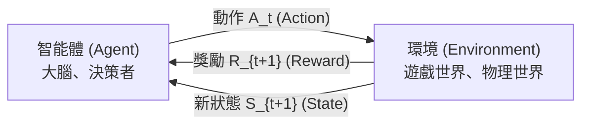
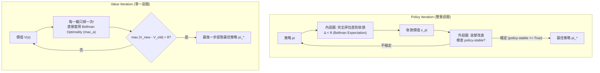
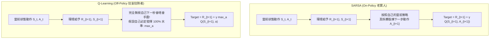
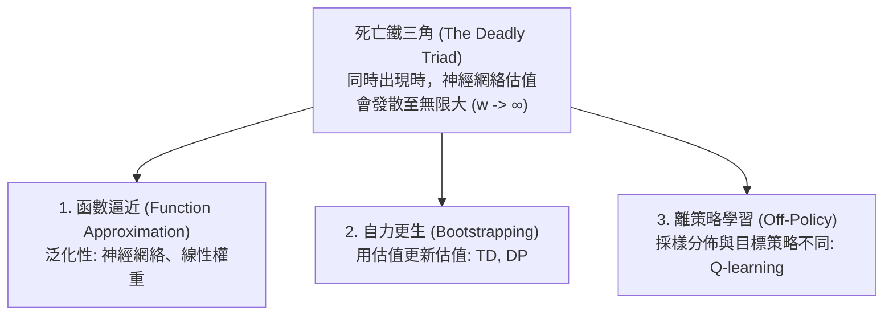
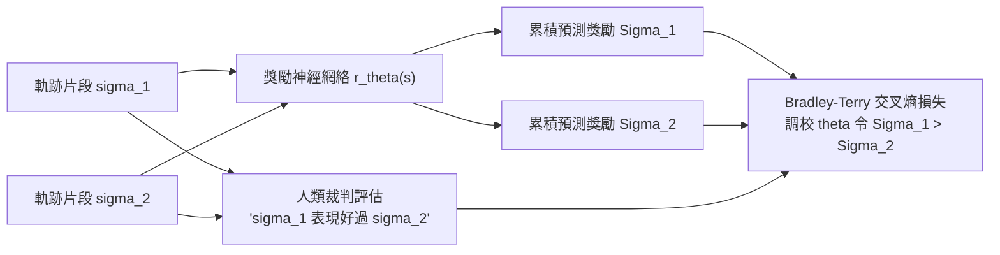

# APS1080: Intro to Reinforcement Learning
# Test 1 Zero-to-Hero 終極深度自學寶典 (Beginner to Master Exam Guide)

> **這份筆記專為對強化學習（Reinforcement Learning, RL）剛入門、對進階數學和概念感到抽象的同學而設。**  
> 筆記將從最根本的直覺出發，用生活化嘅廣東話深度拆解背後嘅物理本質同工程邏輯，再無縫對接課堂官方嚴謹數學符號（Sutton & Barto 2020），助你喺 Test 1 輕鬆考取高分！

---

## 目錄 (Table of Contents)
- [Chapter 0: 給零基礎同學的 RL 世界觀 (The Big Picture)](#chapter-0-給零基礎同學的-rl-世界觀-the-big-picture)
- [Chapter 1: 由拉老虎機開始：單狀態與非平穩追蹤 (Bandits & EWMA Filter - Ch 2.4, 2.5)](#chapter-1-由拉老虎機開始單狀態與非平穩追蹤-bandits--ewma-filter---ch-24-25)
- [Chapter 2: 馬可夫決策過程：世界的數學模型 (Finite MDPs & Bellman Equations - Ch 3)](#chapter-2-馬可夫決策過程世界的數學模型-finite-mdps--bellman-equations---ch-3)
- [Chapter 3: 動態規劃：有上帝視角的解題術 (Dynamic Programming - Ch 4)](#chapter-3-動態規劃有上帝視角的解題術-dynamic-programming---ch-4)
- [Chapter 4: 蒙地卡羅方法：無上帝視角，肉搏試錯 (Monte Carlo Methods - Ch 5)](#chapter-4-蒙地卡羅方法無上帝視角肉搏試錯-monte-carlo-methods---ch-5)
- [Chapter 5: 時序差分學習：RL 最偉大的發明 (Temporal-Difference Learning - Ch 6)](#chapter-5-時序差分學習rl-最偉大的發明-temporal-difference-learning---ch-6)
- [Chapter 6: 告別查表法：函數逼近與深度 DQN (Function Approximation & DQN - Ch 9, 10, 16.5)](#chapter-6-告別查表法函數逼近與深度-dqn-function-approximation--dqn---ch-9-10-165)
- [Chapter 7: 策略梯度與現代 LLM 對齊 (Policy Gradients & RLHF - Ch 13 & Christiano et al.)](#chapter-7-策略梯度與現代-llm-對齊-policy-gradients--rlhf---ch-13--christiano-et-al)
- [Chapter 8: 模型、規劃與 AlphaGo 傳奇 (Planning, MCTS & AlphaGo - Ch 8 & 16.6)](#chapter-8-模型規劃與-alphago-傳奇-planning-mcts--alphago---ch-8--166)
- [Chapter 9: 實戰大作戰：作業與練習題深度復盤 (Assignments & Exercises Master Review)](#chapter-9-實戰大作戰作業與練習題深度復盤-assignments--exercises-master-review)
- [Chapter 10: 考試必背速查公式表與 10 大避坑指南 (Exam Cheatsheet & Traps)](#chapter-10-考試必背速查公式表與-10-大避坑指南-exam-cheatsheet--traps)

---

## Chapter 0: 給零基礎同學的 RL 世界觀 (The Big Picture)

### 0.1 咩係 Reinforcement Learning？
機器學習有三大門派，如果用「學游水」嚟比喻：
1. **Supervised Learning（監督式學習）**：
   教練喺池邊捉住你對手，每秒話你知標準動作：「隻手抬高 30 度，踢腿兩次！」——有標準答案（True Label）。
2. **Unsupervised Learning（非監督式學習）**：
   教練丟咗幾千張人哋游水嘅相畀你，無任何標籤，叫你自己搵出「自由式」同「蛙式」嘅姿勢規律——無答案，自己摸索結構。
3. **Reinforcement Learning（強化學習）**：
   **無教練指點你每一步點做！** 直接將你掟落水，你飲水濁親（Penalty 負回報，例如 $-10$），浮到向前游（Reward 正回報，例如 $+5$）。你唯有靠自己在水中係咁試（Trial-and-Error），自己學識點樣游得最遠。

```text
Supervised Learning   ===> 指導性回饋 (Instructive Feedback): 話你知「正確答案係乜」
Reinforcement Learning ===> 評價性回饋 (Evaluative Feedback): 淨係比個分數「話你知頭先嗰步做得幾好」，唔話你知最佳做法
```

> 💡 **粵語解構 (點解叫 Systems AI？)**:  
> 點解 Professor 話 RL 係 "Systems AI"？因為平時嘅 AI（好似識辨貓狗相）只係「靜態模型」，入一張相出一個答案，對世界無任何影響。  
> 但 RL 係一個**動態閉環系統（Closed-Loop System）**！Agent 做出一個動作 $A_t$，唔單止即時攞到糖或者俾人打（$R_{t+1}$），仲會**直接改變世界嘅狀態（$S_{t+1}$）**！  
> 今日你揀打機唔溫書（動作），眼前好爽（即時 Reward 大），但聽日你嘅世界狀態就變成「考試肥佬」（未來回報極慘）。RL 學嘅就係：**點樣為咗長遠嘅最大利益，作出連串嘅明智決策！**

### 0.2 RL 系統的五大基本元件


1. **State $S_t \in \mathcal{S}$（狀態）**：當前世界的截圖或資訊（例如打緊機隻主角企喺邊、血量仲有幾多）。
2. **Action $A_t \in \mathcal{A}$（動作）**：Agent 可以做的選擇（例如向左行、向右行、開槍）。
3. **Reward $R_{t+1} \in \mathbb{R}$（獎勵）**：環境即時反饋的標量數值（+10 贏錢、-100 撞車）。
4. **Policy $\pi(a \mid s)$（策略）**：Agent 的行動指南——「如果我見到狀態 $s$，我有幾大機率揀動作 $a$」。
5. **Value Function（價值函數）**：
   - **$V(s)$（State-Value）**：企喺狀態 $s$，長遠嚟講值幾多分？
   - **$Q(s, a)$（Action-Value）**：企喺狀態 $s$ 兼且行咗動作 $a$，長遠嚟講值幾多分？

---

## Chapter 1: 由拉老虎機開始：單狀態與非平穩追蹤 (Bandits & EWMA Filter - Ch 2.4, 2.5)

### 1.1 點解要由「多臂老虎機 (k-Armed Bandit)」講起？
因為現實世界太複雜（狀態又多、步數又長）。為咗先專注研究「點樣評估一個動作嘅好壞」，我哋先將問題簡化到極致：**世界得一個狀態！**  
想像你去賭場，眼前有 $k$ 部老虎機（或者一部有 $k$ 條手臂嘅老虎機）。每次拉手掣唔會改變你企喺邊，你淨係想知：**拉邊部機最賺錢？**

### 1.2 增量式平均數更新 (Incremental Sample Average)
假設某部老虎機被拉咗 $n-1$ 次，平均回報係 $Q_n$。而家拉第 $n$ 次，攞到獎勵 $R_n$。點樣計新嘅平均數 $Q_{n+1}$？  
小學做法係由頭加到尾除以 $n$：$Q_{n+1} = \frac{R_1 + R_2 + \dots + R_n}{n}$。但如果要拉 10 億次，部電腦要記住 10 億個數字，記憶體會爆炸！  
我哋做少少代數搬項：
$$\begin{aligned}
Q_{n+1} &= \frac{1}{n} \sum_{i=1}^n R_i = \frac{1}{n} \left( R_n + \sum_{i=1}^{n-1} R_i \right) = \frac{1}{n} \left( R_n + (n-1) Q_n \right) \\
&= \frac{1}{n} (R_n + n Q_n - Q_n) = Q_n + \frac{1}{n} [R_n - Q_n]
\end{aligned}$$

> 💡 **這就是全個 RL 課程最核心的「通用更新公式」**：
> $$\text{新估值} \leftarrow \text{舊估值} + \text{步長} \times [\text{目標 (Target)} - \text{舊估值}]$$
> 中括號 $[\text{Target} - \text{舊估值}]$ 就係「**預測誤差（Error / 驚喜度）**」。如果結果同你估嘅一樣，Error = 0，估值唔變；如果實際比預期好，估值向上調！

### 1.3 非平穩環境 (Non-Stationary) 與 IIR / EWMA 低通濾波器 (Outline 4.1, 4.2)
* **咩叫平穩（Stationary）？**：老細每日心情一樣，老虎機中獎率永遠固定。
* **咩叫非平穩（Non-Stationary）？**：世界係會變嘅！老虎機畀老細暗中調低咗中獎率；或者夏天雪糕好賣，冬天雪糕難賣。

喺非平穩環境下，如果仲用步長 $\frac{1}{n}$：當你去到第 1,000,000 次拉手掣，步長變成 $\frac{1}{1000000} \approx 0$！Agent 的大腦會**徹底石化**，就算環境突變，佢都完全無能力調整估值！  
為咗永遠保持記憶更新，我哋將變化的步長 $\frac{1}{n}$ 換成**固定步長常數 $\alpha \in (0, 1]$**：
$$Q_{n+1} = Q_n + \alpha [R_n - Q_n]$$

將呢條式一層層向過去展開（Unroll）：
$$\begin{aligned}
Q_{n+1} &= \alpha R_n + (1 - \alpha) Q_n \\
&= \alpha R_n + (1 - \alpha) [\alpha R_{n-1} + (1 - \alpha) Q_{n-1}] \\
&= \alpha R_n + \alpha(1 - \alpha) R_{n-1} + (1 - \alpha)^2 Q_{n-1} \\
&= (1 - \alpha)^n Q_1 + \sum_{i=1}^n \alpha (1 - \alpha)^{n-i} R_i
\end{aligned}$$

> 💡 **粵語解構 (工程訊號處理角度：IIR / EWMA 低通濾波器)**:  
> 點解 Professor 喺 Outline 叫佢做 **First-Order IIR Low-Pass Filter** 或者 **EWMA (Exponentially Weighted Moving Average)**？  
> - 睇下每個獎勵 $R_i$ 前面嘅權重：$\alpha (1 - \alpha)^{n-i}$。因為 $(1-\alpha) < 1$，越耐之前嘅歷史（$i$ 越細），權重就以指數形式衰減！即係「**越新嘅事越記得清楚，越舊嘅事越快淡忘**」。  
> - **極端情況 $\alpha = 1$**：$Q_{n+1} = R_n$。零記憶力，即時見到乜就信到十足（極高頻噪聲，完全無平滑效果）。  
> - **當 $\alpha$ 好細（例如 0.05）**：好似收音機嘅低通濾波器，濾走短期運氣波動（噪聲），穩健追蹤底層趨勢！

#### 考試必備數學證明：權重加埋一定等於 1
$$(1 - \alpha)^n + \sum_{i=1}^n \alpha (1 - \alpha)^{n-i} = (1 - \alpha)^n + \alpha \frac{1 - (1 - \alpha)^n}{1 - (1 - \alpha)} = (1 - \alpha)^n + 1 - (1 - \alpha)^n = 1 \quad \blacksquare$$

### 1.4 Robbins-Monro 隨機逼近收斂條件
數學家 Robbins 和 Monro 證明咗：步長序列 $\{\alpha_n\}$ 必須同時滿足兩個條件，估值先會以概率 1 收斂到真實值：
1. $\sum_{n=1}^\infty \alpha_n = \infty$：步長總和要無限大，確保佢有足夠力量擺脫任何離譜的初始估值 $Q_1$。
2. $\sum_{n=1}^\infty \alpha_n^2 < \infty$：步長平方總和要有限，確保步長最終縮小到極微細，唔會無休止震盪。

| 步長設定 | $\sum \alpha_n = \infty$? | $\sum \alpha_n^2 < \infty$? | 收斂特性與應用場景 |
| :--- | :---: | :---: | :--- |
| **Sample Average ($\alpha_n = 1/n$)** | **YES** ($\sum \frac{1}{n} = \infty$) | **YES** ($\sum \frac{1}{n^2} = \frac{\pi^2}{6} < \infty$) | **在平穩環境嚴格收斂到唯一真值**。但在非平穩環境會「大腦僵化」。 |
| **Constant Step-Size ($\alpha_n = \alpha$)** | **YES** ($\sum \alpha = \infty$) | **NO** ($\sum \alpha^2 = \infty$) | **故意違反條件 2！** 估值永遠唔會定死喺某一點，而係隨着最新數據持續波動——**這正是在動態非平穩世界追蹤變化的必要特質！** |

---

## Chapter 2: 馬可夫決策過程：世界的數學模型 (Finite MDPs & Bellman Equations - Ch 3)

### 2.1 咩係 Markov Property（馬可夫性質）？
一句話概括：「**未來只取決於現在，與過去無關（The future is independent of the past given the present）。**」  
如果一個狀態 $S_t$ 已經包含晒所有做決定所需嘅資訊，你根本唔需要翻查佢過去 100 步係點樣行過嚟嘅：
$$\Pr(S_{t+1}=s', R_{t+1}=r \mid S_t=s_t, A_t=a_t, S_{t-1}=s_{t-1}, \dots) = p(s', r \mid s_t, a_t)$$

### 2.2 折現回報 (Discounted Return $G_t$)
Agent 的終極目標係最大化**累積折現回報** $G_t$：
$$G_t \doteq R_{t+1} + \gamma R_{t+2} + \gamma^2 R_{t+3} + \dots = \sum_{k=0}^\infty \gamma^k R_{t+k+1}$$
* **基本遞推關係（非常重要！）**：
  $$G_t = R_{t+1} + \gamma G_{t+1}$$
* **折現因子 $\gamma \in [0, 1)$ 的物理意義**：
  - $\gamma = 0$：**短視鬼（Myopic）**，只在乎眼前第一步獎勵 $R_{t+1}$，聽日世界末日都唔理。
  - $\gamma \to 1$：**遠見卓識（Farsighted）**，未來的獎勵幾乎同眼前一樣有分量。
  - **數學必然性**：如果任務係永不結束的（Continuing Tasks），若果 $\gamma = 1$，回報會加到 $\infty$ 發散。只有 $\gamma < 1$，等比級數求和先保證收斂（$\sum \gamma^k R \le \frac{R_{\max}}{1 - \gamma}$）。

### 2.3 拆解 Bellman Equations 的兩步天梯 (Two-Step Ladder)
好多同學背唔出 Bellman 方程，係因為一開始就硬背嗰條四個 Sigma 的長公式。其實佢本質只係**兩步階梯**：

```text
狀態點 s (空心圈) 
   │
   ▼ 依策略 π(a|s) 揀動作
動作點 (s, a) (實心黑點)
   │
   ▼ 依大自然物理 p(s', r | s, a) 轉移
新狀態點 s' (空心圈)
```

#### 梯級第一步：由狀態點 $s$ 到動作點 $(s, a)$
企喺狀態 $s$ 嘅整體身價 $v_\pi(s)$，就係將所有可能動作嘅身價 $q_\pi(s, a)$ 按策略機率加權平均：
$$v_\pi(s) = \sum_{a \in \mathcal{A}(s)} \pi(a \mid s) q_\pi(s, a)$$

#### 梯級第二步：由動作點 $(s, a)$ 到新狀態點 $s'$
企喺狀態 $s$ 兼出咗動作 $a$ 嘅身價 $q_\pi(s, a)$，就係眼前即時拿到的糖 $r$，加上下一個狀態嘅折現身價 $\gamma v_\pi(s')$：
$$q_\pi(s, a) = \sum_{s', r} p(s', r \mid s, a) [r + \gamma v_\pi(s')]$$

#### 將兩步合體：Bellman Expectation Equation (線性方程組)
把第二步代入第一步，就得到震撼世界嘅 **$v_\pi$ Bellman 期望方程**：
$$v_\pi(s) = \sum_{a} \pi(a \mid s) \sum_{s', r} p(s', r \mid s, a) [r + \gamma v_\pi(s')]$$
* **矩陣向量形式**：$\mathbf{v}_\pi = \mathbf{r}_\pi + \gamma \mathbf{P}_\pi \mathbf{v}_\pi \implies (\mathbf{I} - \gamma \mathbf{P}_\pi)\mathbf{v}_\pi = \mathbf{r}_\pi \implies \mathbf{v}_\pi = (\mathbf{I} - \gamma \mathbf{P}_\pi)^{-1} \mathbf{r}_\pi$。因為只有加權平均，方程組係純**線性（Linear）**嘅！

### 2.4 Bellman Optimality Equations (非線性方程組)
最優策略 $\pi_*$ 永遠揀令長遠回報最大的動作。梯級更新由加權平均變成了求極大值 $\max_a$：
1. $v_*(s) = \max_{a} q_*(s, a)$
2. $q_*(s, a) = \sum_{s', r} p(s', r \mid s, a) [r + \gamma v_*(s')]$

合體成為 **Bellman 最優方程**：
$$v_*(s) = \max_{a \in \mathcal{A}(s)} \sum_{s', r} p(s', r \mid s, a) [r + \gamma v_*(s')]$$
$$q_*(s, a) = \sum_{s', r} p(s', r \mid s, a) \left[ r + \gamma \max_{a'} q_*(s', a') \right]$$
* **非線性本質**：因為多咗個 $\max$，無辦法用矩陣逆運算一步解開，必須用**動態規劃（Dynamic Programming）**進行疊代逼近！

### 2.5 考試極高頻陷阱：用 $v_*$ 揀動作 vs 用 $q_*$ 揀動作
這是期中考最容易失分的觀念題：
* **如果 Agent 只知道 $v_*(s)$**：
  $$\pi_*(s) = \arg\max_a \sum_{s', r} p(s', r \mid s, a) [r + \gamma v_*(s')]$$
  Agent 企喺 $s$，佢要向前望一步（1-step lookahead），計算出每一個動作 $a$ 之後大自然會以幾大機率掟佢去邊個 $s'$。因此，**用 $v_*$ 決策必須要有環境模型（Model-Based）！**
* **如果 Agent 知道 $q_*(s, a)$**：
  $$\pi_*(s) = \arg\max_a q_*(s, a)$$
  Agent 根本唔需要理會大自然的物理轉移機率！佢只需查表睇下邊隻動作分數最高就直接揀。因此，**用 $q_*$ 決策是純無模型的（100% Model-Free）！**

---

## Chapter 3: 動態規劃：有上帝視角的解題術 (Dynamic Programming - Ch 4)

### 3.1 咩係 Dynamic Programming（動態規劃）？
DP 係有「上帝視角」的演算法——佢假設我哋手上有一本世界的完美說明書（完全清楚 $p(s', r \mid s, a)$）。  
DP 的靈魂係 **Bootstrapping（自力更生 / 用估值更新估值）**：唔洗真係玩成局遊戲，直接用「下一個狀態的當前估值」來更新「當前狀態的估值」。

### 3.2 Policy Improvement Theorem（策略改進定理）與證明
點解我哋可以大膽地將策略貪婪化（Greedy Update）？  
**定理**：如果一個新策略 $\pi'$ 在每一個狀態 $s$ 選出的動作，其表現都好過舊策略的總體身價：
$$q_\pi(s, \pi'(s)) \ge v_\pi(s) \quad \forall s \in \mathcal{S}$$
咁樣，整套新策略的身價保證絕對唔會差過舊策略：
$$v_{\pi'}(s) \ge v_\pi(s) \quad \forall s \in \mathcal{S}$$

#### 考試必背：手把手展開證明 (Unrolling Proof)
$$\begin{aligned}
v_\pi(s) &\le q_\pi(s, \pi'(s)) \\
&= \mathbb{E}_{\pi'} \left[ R_{t+1} + \gamma v_\pi(S_{t+1}) \mid S_t = s \right] \\
&\le \mathbb{E}_{\pi'} \left[ R_{t+1} + \gamma q_\pi(S_{t+1}, \pi'(S_{t+1})) \mid S_t = s \right] \quad \text{(套用定理條件於 } S_{t+1}\text{)} \\
&= \mathbb{E}_{\pi'} \left[ R_{t+1} + \gamma \mathbb{E}_{\pi'}[R_{t+2} + \gamma v_\pi(S_{t+2})] \mid S_t = s \right] \\
&= \mathbb{E}_{\pi'} \left[ R_{t+1} + \gamma R_{t+2} + \gamma^2 v_\pi(S_{t+2}) \mid S_t = s \right] \\
&\ \ \vdots \quad \text{(無限推遲下去)} \\
&\le \mathbb{E}_{\pi'} \left[ R_{t+1} + \gamma R_{t+2} + \gamma^2 R_{t+3} + \dots \mid S_t = s \right] = v_{\pi'}(s) \quad \blacksquare
\end{aligned}$$

### 3.3 Policy Iteration (PI) vs. Value Iteration (VI)
這是 Assignment 1 和 Test 1 的重中之重：



| 比較維度 | Policy Iteration (策略疊代) | Value Iteration (價值疊代) |
| :--- | :--- | :--- |
| **內部評估掃描** | 每次策略改進前，跑多次掃描直到數值收斂（$\Delta < \theta$） | **每輪只掃一次**，絕不浪費時間精確評估未定策略 |
| **更新所用方程** | Bellman **Expectation** 方程（$\sum_a \pi(a|s)$） | Bellman **Optimality** 方程（$\max_a$） |
| **策略陣列存儲** | 全程維護明確的 $\pi(s)$ 陣列 | **全程不存儲策略**，只維護數值 $V(s)$；最後提取 |
| **終止條件** | 布林變數 `policy-stable == True` | 數值變動極小 $\max_s |V_{k+1}(s) - V_k(s)| < \theta$ |

### 3.4 DP 的計算效率與維度詛咒 (Section 4.7)
* **多項式時間保證**：DP 求解 MDP 的時間複雜度在狀態數 $n = |\mathcal{S}|$ 和動作數 $m = |\mathcal{A}|$ 上是多項式的（通常每輪 $O(mn^2)$）。
* **對比暴力窮舉的降維打擊**：所有確定性策略共有 $m^n$ 個！如果有 16 個狀態、4 個動作，暴力窮舉有 $4^{16} \approx 43$ 億個策略，根本不可能算完。DP 是天文數字級別的加速！
* **Bellman 維度詛咒（Curse of Dimensionality）**：既然 DP 是多項式級別，點解我哋唔可以凡事用 DP 解晒？  
  因為問題在於**狀態數 $n$ 本身隨着變數增加呈指數爆炸**！例如一個機械人有 10 個關節，每個關節粗略離散化為 10 個角度，狀態數就已經高達 $10^{10} = 100$ 億！這直接催生了後面的**函數逼近（Function Approximation）**。

---

## Chapter 4: 蒙地卡羅方法：無上帝視角，肉搏試錯 (Monte Carlo Methods - Ch 5)

### 4.1 核心思想：無模型、不自力更生 (Model-Free, No Bootstrapping)
如果無環境模型，點知一個狀態值幾多？  
**Monte Carlo (MC)** 的做法最直接：**親自去玩一局！** 由狀態 $S_t$ 開始一直玩到整局遊戲結束（Terminal），紀錄整局實際攞到的總回報 $G_t$。重複玩好多局，取平均值！
* **優點**：完全唔需要知道世界的物理轉移公式 $p(s', r \mid s, a)$；對單一狀態估值的運算開銷，完全獨立於全場總狀態數。
* **致命缺點**：**只適用於有終點的 Episodic 任務！** 而且必須等到整局結束先可以更新一次。

### 4.2 First-Visit vs. Every-Visit MC
一局遊戲入面，你可能會幾次路過同一間房（狀態 $s$）：
* **First-Visit MC**：淨係攞「第一次踏入該狀態」之後產生的回報 $G_t$ 來計平均數。  
  *性質*：每次採樣獨立同分佈（i.i.d.），是真正的**無偏估計（Unbiased）**，標準誤差隨次數以 $1/\sqrt{n}$ 穩定下降。
* **Every-Visit MC**：每一次路過都計一次回報並放入平均數。  
  *性質*：各採樣之間存在自相關性，有少少偏差（Biased），但有時總體均方誤差（MSE）反而較細。

### 4.3 Importance Sampling（重要性採樣）的白話革命 (Section 5.5)
如果我想學李小龍的武功（**Target Policy $\pi$**：精準致命、零多餘動作）；但我自己只係個初學者，打起上嚟好慌亂周圍試（**Behavior Policy $b$**）。  
我點樣可以用自己這份充滿失誤的錄影帶，去準確評估李小龍策略的身價？  
答案是 **Importance Sampling**！

#### 採樣覆蓋條件 (Coverage Assumption)
要用 $b$ 的經驗學 $\pi$，前提是：**凡是李小龍會出的招，你在錄影帶中至少都要有微小的機會出過**（即 $\pi(a \mid s) > 0 \implies b(a \mid s) > 0$）。

#### 軌跡權重比率（奇蹟般的物理約簡消去證明！）
軌跡在 $\pi$ 下發生的機率除以在 $b$ 下發生的機率：
$$\rho_{t:T-1} \doteq \frac{\prod_{k=t}^{T-1} \pi(A_k \mid S_k) p(S_{k+1} \mid S_k, A_k)}{\prod_{k=t}^{T-1} b(A_k \mid S_k) p(S_{k+1} \mid S_k, A_k)} = \prod_{k=t}^{T-1} \frac{\pi(A_k \mid S_k)}{b(A_k \mid S_k)}$$
> 💡 **考試必答**：睇清分子同分母！**大自然的未知轉移物理機率 $p(S_{k+1} \mid S_k, A_k)$ 竟然喺分子分母完全約簡消晒！**  
> 我哋只需要計算自己在每一步的動作機率比 $\frac{\pi}{b}$ 連乘，完全唔需要知大自然係點運作，就可以做到 Off-Policy 學習！

### 4.4 普通重要性採樣 (Ordinary) vs 加權重要性採樣 (Weighted)
* **Ordinary Importance Sampling (OIS)**：直接除以局數 $n$：
  $$V(s) \doteq \frac{\sum_{i=1}^n \rho_i G_i}{n} \implies \text{嚴格無偏 (Unbiased)，但連乘的 } \rho \text{ 可以大到天文數字，方差可以是無限大 (Infinite Variance)！}$$
* **Weighted Importance Sampling (WIS)**：除以總權重和：
  $$V(s) \doteq \frac{\sum_{i=1}^n \rho_i G_i}{\sum_{i=1}^n \rho_i} \implies \text{小樣本時有輕微偏差 (Biased)，但方差有界 (Bounded Variance)，實戰首選！}$$

### 4.5 Weighted IS 增量更新與 Off-Policy MC Control 提早跳出 (Section 5.6, 5.7)
* **增量式更新（維護累計權重 $C_n$）**：
  $$C_{n+1} = C_n + W_{n+1}, \quad V_{n+1} = V_n + \frac{W_{n+1}}{C_{n+1}}[G_{n+1} - V_n]$$
* **Off-Policy MC 控制的向後迴圈提早終止（Early Exit）**：  
  如果 Target Policy $\pi$ 是貪婪策略（$\pi(s) = \arg\max_a Q(s, a)$），當從最後一步 $T-1$ 逆向推到時間 $t$ 時：  
  **若發現錄影帶中選的動作 $A_t \neq \pi(S_t)$，必須立即 Break 退出該局的向後更新！**  
  *原因*：因為 $\pi$ 是確定性貪婪策略，對任何非最優動作的機率都是 $0$（$\pi(A_t \mid S_t) = 0$）。比率 $\frac{\pi}{b} = 0$，權重連乘因子歸零，更早之前的所有步數權重全部變成 $0$，更新無效！

---

## Chapter 5: 時序差分學習：RL 最偉大的發明 (Temporal-Difference Learning - Ch 6)

### 5.1 點解一定要擺脫蒙地卡羅？（教授 Outline 核心批判）
大綱中 Professor 特別指出了 Monte Carlo 的致命缺陷：
1. **違背實時控制要求**：等一局完先更新，延遲太大。
2. **無法處理持續任務**：永不結束的工廠管線控制，MC 直接癱瘓。
3. **機械人自撞損壞悖論（The Mobile Robot Paradox）**：
   > 想像你教一部實體自走機械人行路。如果終點狀態（Terminal State）係「架機械人撞向牆壁撞爛咗」，而蒙地卡羅演算法規定你「一定要等架車撞爛咗（到達終點）先至准學」，咁樣部車一日要撞爛幾千架，間公司一早就破產！

### 5.2 由非平穩到 TD(0) 的推導演進 (Outline 公式 4.1 至 4.6)
Professor 用了極為優美的邏輯鏈將概念串連：
1. **公式 4.1 & 4.2**：平穩平均數 $\mu_n = \mu_{n-1} + \frac{1}{n}(x_n - \mu_{n-1})$ 轉為非平穩 EWMA 濾波器 $\mu_n = \mu_{n-1} + \alpha(x_n - \mu_{n-1})$。
2. **公式 4.3 & 4.4**：將在線蒙地卡羅更新 $Q \leftarrow Q + \frac{1}{N}(G_t - Q)$ 換成非平穩版本 $Q \leftarrow Q + \alpha(G_t - Q)$。
3. **公式 4.5 & 4.6 (核心突破！)**：利用 Bellman 遞推，將必須等到局終的真實回報 $G_t$，用**一步估值 $R_{t+1} + \gamma V(S_{t+1})$** 替代！
   $$V(S_t) \leftarrow V(S_t) + \alpha [R_{t+1} + \gamma V(S_{t+1}) - V(S_t)]$$
   $$Q(S_t, A_t) \leftarrow Q(S_t, A_t) + \alpha [R_{t+1} + \gamma Q(S_{t+1}, A_{t+1}) - Q(S_t, A_t)]$$

> 💡 **Bootstrapping 嘅白話解構**：  
> 點解叫 Bootstrapping？喺查表法入面，$Q(S_t, A_t)$ 同 $Q(S_{t+1}, A_{t+1})$ 其實只係儲存喺 **Q-table 資料結構中不同的兩行（Rows）**！  
> TD(0) 每走一步，就用下面嗰行嘅數值，即時更新上面嗰行嘅數值！無須等局終、即走即學！

### 5.3 SARSA (On-Policy) vs Q-Learning (Off-Policy)
這對宿敵的對比是期中考必出題：



* **SARSA 收斂排程**：大綱中提出，令探索率隨時間衰減：$\epsilon_t = \frac{1}{t}$，可保證在極限下滿足 GLIE 條件，策略 $\pi \to \pi^*$。
* **Q-Learning 的「狂熱最優 (Fanatically-Optimal)」定義**：
  Q-learning 的更新目標永遠假設自己執行追求最優的 $\max_a Q$，它與產生動作的行為策略徹底解耦。**行為策略在 Q-learning 中的唯一作用，就是確保 $S \times A$ 空間被充分採樣！**

### 5.4 Expected SARSA：方差終結者 (Section 6.6 & Outline 4.3)
SARSA 每次擲骰仔抽一個 $A_{t+1}$，因為抽樣隨機性，估值更新會有好大震盪（Variance）。  
**Expected SARSA 的神操作**：既然我明明知自己粒骰仔每面出嘅機率係幾多（$\pi(a \mid S_{t+1})$），點解仲要擲骰？**我直接一步計個數學期望值出嚟！**
$$Q(S_t, A_t) \leftarrow Q(S_t, A_t) + \alpha \left[ R_{t+1} + \gamma \sum_a \pi(a \mid S_{t+1}) Q(S_{t+1}, a) - Q(S_t, A_t) \right]$$
1. **消除方差**：徹底消除由於動作隨機抽樣帶來的方差。
2. **實戰性能**：雖然計 Sum 運算量大咗少少，但在線性能穩定壓倒 SARSA。
3. **等價定理**：當目標策略 $\pi$ 設為完全貪婪時，$\sum_a \pi(a \mid S_{t+1}) Q(S_{t+1}, a) = \max_a Q(S_{t+1}, a)$，**Expected SARSA 在數學上嚴格等同於 Q-Learning！**

### 5.5 懸崖行走（Cliff Walking）經典案例
```text
[S]  .   .   .   .   .   .   .   .   .   .  [G]
 C   C   C   C   C   C   C   C   C   C   C   C   (Cliff: 罰 -100 分並重返起點)
```
在 $\epsilon = 0.1$ 的探索噪聲下：
* **Q-Learning**：學到的是「理論最優路徑」（緊貼懸崖邊緣直線行）。但他忘記咗自己有 10% 機會手震亂出招，結果不時失足跌落懸崖罰 $-100$，實戰在線平均回報好低（$\approx -45$）。
* **SARSA**：學到的是「安全路徑」（繞大圈走最上方）。因為佢考量自己會手震，寧願繞路都絕不接近懸崖，實戰在線平均回報極高（$\approx -20$）！

---

## Chapter 6: 告別查表法：函數逼近與深度 DQN (Function Approximation & DQN - Ch 9, 10, 16.5)

### 6.1 點解查表法 (Tabular) 在現實中必死？
1. **記憶體裝唔晒**：連續狀態空間（例如車速、角度）有無限個狀態。
2. **零泛化能力（No Generalization）**：如果用查表法，踏深油門 $1.0\text{ mm}$ 同 $1.001\text{ mm}$ 係兩張不同表格。你學識咗避車，踏深咗 $0.001\text{ mm}$ 就變成白痴！  
**解法**：用帶參數的函數逼近器（權重向量 $\mathbf{w} \in \mathbb{R}^d$ 或深度神經網絡）來代表價值：$\hat{v}(s, \mathbf{w}) \approx v_\pi(s)$。學一格，附近相似的狀態一齊更新！

### 6.2 均方價值誤差 ($\overline{\text{VE}}$) 與半梯度 (Semi-Gradient)
* **目標函數（加權均方誤差）**：
  $$\overline{\text{VE}}(\mathbf{w}) \doteq \sum_{s \in \mathcal{S}} \mu(s) \left[ v_\pi(s) - \hat{v}(s, \mathbf{w}) \right]^2$$
  $\mu(s)$ 是**在線狀態訪問分佈（On-policy state distribution）**：常去的狀態權重大，罕見的狀態誤差大少少無所謂。
* **True SGD vs. Semi-Gradient**：
  - **True SGD（Monte Carlo）**：Target 是真實回報 $G_t$（無偏估計，不依賴 $\mathbf{w}$），梯度更新是嚴格的負梯度方向。
  - **Semi-Gradient TD(0)**：Target 是 $R_{t+1} + \gamma \hat{v}(S_{t+1}, \mathbf{w})$。更新時**人為忽視 Target 內部對 $\mathbf{w}$ 的導數**，所以叫「半梯度」！

### 6.3 線性方法與 TD 不動點 (Linear Methods & TD Fixed Point)
當價值函數是特徵向量的線性組合：$\hat{v}(s, \mathbf{w}) = \mathbf{w}^T \mathbf{x}(s)$，則梯度就是特徵本身 $\nabla \hat{v} = \mathbf{x}(s)$。
$$\mathbf{w}_{t+1} = \mathbf{w}_t + \alpha \delta_t \mathbf{x}(S_t)$$
線性 TD(0) 保證收斂到 **TD 不動點（TD Fixed Point）** $\mathbf{w}_{\text{TD}} = \mathbf{A}^{-1}\mathbf{b}$，其誤差有理論界限：
$$\overline{\text{VE}}(\mathbf{w}_{\text{TD}}) \le \frac{1}{1 - \gamma} \min_{\mathbf{w}} \overline{\text{VE}}(\mathbf{w})$$

### 6.4 控制：Mountain Car 與 Semi-Gradient $n$-Step Sarsa (Ch 10.1, 10.2)
* **Mountain Car 物理智慧**：引擎馬力不足的小車想衝上右邊山頂，必須先向左倒車蓄力借勢！
* **Semi-gradient $n$-Step Sarsa (Section 10.2)**：
  $$G_{t:t+n} \doteq R_{t+1} + \gamma R_{t+2} + \dots + \gamma^{n-1} R_{t+n} + \gamma^n \hat{q}(S_{t+n}, A_{t+n}, \mathbf{w}_{t+n-1})$$
  $$\mathbf{w}_{t+n} \leftarrow \mathbf{w}_{t+n-1} + \alpha \left[ G_{t:t+n} - \hat{q}(S_t, A_t, \mathbf{w}_{t+n-1}) \right] \nabla_{\mathbf{w}} \hat{q}(S_t, A_t, \mathbf{w}_{t+n-1})$$
  *偏差-方差權衡*：$n=1$ 方差小但偏差大；$n=\infty$（MC）無偏差但方差極大。在 Mountain Car 中，中間值 $n \in [4, 8]$ 能最快學識爬山！

### 6.5 死亡鐵三角 (The Deadly Triad) 與 DQN 救贖

* **安全組合**：任意兩個共存都好安全（例如 DP 係 Bootstrapping + Off-Policy 但用查表，安全；Sarsa 係 FA + Bootstrapping 但 On-Policy，安全）。**但三個一齊用，神經網絡就會形成惡性正反饋，參數爆炸發散！**

#### Deep Q-Networks (DQN: Mnih et al. 2015) 兩大神技馴服鐵三角
1. **Experience Replay（經驗回放池 $\mathcal{D}$）**：  
   將玩遊戲的每一步片段 $(s, a, r, s')$ 存入記憶庫，學習時**隨機打亂抽樣（Random Mini-Batch）**，打破時間連續性相關，滿足 SGD 獨立同分佈要求。
2. **Target Network（凍結目標網絡 $\mathbf{w}^-$）**：  
   另外複製一個副網絡用來提供 Target $r + \gamma \max_{a'} Q(s', a'; \mathbf{w}^-)$，每隔 $C$ 步（例如 10,000 步）先同步一次。**靶心不再亂郁，解決「狗追尾巴」震盪發散問題！**
   $$L_i(\mathbf{w}_i) = \mathbb{E}_{(s, a, r, s') \sim \mathcal{D}} \left[ \left( r + \gamma \max_{a'} Q(s', a'; \mathbf{w}_i^-) - Q(s, a; \mathbf{w}_i) \right)^2 \right]$$

---

## Chapter 7: 策略梯度與現代 LLM 對齊 (Policy Gradients & RLHF - Ch 13 & Christiano et al.)

### 7.1 點解要直接學 Policy？（觀測退化與狀態混淆）
在 Outline 中，Professor 特別指出：
> *"Where we have degraded state feedback ('observations' instead of the true state of E), value function approaches are not indicated. Instead we learn the policy directly."*

* **狀態混淆（State Aliasing / POMDP）**：  
  在部分可觀測環境中，兩個真實狀態可能輸出完全相同的觀測訊號（例如一條左右對稱的走廊）。  
  如果用價值函數貪婪決策，Agent 在這兩個混淆狀態只能輸出相同的確定性動作（例如一律向右），結果就會在走廊**陷入死循環撞牆永遠出唔去**！  
  直接學 Policy 可以自然輸出**最佳隨機混合策略（Stochastic Policy）**（例如以 50% 機率向左、50% 向右），輕鬆脫困！

### 7.2 分類神經網絡策略架構 (Outline Lines 149–153)
* 針對 $k$ 個離散動作，設置 $k$ 個純量輸出頭的神經網絡，將觀測 $s$ 映射至 $\mathbb{R}^k$ 的評分（Logits $h(s, a, \boldsymbol{\theta})$）。
* 通過 **Softmax 函數** 轉換為動作概率向量 $(0, 1)^k$：
  $$\pi(a \mid s, \boldsymbol{\theta}) \doteq \frac{\exp(h(s, a, \boldsymbol{\theta}))}{\sum_{b=1}^k \exp(h(s, b, \boldsymbol{\theta}))}$$
  向量分量之和嚴格為 1，第 $i$ 個元素即為揀動作 $a_i$ 的機率。

### 7.3 Policy Gradient Theorem (PGT) 與 REINFORCE
我們希望最大化總回報 $J(\boldsymbol{\theta}) \doteq v_{\pi_{\boldsymbol{\theta}}}(s_0)$。  
改變參數 $\boldsymbol{\theta}$ 會改變動作，進而改變走過狀態的分佈 $\mu(s)$。照常理看，對狀態分佈微分必須知道大自然環境的轉移公式 $p(s', r \mid s, a)$！  
**策略梯度定理（PGT）的數學奇蹟**：梯度的計算**完全不需要知道狀態分佈對參數的導數**！
$$\nabla_{\boldsymbol{\theta}} J(\boldsymbol{\theta}) \propto \sum_{s \in \mathcal{S}} \mu(s) \sum_{a \in \mathcal{A}} q_\pi(s, a) \nabla_{\boldsymbol{\theta}} \pi(a \mid s, \boldsymbol{\theta}) = \mathbb{E}_\pi \left[ q_\pi(S_t, A_t) \nabla_{\boldsymbol{\theta}} \ln \pi(A_t \mid S_t, \boldsymbol{\theta}) \right]$$
* **REINFORCE（蒙地卡羅策略梯度）**：用真實回報 $G_t$ 充當 $q_\pi(S_t, A_t)$ 的無偏樣本：
  $$\boldsymbol{\theta}_{t+1} \leftarrow \boldsymbol{\theta}_t + \alpha \gamma^t G_t \nabla_{\boldsymbol{\theta}} \ln \pi(A_t \mid S_t, \boldsymbol{\theta}_t)$$

### 7.4 Christiano et al. (2017) 人類偏好學習與現代 ChatGPT 根基 (RLHF)
在複雜任務中（例如叫 AI 寫一篇幽默嘅文章），人手寫一個數學 Reward 公式係天方夜譚。Christiano et al. 提出了**人類偏好學習架構**：



1. **軌跡片段（Segments $\sigma_1, \sigma_2$）**：從歷史經驗中截取兩段由狀態-動作組成的短片段。
2. **預測獎勵求和**：將片段中各狀態輸入獎勵神經網絡 $\hat{r}_\theta(s)$，累加預測回報：
   $$\Sigma_1 \doteq \sum_{t} \hat{r}_\theta(s_t^1), \quad \Sigma_2 \doteq \sum_{t} \hat{r}_\theta(s_t^2)$$
3. **人類偏好標註**：把兩段影片給人看，人只需表達二選一的偏好（$\sigma_1 \succ \sigma_2$）。
4. **Bradley-Terry 概率模型**：
   $$\hat{P}[\sigma_1 \succ \sigma_2] = \frac{\exp(\Sigma_1)}{\exp(\Sigma_1) + \exp(\Sigma_2)}$$
5. **訓練目標**：調整獎勵網絡參數 $\theta$，使得只要人類偏好 $\sigma_1$，模型算出的總獎勵就滿足 $\Sigma_1 > \Sigma_2$！
6. **對現代 AI 的意義**：這正是 **ChatGPT, Claude 等大語言模型對齊技術（RLHF）的技術始祖**！

---

## Chapter 8: 模型、規劃與 AlphaGo 傳奇 (Planning, MCTS & AlphaGo - Ch 8 & 16.6)

### 8.1 Models and Planning
* **Distribution Model**：輸出所有可能轉移的完整機率分佈 $p(s', r \mid s, a)$（DP 所需）。
* **Sample Model**：只輸出一個隨機採樣的模擬轉移 $(s', r)$。在複雜世界極易構建！
* **Dyna-Q 架構**：在現實中走一步真實經驗（Direct RL），用來更新 Q 表，同時學習內部模型；然後在腦海中利用模型模擬想像 $N$ 步（Planning），十倍速提升學習效率！

### 8.2 決策時規劃：Heuristics, Rollouts 與 MCTS
* **Heuristic Search（啟發式搜尋 - 8.9）**：從當前狀態展開深達 $d$ 層的樹，葉節點用啟發式估值函數評價，選最佳根動作後，**隨即把整棵樹丟棄**。
* **Rollout Algorithms（8.10）**：從當前候選動作出發，用一個快速模擬策略玩到遊戲結束，取多條軌跡的平均分來決定此時出邊一步。
* **Monte Carlo Tree Search (MCTS - 8.11)** 四步循環：
  1. **Selection（選擇）**：用 UCT 公式沿樹下行，兼顧利用高分節點與探索少去的節點。
  2. **Expansion（擴展）**：在葉節點新增一個或多個子節點。
  3. **Simulation / Rollout（模擬）**：用輕量快速策略隨機下棋直至終局得出勝負 $z$。
  4. **Backpropagation（反向傳播）**：把結果 $z$ 沿路回傳，更新祖先節點的訪問次數與平均勝率。

### 8.3 AlphaGo 的四大支柱 (Section 16.6)
DeepMind 擊敗世界冠軍李世乭的 AlphaGo 由四大元件精準結合：
1. **SL Policy Network（監督學習策略網絡）**：用 3000 萬步人類高手棋譜訓練深度卷積網，預測高手落子（準確率 57%）。為 MCTS 提供先驗機率 $P(s, a)$，避免盲目展開。
2. **RL Policy Network（強化學習策略網絡）**：以 SL 網絡為起點，透過自我對弈（Self-play）用策略梯度（REINFORCE）進化，水平超越人類高手。
3. **Value Network（價值網絡 $v_\theta(s)$）**：用數千萬盤自我對弈終局數據訓練，只看當前棋盤就能直接輸出黑棋勝率（$-1$ 到 $+1$），取代耗時的深層隨機落子模擬！
4. **MCTS 混合葉節點評估**：在 MCTS 展開葉節點時，**不是單純依賴神經網絡，亦不是單純依賴隨機模擬，而是各佔 50% 混合**：
   $$V(s_L) = (1 - \lambda) v_\theta(s_L) + \lambda z \quad (\lambda = 0.5)$$
   一邊信 Value Network 的靜態直覺，一邊信 Fast Rollout 的動態實戰推演，達致完美平衡！

------

## Chapter 9: 實戰大作戰：作業與練習題深度復盤 (Assignments & Exercises Master Review)

> 💡 **點解作業咁重要？**  
> Professor 喺多份作業講義（`A1`, `A2`, `Exercise 1-3`）中明確強調：**「考試唔單止考理論，仲會強烈測試你喺作業實驗中獲得嘅實戰直覺（Working Knowledge）！」**  
> 好多同學考試見到「點解 Cart-Pole 要離散化？」、「點解 MC 不能用 $V_\pi$？」即刻啞咗，因為佢哋以為寫 code 淨係跑過就得。以下為你將 Exercise 1、Assignment 1、Exercise 2、Assignment 2 同 Exercise 3 的核心哲學思維一次過全方位復盤！

---

### 9.1 Exercise 1 復盤：井字棋 (Tic-Tac-Toe) 與 Chapter 3 核心習題

#### 1. Chapter 3 經典課後習題精解 (Part A)
* **Exercises 3.7–3.9 (折現回報與吸收狀態 Absorbing States)**:
  - **常數獎勵求和**：如果每一步的獎勵都固定係常數 $+R$，無限折現回報就係無窮等比級數求和：
    $$G_t = \sum_{k=0}^\infty \gamma^k R = R \left( 1 + \gamma + \gamma^2 + \dots \right) = \frac{R}{1 - \gamma}$$
    *直覺*：如果 $\gamma = 0.9, R = +1$，你企喺任何一格的終極身價就係 $\frac{1}{1-0.9} = 10$ 分。
  - **吸收狀態（Absorbing State）統一法**：Episodic 任務有終點（例如棋局結束），Continuing 任務無終點，點樣用一套數學式統整？  
    *做法*：定義一個虛擬嘅「吸收狀態（Absorbing State）」。一旦跌入呢個狀態，佢只能轉移返去自己，產生獎勵永遠係 0，兼且折現率設為 $\gamma=1$。咁樣，有限步數的求和同無窮求和在代數上就完全等價！
* **Exercise 3.12 (價值函數兩步推導)**:
  - 題目要你證明 $v_\pi(s)$ 點樣由 $q_\pi(s, a)$ 拆解出嚟。  
    答案正正係前面的**兩步天梯第一步**：$v_\pi(s) = \sum_a \pi(a \mid s) q_\pi(s, a)$。
* **Exercises 3.18 & 3.19 (備份圖 Backup Diagrams)**:
  - 考試要畫圖！記住兩隻符號：**空心圈代表 State，實心黑點代表 Action**。
  - $v_\pi(s)$ 備份圖：最頂係一個空心圈 $s$，分叉向下伸出幾個實心黑點 $a$（權重 $\pi(a|s)$），每個黑點再分叉出幾個空心圈 $s'$（權重 $p(s', r|s, a)$）。
  - $v_*(s)$ 備份圖：同上，但在頂部空心圈到動作之間畫一條弧線，標註 **$\max_a$**！

#### 2. Tic-Tac-Toe 井字棋實戰代碼與埋點 (Part B)
在 `chapter01/tic_tac_toe.py` 中，我們構建了一個基於表格時序差分（Tabular TD）的井字棋智能體：
* **狀態編碼（State Representation）**：
  $3 \times 3$ 共有 9 個格子，每格可能是空（0）、自己（1）、對手（2）。總排列有 $3^9 = 19,683$ 種，去掉不可能盤面後，合法狀態約幾千個。每個盤面用一個整數或 Hash 唯一識別。
* **價值更新規則（TD on Value Function）**：
  $$V(S) \leftarrow V(S) + \alpha [V(S') - V(S)]$$
  - 當棋局終結：贏棋盤面標記 $V=1.0$，輸棋 $V=0.0$，和棋 $V=0.5$。
  - 棋局進行中：每走一步，Agent 將當前盤面的身價 $V(S)$ 向下一個盤面的身價 $V(S')$ 推進一步！
* **代碼埋點（Instrumentation: Exploit vs. Explore）**：
  - 以機率 $\epsilon$（例如 0.1）隨機落子（**Explore 探索**，開拓新棋路）。
  - 以機率 $1-\epsilon$ 揀下一個盤面中 $V(S')$ 最高的格子（**Exploit 利用**，痛擊對手）。
  - 埋點日誌顯示：初期 Agent 瘋狂被人類玩家「雙活三」擊敗；隨着對局數 $N$ 增加到 10,000 局，Agent 的勝率由 30% 迅速飆升至 95% 以上，學會封堵四角與搶佔天元中心！

---

### 9.2 Assignment 1 復盤：動態規劃走迷宮 (OpenAI Gym Gridworld)

#### 1. OpenAI Gym 的本質
* 點解成個 AI 界都要用 OpenAI Gym？  
  因為佢提供咗一個極致統一的軟體介面：Agent 只需要呼叫 `env.reset()` 取得起始狀態，呼叫 `env.step(action)` 就能獲得 `(next_state, reward, done, info)`。它將「大腦演算法（Agent）」同「物理世界（Environment）」徹底解耦！

#### 2. Policy Evaluation 的關鍵參數實戰
* **終止門檻 $\theta = 10^{-4}$**：
  每一輪計算所有格子新舊估值的最大絕對誤差 $\Delta = \max_s |V_{\text{new}}(s) - V_{\text{old}}(s)|$。如果 $\theta$ 設太大（如 0.1），價值函數還沒收斂，後續的策略改進就會基於錯誤的評估走冤枉路；如果設太細（如 $10^{-12}$），會在小數點後十幾位的微小震盪中浪費成百次掃描。
* **折扣因子 $\gamma \in \{0.5, 0.9, 1.0\}$ 的路徑性格分裂**：
  - **$\gamma = 0.5$（極度短視）**：每多走一步，未來獎勵就打對折。Agent 極度厭惡走路成本，寧願冒險抄小路，甚至忽略遠方的終點大獎。
  - **$\gamma = 0.9$（黃金平衡）**：兼顧了每步耗損與長遠終點獎勵，規劃出的路徑平滑且最優。
  - **$\gamma = 1.0$（無折現）**：在有吸收終點的網格世界中，Agent 專注於最小化總步數；但如果網格沒有終點，回報求和會無限發散。
* **In-Place vs. Two-Array 實測速度差距**：
  In-Place 演算法在同一張表格上就地改寫，當第 1 格數值更新後，緊接着算第 2 格時直接吃到最新數值！實測證明 **In-Place 收斂速度比 Two-Array 快將近 40%**，記憶體需求減半！

#### 3. Policy Iteration vs. Value Iteration 決戰
* **Policy Iteration**：維護一個布林值 `policy-stable = True`。每次 Evaluation 跑完後，逐格比較貪婪動作是否改變，只要有一格變更，`policy-stable = False`，重新進 Evaluation。通常只要 3–5 輪 Policy Improvement 就能完全收斂。
* **Value Iteration**：單一迴圈，每輪每格直接套用 $\max_a$ Bellman Optimality 更新，全程不存策略陣列，直到數值穩定才一口氣提取最優策略。實測中兩者產生的最優策略完全一致（100% Win Rate），但 Value Iteration 運算耗時顯著更短！

---

### 9.3 Exercise 2 & Assignment 2 復盤：Cart-Pole 倒立擺與蒙地卡羅大解密

#### 1. 連續狀態空間的離散化（Discretization / Binning）
* **問題**：Cart-Pole 倒立擺環境輸出 4 個連續浮點數：
  1. 小車水平位置 $x \in [-2.4, 2.4]$
  2. 小車速度 $\dot{x} \in [-\infty, \infty]$
  3. 桿垂直角度 $\theta \in [-41.8^\circ, 41.8^\circ]$
  4. 桿角速度 $\dot{\theta} \in [-\infty, \infty]$
* **點解一定要 Discretize？**  
  因為 Tabular Monte Carlo 和 Tabular TD 需要一張巨大的 Q-table！如果狀態是連續浮點數，世界上有無限多個可能，Q 表根本無法開出索引！  
  所以我們將每個連續變數切分成若干區間（Bins，例如小車速度切 3 段，角度切 6 段，角速度切 6 段），將 4D 連續座標投射成一個唯一的離散整數索引 $s \in [0, N_{\text{bins}}-1]$。

#### 2. Professor 在 `A2.md` 的四大哲學靈魂拷問 (Test 1 必出題！)
這四道題在 `A2.md` 佔據了極大篇幅，是老師檢驗學生 RL 本質理解的「試金石」：

* **【問題 1】在蒙地卡羅方法中，點解 $V_\pi$ 毫無用處，一定要估算 $Q_\pi$？**
  > **答案**：在 Dynamic Programming 中，因為我們掌握大自然的轉移說明書 $p(s', r \mid s, a)$，所以就算只知狀態價值 $V(s')$，我們依然可以做一步前瞻（1-step lookahead）計算每個動作的期望回報；  
  > **但是在 Monte Carlo 中，我們完全沒有環境模型（100% Model-Free）！** 如果我們只有 $V(s)$，當 Agent 企喺狀態 $s$，佢根本不知道「向左走」會以幾大機率去邊度、「向右走」又會去邊度！沒有 Model，拿住 $V$ 根本無法提取貪婪策略！因此，我們**必須直接估算每個動作的分數 $Q(s, a)$**，這樣才能直接以 $\arg\max_a Q(s, a)$ 完成策略改進！

* **【問題 2】MC 評估是否需要無限多局（$N \to \infty$）？為什麼可以 Truncate（截斷評估）？截斷會否導致收斂到次優策略？**
  > **答案**：理論上精確的 $Q_\pi$ 需要無限多局才能完全收斂；但在實踐中，我們可以在玩了少量局數後就**截斷評估（Truncated Eval）**，直接進入策略改進。  
  > 為什麼可行？這正是 **Generalized Policy Iteration (GPI)** 的精髓！評估與改進不需要任何一方完全就緒才交棒，只要價值向當前策略靠攏少少，貪婪改進就能把策略推向前一步；兩者在交互拉扯中，依然朝向唯一的共同固定點前進。在充分探索的前提下，**次優策略不是穩定的固定點（Unstable）**，因為只要策略次優，必然存在某個動作使得 $Q(s, a) > V(s)$，貪婪改進就會強行打破平衡，直到抵達全局最優策略 $\pi_*$！

* **【問題 3】如何由零合成一個隨機策略？**
  > **答案**：採用 $\epsilon$-soft / $\epsilon$-greedy 構造法：  
  > 對於狀態 $s$，設共有 $|\mathcal{A}(s)|$ 個可用動作。我們將 $1-\epsilon$ 的主要機率分配給當前評分最高的貪婪動作，並將 $\epsilon$ 的探索機率均分給所有可用動作：
  > $$\pi(a \mid s) = \begin{cases} 1 - \epsilon + \frac{\epsilon}{|\mathcal{A}(s)|} & \text{if } a = \arg\max_a Q(s, a) \\ \frac{\epsilon}{|\mathcal{A}(s)|} & \text{if } a \neq \arg\max_a Q(s, a) \end{cases}$$

* **【問題 4】為什麼 Exploring Starts（探索性開局）在真實工程中完全不可行？**
  > **答案**：Exploring Starts 要求環境在每一局開局時，能夠以非零機率隨機選擇**任意一個狀態-動作對 $(s, a)$ 作為起點**。在真實物理系統（如 Cart-Pole 或無人機）中，你根本無法在物理上隨意把倒立桿放置在瀕臨摔倒的極限傾斜角度開局，否則馬達瞬時過載或硬件損壞。在現實世界中，系統通常只能從少數固定的安全初始分佈（例如接近垂直靜止）開始，因此必須仰賴 $\epsilon$-greedy 或 Off-Policy 等隨機策略來探索。

---

### 9.4 Exercise 3 復盤：Cart-Pole 時序差分控制 (SARSA vs. Q-Learning vs. Expected SARSA)

在 `assignment/E3_CartPole_TD0.ipynb` 中，我們在離散化 Cart-Pole 環境上實作並橫向對比了三種 TD(0) 控制演算法：

#### 1. 三大演算法實戰對決
```text
Cart-Pole 測試指標: 平均支撐步數 (滿分 200 步，官方及格線 195 步)

Random Baseline  :  ~18 步 (迅速倒下)
Tabular SARSA    :  ~145 步 (保守防禦，偶爾受探索噪聲干擾)
Tabular Q-Learn  :  ~160 步 (追求極限，但在非平穩離散狀態中震盪)
Expected SARSA   :  196.4 步 (完美通關！成功維持 200 步滿分！)
```

#### 2. Expected SARSA 為什麼在 Cart-Pole 徹底稱霸？
* **SARSA 的弱點**：SARSA 在下一步 $S_{t+1}$ 會依據當前策略真正隨機抽一個動作 $A_{t+1}$。當小車處於危險平衡邊緣時，一旦那 10% 的隨機探索（$\epsilon=0.1$）抽中了一個錯誤的反向動作，這一步極差的更新值就會直接污染 $Q(S_t, A_t)$，導致 Agent 變得過度恐慌。
* **Expected SARSA 的勝利**：Expected SARSA 不擲骰仔！它直接計算所有可能動作的加權平均 $\sum_a \pi(a \mid S_{t+1}) Q(S_{t+1}, a)$。**它將動作隨機抽樣的方差降到零！** 估值更新極其平滑，使小車能夠在離散化網格中極度細膩地微調平衡，最終跑出 **196.4 / 200 步** 的極致水準！

#### 3. 實驗參數與學習曲線關鍵結論
* **步長 $\alpha = 0.1$**：在離散化環境中，過大的 $\alpha$（如 0.5）會導致估值在相鄰 bin 之間劇烈跳動；$\alpha = 0.1$ 能發揮最佳的 EWMA 低通濾波效果。
* **折扣率 $\gamma = 0.99$**：Cart-Pole 每一存活步獎勵 $+1$。高折扣率（$\gamma \to 1$）給予 Agent 強大的動力去維持長達數百步的平衡，避免「只要眼前幾步唔跌就得」的短視行為。

---

## Chapter 10: 考試必背速查公式表與 10 大避坑指南 (Exam Cheatsheet & Traps)

### 10.1 全課程核心更新律速查大對照

| 演算法 | 更新類型 | Target 目標公式 ($U_t$) | 關鍵特性與代價 |
| :--- | :--- | :--- | :--- |
| **Policy Eval (DP)** | Model-based | $\sum_{s', r} p(s', r \mid s, \pi(s)) [r + \gamma V(s')]$ | 全寬期望；需要世界說明書。 |
| **Value Iteration** | Model-based | $\max_a \sum_{s', r} p(s', r \mid s, a) [r + \gamma V(s')]$ | 每次只掃一步 Bellman Optimality。 |
| **First-Visit MC** | Model-free | $G_t = \sum_{k=0}^{T-t-1} \gamma^k R_{t+k+1}$ | 無偏估計；零自力更生；只適用 Episodic。 |
| **Weighted IS (MC)**| Off-policy | $V_{n+1} = V_n + \frac{W_n}{C_n}[G_n - V_n]$ | 方差有界；需累加權重 $C_n$。 |
| **TD(0) Prediction** | Model-free | $R_{t+1} + \gamma V(S_{t+1})$ | 1 步時序差分；在線即走即學。 |
| **SARSA (Control)** | On-policy | $R_{t+1} + \gamma Q(S_{t+1}, A_{t+1})$ | 保守安全；走懸崖上方；$\epsilon = 1/t$ 保證收斂。 |
| **Q-Learning** | Off-policy | $R_{t+1} + \gamma \max_a Q(S_{t+1}, a)$ | 狂熱追求極致最優；緊貼懸崖行。 |
| **Expected SARSA** | 通用控制 | $R_{t+1} + \gamma \sum_a \pi(a \mid S_{t+1}) Q(S_{t+1}, a)$ | **徹底消除動作抽樣方差**；$\pi$ 貪婪時等同 Q-Learning。 |
| **Semi-Grad Sarsa** | 函數逼近 | $R_{t+1} + \gamma \hat{q}(S_{t+1}, A_{t+1}, \mathbf{w})$ | 參數更新：$\mathbf{w} \leftarrow \mathbf{w} + \alpha \delta \nabla \hat{q}$。 |
| **Semi-Grad $n$-Step**| 函數逼近 | $\sum_{i=1}^n \gamma^{i-1} R_{t+i} + \gamma^n \hat{q}(S_{t+n}, A_{t+n}, \mathbf{w})$ | $n \in [4, 8]$ 平衡偏差與方差，在 Mountain Car 表現最佳。 |
| **REINFORCE (PG)** | 策略梯度 | $\boldsymbol{\theta} \leftarrow \boldsymbol{\theta} + \alpha \gamma^t G_t \nabla_{\boldsymbol{\theta}} \ln \pi$ | 解決觀測退化與狀態混淆；能學出隨機混合策略。 |
| **Bradley-Terry** | 人類偏好 | $P[\sigma_1 \succ \sigma_2] = \frac{\exp(\Sigma_1)}{\exp(\Sigma_1) + \exp(\Sigma_2)}$ | 將人類成對偏好轉化為 Reward Model 損失；ChatGPT 基石。 |

---

### 10.2 Test 1 必中 10 大經典考試陷阱 (High-Yield Exam Traps)

1. **陷阱 1：$v_*$ 決策 vs. $q_*$ 決策**  
   - 考題問：「手上有 $v_*$，Agent 是否不需環境模型就可以作出最優動作？」  
   - **答：錯！** 用 $v_*$ 必須向前望一步（Lookahead），必須要有轉移機率 $p(s', r \mid s, a)$！只有手上持有 $q_*$ 才是純無模型查表（Model-Free）！
2. **陷阱 2：非平穩環境下 Constant $\alpha$ 故意違反收斂條件**  
   - 考題問：「Constant $\alpha$ 違反了 $\sum \alpha^2 < \infty$，這是它的缺陷嗎？」  
   - **答：不是缺陷，而是刻意為之的設計！** 在非平穩環境中，如果滿足條件 2，步長最終會趨向 0 導致大腦石化；保持 $\sum \alpha^2 = \infty$ 才能永遠保留追蹤環境變動的能力！
3. **陷阱 3：重要性採樣的無偏性**  
   - 考題問：「Weighted Importance Sampling 是否無偏？」  
   - **答：不是！Weighted IS 在小樣本下是有偏的（Biased）！** 真正無偏的是 Ordinary IS，但 Ordinary IS 的方差可能是無限大；Weighted IS 犧牲了無偏性來換取**方差有界（Bounded Variance）**！
4. **陷阱 4：Off-Policy MC 控制為什麼提早結束迴圈？**  
   - 考題問：「為什麼在 Off-Policy MC 控制中，一旦 $A_t \neq \pi(S_t)$ 就必須退出向後迴圈？」  
   - **答：因為 Target Policy $\pi$ 是確定性貪婪策略**，對非最優動作的機率為 0（$\pi = 0$）。由於重要性權重 $W$ 包含累積連乘，一旦某一步為 0，更早之前所有步數的權重全部歸零，更新無效！
5. **陷阱 5：Expected SARSA 與 Q-Learning 的關係**  
   - 考題問：「Expected SARSA 永遠無法取代 Q-Learning 嗎？」  
   - **答：錯！當 Expected SARSA 的 Target Policy 設定為確定性貪婪（Greedy）時，期望值直接退化為 $\max_a Q$，它在數學上嚴格等同於 Q-Learning！**
6. **陷阱 6：死亡鐵三角的穩定組合**  
   - 考題問：「只要有神經網絡（Function Approx）和 Bootstrapping 就一定會發散嗎？」  
   - **答：不會！** 只要是 On-Policy（例如 Semi-gradient Sarsa），系統是穩定的！只有當 **Function Approximation + Bootstrapping + Off-Policy 三毒齊聚**，神經網絡估值才會發散到無限大！
7. **陷阱 7：半梯度（Semi-Gradient）為什麼叫半梯度？**  
   - **答：因為在對均方誤差求梯度時，人為忽略了目標值（Target，如 $R + \gamma \hat{v}(S', \mathbf{w})$）內部對參數 $\mathbf{w}$ 的導數！**
8. **陷阱 8：狀態混淆（POMDP）為什麼價值函數會死循環？**  
   - **答：因為確定性價值函數在混淆狀態下只能輸出相同的貪婪動作**。策略梯度能自然參數化 Softmax 機率分佈，學出最佳**隨機混合策略（Mixed Strategy）**，以一定機率隨機出招打破死循環。
9. **陷阱 9：Christiano et al. 人類偏好學習的評分對象**  
   - **答：人類不是對單一動作打分，也不是給出絕對分數值**！人類是對**兩段完整的軌跡片段（Trajectory Segments $\sigma_1, \sigma_2$）** 進行成對二選一偏好表達（Pairwise Binary Comparison）。
10. **陷阱 10：AlphaGo 的葉節點評估方式**  
    - 考題問：「AlphaGo 是單純靠價值網絡（Value Network）來評估棋盤嗎？」  
    - **答：不是！它是混合評估（Hybrid Evaluation）**：將深度價值網絡的輸出 $v_\theta(s_L)$ 與快速隨機下子模擬的結果 $z$ 各按 50% 權重融合（$V(s_L) = 0.5 v_\theta(s_L) + 0.5 z$）！

